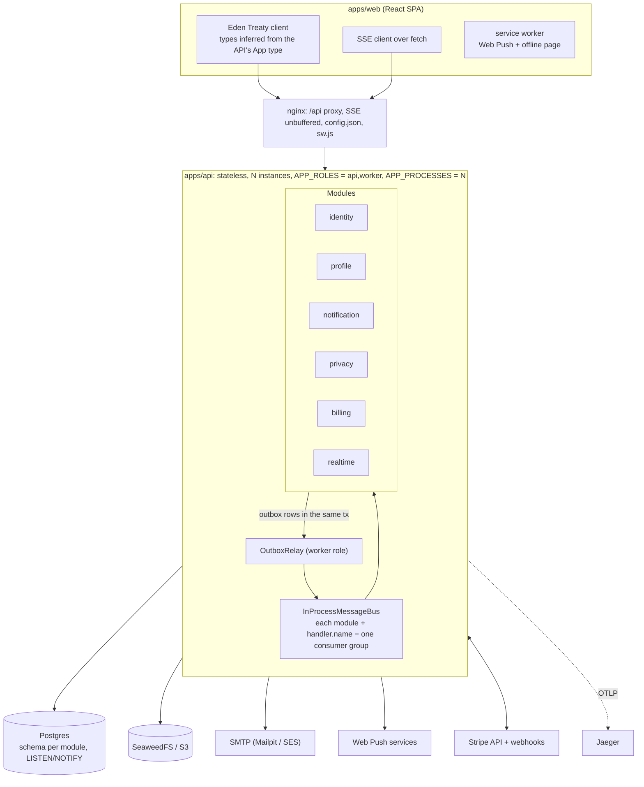
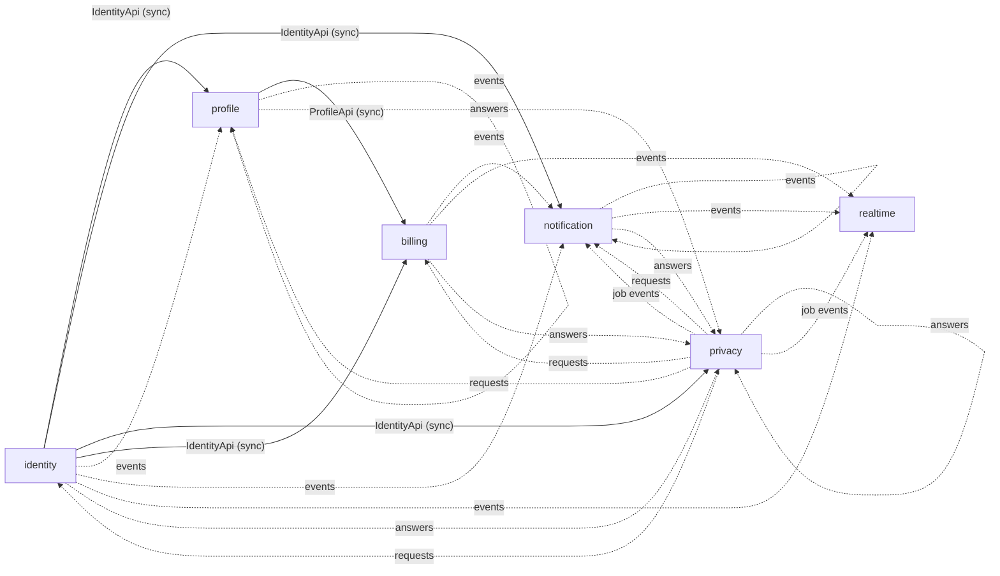
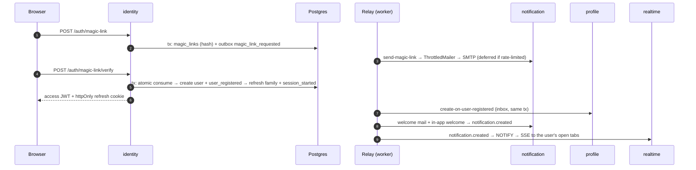

# Architecture

A modular monolith on Bun + Elysia + Drizzle + Postgres, with a React SPA. It runs as N stateless instances today, and any module can be extracted into a service tomorrow without rewriting its domain or application code.

This page is the map. The details live in [`docs/architecture/`](architecture/) (how this system works) and [`docs/patterns/`](patterns/README.md) (the reusable techniques, written to be lifted into other projects).

## Design goals

1. **Boundaries that are enforced, not just documented.** Layer and module rules fail CI (`bun run check:arch`).
2. **Distributed-ready from day one.** N stateless instances today, any module extractable into a service tomorrow, without rewriting domain or application.
3. **Reliable async by default.** A state change and its event are one transaction (outbox); consumers are idempotent (inbox).
4. **Few moving parts.** Postgres is the only stateful dependency besides object storage and an SMTP relay. No Redis, and no broker until you need one: rate limits, fan-out, queues, locks and the maintenance flag all live in Postgres.

## Big picture

Inside each module: `presentation → application → domain`, with `infrastructure` implementing the application's ports, and `contracts` the only thing other modules may import. See [Modules and boundaries](architecture/01-modules-and-boundaries.md).

## Modules

| Module | Owns | Publishes | Consumes | Talks to |
| --- | --- | --- | --- | --- |
| `identity` | Users, magic links, refresh-token families (= devices), email-change requests, passkeys, OAuth links; short-lived WebAuthn challenges, OAuth states, step-up codes | `magic_link_requested`, `user_registered`, `email_change_requested`, `email_changed`, `session_started`, `session_revoked`, `step_up_code_requested`, `passkey_added`, `passkey_removed`, `oauth_account_linked`, `oauth_account_unlinked`, `data_exported`, `user_data_erased` | `data_export_requested`, `account_erasure_requested` (privacy) | — |
| `profile` | Profiles (display name, avatar, cover, optimistic-lock `version`) | `avatar_changed`, `cover_changed`, `data_exported`, `user_data_erased` | `user_registered` (create profile), `avatar_changed` (delete old file, make thumbnails), `cover_changed` (delete old file), privacy requests | `IdentityApi.getAccount` (sync, for `GET /me`) |
| `notification` | In-app notifications, inbox state (`seen_at`), push subscriptions, mail send-rate state | `created`, `read`, `seen`, `data_exported`, `user_data_erased` | Identity events (mail, in-app, security alerts), `session_revoked` (drop push subscriptions), `created` (Web Push), privacy job events (mail + in-app), `billing.topup_succeeded` (in-app), privacy requests | `IdentityApi` (locale lookup) |
| `privacy` | The ledger of two jobs: `export_requests` + `export_parts`, `account_deletions` + `deletion_steps`; archives under `exports/<userId>/` | `data_export_requested`, `data_export_progressed`, `data_export_ready`, `data_export_failed`, `account_deletion_scheduled`, `account_deletion_cancelled`, `account_erasure_requested`, `account_erasure_progressed`, `account_deletion_stalled`, `account_deleted` | Every participant's `<module>.data_exported` and `<module>.user_data_erased` | `IdentityApi.getAccount` (only for the address to mail) |
| `billing` | Top-ups, the append-only ledger, wallet balances per currency, invoices, receipts and credit notes, payment audit and anomalies | `topup_succeeded`, `topup_failed`, `data_exported`, `user_data_erased` | Privacy requests | Stripe (`PaymentGateway` port); `IdentityApi`, `ProfileApi` (buyer on invoices) |
| `realtime` | `realtime.events` (a short replay buffer for opt-in events) | — | `session_revoked`, `notification.created/read/seen`, `billing.topup_succeeded/failed`, privacy job steps, deletion scheduled/cancelled → SSE; `account_deleted` → purge the buffer | — |

Event names are `<module>.<name>.v1` (see each module's `contracts/events.ts`). Contracts are the *only* thing another module may import.

Solid arrows are synchronous contract calls (the arrow points from the provider to the caller). Dotted arrows are integration events through the outbox.

## Reading guide

### How this system works: [`docs/architecture/`](architecture/)

| # | Page | What you will find |
| --- | --- | --- |
| 1 | [Modules and boundaries](architecture/01-modules-and-boundaries.md) | Layers, the kit packages and the three dependency-cruiser configs, composition root and `install(host)`, producer-side integrations, contracts and event versioning, schema per module, migrations, adding a module, extracting a service |
| 2 | [Messaging](architecture/02-messaging.md) | Outbox → relay → bus → inbox in depth: claim SQL, per-aggregate concurrency, backoff, deferral, dead letters, cleanup, pause |
| 3 | [Runtime and operations](architecture/03-runtime-and-operations.md) | Stateless rules, roles, cluster supervisor, graceful shutdown, health, observability, maintenance mode, the deploy flow, nginx and Docker |
| 4 | [Identity and sessions](architecture/04-identity-and-sessions.md) | Magic links, refresh families and reuse detection, ES256 + JWKS, passkeys, OAuth + PKCE, step-up |
| 5 | [Realtime](architecture/05-realtime.md) | SSE over LISTEN/NOTIFY, opt-in replay with `Last-Event-ID`, closing revoked sessions |
| 6 | [Notifications](architecture/06-notifications.md) | In-app inbox, unseen vs unread, folding, Web Push, alert throttling |
| 7 | [Mail delivery](architecture/07-mail-delivery.md) | Postgres token bucket + quota, penalize, SMTP classification, expiry, SES |
| 8 | [Privacy](architecture/08-privacy.md) | Data export and account deletion as a choreographed saga across modules |
| 9 | [Billing](architecture/09-billing.md) | Stripe top-ups exactly once, ledger, refunds and disputes, reconciliation, gapless invoices |
| 10 | [Web client](architecture/10-web-client.md) | End-to-end types, `authFetch`, SSE client, cache patching, optimistic writes, conflicts, outage detection, offline page, card form |
| 11 | [i18n](architecture/11-i18n.md) | One locale list, typed catalogs, template + data notifications, mail language, parity tests |
| 12 | [Testing and CI](architecture/12-testing-and-ci.md) | Fakes, the e2e harness, Playwright, quality gates, CI path gating |
| 13 | [Trade-offs and known gaps](architecture/13-trade-offs-and-known-gaps.md) | Deliberate trade-offs, and gaps found in the code |

### Using it in your own project: [`docs/guides/`](guides/)

| Guide | What you will find |
| --- | --- |
| [Adopt in a new project](guides/adopt-in-new-project.md) | Start from the starter, `kit:add` a module, swap an adapter, reword a message, react to an event, eject |
| [Use a kit package alone](guides/use-a-kit-package-alone.md) | `@kit/messaging` (outbox, inbox, relay) in an existing Elysia app |

The decisions behind the split are in [`docs/adr/`](adr/).

### Reusable techniques: [`docs/patterns/`](patterns/README.md)

25 recipes grouped as data and messaging, concurrency, security, delivery, workflows and money, ops and tooling, and frontend. Start with the [catalog](patterns/README.md). The most portable ones:
- [Transactional outbox](patterns/transactional-outbox.md) + [Idempotent consumer](patterns/idempotent-consumer-inbox.md)
- [SKIP LOCKED work claiming](patterns/skip-locked-work-claiming.md)
- [Postgres token-bucket rate limit](patterns/postgres-token-bucket-rate-limit.md)
- [Postgres pub/sub with replay](patterns/postgres-pubsub-with-replay.md)
- [Idempotent webhooks and a money ledger](patterns/idempotent-webhooks-and-money-ledger.md)
- [Maintenance mode and soft deploys](patterns/maintenance-mode-soft-deploy.md)

## Typical flow in one picture

Signing in with a magic link touches most of the machinery:

## Glossary

| Term | Meaning here |
| --- | --- |
| **Outbox** | Per-module table of events written in the same transaction as the state change |
| **Relay** | The worker loop that claims outbox rows and publishes them (`OutboxRelay`) |
| **Inbox** | Per-module table of `(message_id, handler)` that makes handlers idempotent |
| **Consumer group** | A handler's `name`; one per `(module, handler)`; becomes a broker subscription later |
| **Contract** | `modules/<m>/src/contracts/` (`@mod/<m>/contracts`): event names and payloads, sync interfaces with plain DTOs |
| **Integration** | What a producer module tells an optional consumer (`notification`, `realtime`): `@mod/<m>/integrations/<consumer>`; the app installs the ones it wants |
| **Manifest** | `@mod/<m>/manifest`: a module's folder, migrations, schema, outbox table and config slice, as static data for the host |
| **Kit** | The infrastructure packages (`@kit/*`) and business modules (`@mod/*`), versioned and installable; see [adopt in a new project](guides/adopt-in-new-project.md) |
| **Composition root** | `bootstrap/container.ts` + `module-catalog.ts` + `app.ts` + `main.ts`, the only code that knows concrete adapters and which modules are installed |
| **Family** | One sign-in on one device: a chain of rotated refresh tokens; its id is the `sid` claim |
| **Step-up** | Re-confirming identity (passkey or emailed code) before a sensitive action; `auth_time` in the token |
| **Deferral** | A `RetryLaterError`: rescheduled without spending an attempt |
| **Replay buffer** | `realtime.events`: opt-in events a reconnecting client can catch up on with `Last-Event-ID` |
| **Participant** | A module that answers privacy's export and erasure requests |
| **Nudge** | Privacy re-sending a request to the participants that have not answered |
| **Maintenance mode** | The `platform.maintenance` flag: 503 for requests, paused workers, used by deploys |
| **Worker role** | Processes with `APP_ROLES` including `worker`: run the relay and the job timers |
