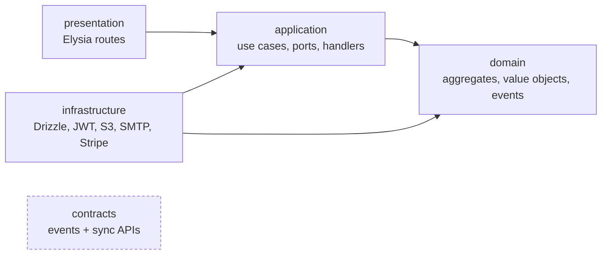
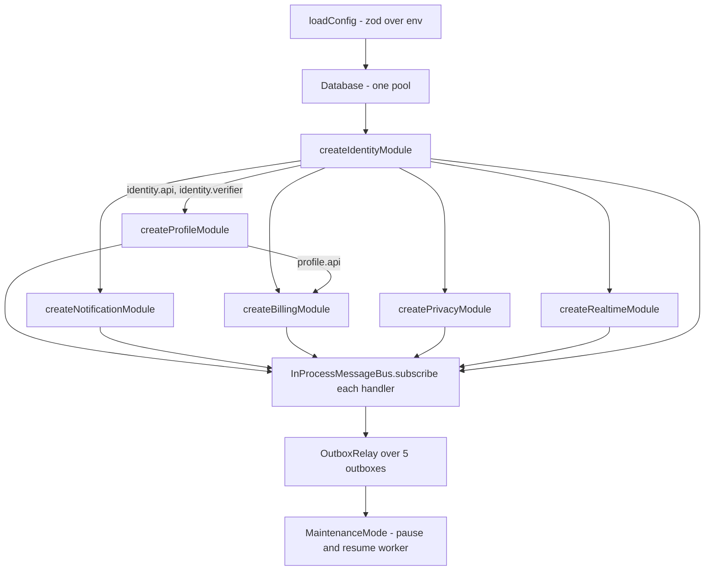
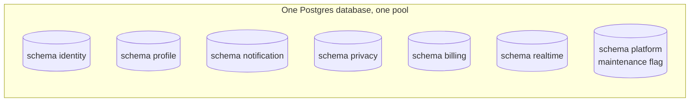
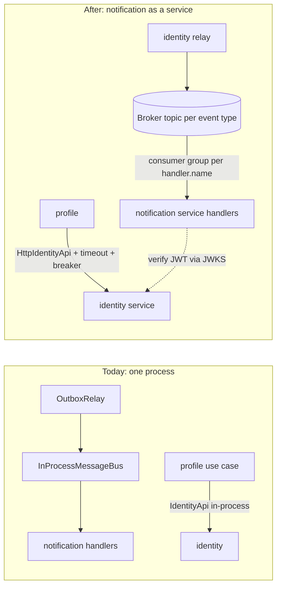

# 1. Modules and boundaries

The API is a **modular monolith**: one deployable, split into modules that behave as if they were already separate services. This page covers how a module is shaped, which imports are allowed, how modules talk to each other, and how one would leave the monolith.

← [Architecture overview](../architecture.md)

## Layers inside a module

Every module under `apps/api/src/modules/<name>/` has the same five folders:



| Layer | Contains | Must not know about |
| --- | --- | --- |
| `domain` | Aggregates, value objects, domain events, repository interfaces | Anything else, including frameworks |
| `application` | Use cases, ports (interfaces), integration event handlers | `infrastructure`, `presentation`, Elysia, Drizzle |
| `infrastructure` | Drizzle repositories, JWT, S3, SMTP, Stripe, outbox | `presentation` |
| `presentation` | Elysia routes, input validation (`t` schemas), OpenAPI detail | — |
| `contracts` | Event names and payload types, sync interfaces with plain DTOs | Anything inside the module, `shared/` |

`shared/` follows the same split (`shared/domain`, `shared/application`, `shared/infrastructure`, `shared/http`, `shared/messaging`, `shared/testing`) and knows no module.

## The rules are enforced, not documented

`bun run check:arch` runs dependency-cruiser with `apps/api/.dependency-cruiser.cjs`. Every rule is `severity: error` and runs in CI.

| Rule | From → forbidden target | What it prevents |
| --- | --- | --- |
| `domain-is-pure` | `modules/*/domain`, `shared/domain` → application, infrastructure, presentation, `shared/{application,infrastructure,presentation,http,messaging}`, the composition root, any framework | Business rules that need a DB or HTTP to be tested |
| `application-no-infrastructure` | `*/application` → infrastructure, presentation, `shared/{infrastructure,presentation,http}`, root, frameworks | Use cases that call Drizzle or Elysia directly instead of a port |
| `modules-talk-only-through-contracts` | `modules/A/**` → `modules/B/**` unless `modules/B/contracts/` | Reaching into another module's internals, which would make extraction a rewrite |
| `contracts-are-self-contained` | `*/contracts` → module internals, `shared/`, root | A contract that drags the module (or the framework) along when another service imports it |
| `shared-knows-no-module` | `shared/**` (except `shared/testing`) → `modules/` | A "shared" layer that is secretly a module |
| `only-composition-root-wires-modules` | `modules/`, `shared/` → `app.ts`, `main.ts`, `bootstrap/` | Modules that build their own dependencies |
| `no-circular` | anything → a cycle | Import cycles |

The trick in `modules-talk-only-through-contracts` is the capture group: `from: '^src/modules/([^/]+)/'` and `pathNot: ['^src/modules/$1/', '^src/modules/[^/]+/contracts/']`, so one rule covers every pair of modules.

`FRAMEWORKS` lists the packages the inner layers must not import (`elysia`, `drizzle-orm`, `postgres`, `nodemailer`, `jose`, `pino`, `@simplewebauthn`, `arctic`, `stripe`, …). Test files are excluded and `tsPreCompilationDeps` is on, so type-only imports count too.

→ Reusable recipe: [Enforced architecture boundaries](../patterns/enforced-architecture-boundaries.md)

## Composition root

`apps/api/src/bootstrap/container.ts` (`createContainer`) is the only place that knows concrete classes. No DI container is used: the wiring is plain code, read top to bottom.



`createContainer(config, logger, overrides)` takes `ContainerOverrides` (mailer, webPushSender, webauthn, oauth, paymentGateway, maintenanceStore). The e2e tests use it to swap in fakes while keeping the rest of the real graph.

`app.ts` (`buildApp`) mounts the plugins in this order: request context → tracing → error handler → CORS → maintenance gate → OpenAPI (dev only) → health → each module's `routes`. `App = ReturnType<typeof buildApp>` is the type the web client infers from (see [Web client](10-web-client.md)).

### The module factory

Every module exports `create<Name>Module(deps)` that returns a typed object:

```ts
export interface ProfileModule {
  name: 'profile'
  routes: ReturnType<typeof profileRoutes>
  handlers: IntegrationEventHandler[]
  outbox: OutboxSource
  api: ProfileApi
}
```

- `deps` holds `database`, `clock`, `ids`, `log`, `storage`, and **only the contracts** of other modules (`identity: IdentityApi`, `verifier: TokenVerifier`).
- Inside, the factory builds its repositories, a `DrizzleOutboxWriter(database, outbox, () => ids.next())`, a `DrizzleInboxGuard(database, inbox)`, and passes `database` as the `UnitOfWork`.
- Optional members cover modules with clocks of their own: `startJobs`/`stopJobs` (privacy, billing, notification), `prune`/`stop` (realtime).
- Variations:
  - `createIdentityModule` is `async` because it imports the signing keys.
  - `realtime` has no outbox and no inbox.
  - `notification` registers Web Push handlers only when VAPID is configured.
  - `billing` runs read-only when no payment gateway is configured.

## Contracts: the only thing another module may import

```
modules/identity/contracts/
  events.ts                  IdentityEvents + payload types
  identity-api.ts            IdentityApi.getAccount(userId) → plain DTO
  access-token-verifier.ts   TokenVerifier for other modules' routes
  index.ts
```

**Synchronous contracts** (`IdentityApi.getAccount`, `ProfileApi.getDisplayName`) return serialisable DTOs: ISO strings, no entities. Today they are in-process calls (`application/queries/*-api-impl.ts`); tomorrow the same interface can be backed by an HTTP client. Callers must therefore:
- tolerate errors and timeouts (billing resolves the buyer *before* its transaction, so a failure costs the name on an invoice, not the top-up);
- never call one inside a transaction.

**Asynchronous contracts** are integration events named `<module>.<name>.v1`:
- Fields are only ever **added**. A field added later is optional and documented as "absent on older messages = default".
- A breaking change ships as `.v2`, emitted in parallel with `.v1` for a while.
- Payloads carry enough data (for example the email) that a handler never has to call back into the module that emitted the event.
- Events a module sends to itself are kept out of `contracts/` (for example `INTERNAL_EXPORT_COLLECTED` in `privacy/application/privacy-events.ts`).

Each `(module, handler.name)` pair is one **consumer group**. Today that is a name in the in-process bus; on a broker it becomes a real subscription.

## Data ownership



- Each module that persists data has its **own Postgres schema**, with its own `outbox` and `inbox` tables (`outboxTable(schema)` and `inboxTable(schema)` in `shared/infrastructure/outbox/tables.ts`).
- There are **no cross-module foreign keys or joins**. `profile.profiles.user_id` only holds the value of the user's id.
- There is **one pool and one ambient transaction** for all modules (`Database`, see [Ambient transaction](../patterns/ambient-transaction-async-local-storage.md)).
  - A transaction *can* span modules. By convention it should stay within one, so that splitting later needs no rewrite.
  - Commit `07f7187` replaced the per-module database objects with this single pool. The cost is that cross-module transactions are possible and must be reviewed before extraction.
- `platform.maintenance` is outside every module on purpose (see [Runtime and operations](03-runtime-and-operations.md#maintenance-mode)).

### Migrations per module

- `drizzle.config.ts` requires a `MODULE` env var. It reads `src/modules/<m>/infrastructure/persistence/schema.ts`, writes `src/modules/<m>/migrations`, filters on that schema, and keeps the history in **schema `drizzle_<m>`, table `__migrations`**.
- `apps/api/scripts/db.ts` loops over `MODULES` for `db:generate` and `db:migrate`. It runs migrations on one connection with `prepare: false`, so they also work behind PgBouncer.
- Migrations are a separate job (the compose `migrate` service, or step 4 of `bun run deploy`), never something the app does at boot.

## A small module end to end: profile

`profile` is the simplest module that uses every piece, which makes it a good template.

- **It owns `profile.profiles`**: display name, bio, avatar key, cover key, and an optimistic-lock `version`.
- **It creates its rows from an event.** `identity.user_registered.v1` → `CreateProfileOnUserRegistered`, using the inbox in `transactional` mode. The row therefore appears *after* sign-up.
  - `ProfileLoader` returns an unsaved default profile at version 0 until then, so `GET /me` tolerates a missing profile.
  - A first save that races the creation gets `409 profile_conflict` and retries.
- **`GET /me`** combines the profile with `IdentityApi.getAccount` (email, locale, sign-in methods). This is the module's only synchronous dependency, and why `GET /me` fails during an identity outage.
- **Edits** send `If-Match: <version>`; a stale one is `409 version_conflict` ([Optimistic locking](../patterns/optimistic-locking-with-version.md)).
- **Avatar upload:**
  1. `POST /me/avatar/upload-url` issues a presigned PUT (5 minutes).
  2. The browser PUTs straight to SeaweedFS.
  3. `PUT /me/avatar {key}` checks that the key belongs to the user and `stat`s size and type. A presigned PUT cannot enforce them, so a bad file is deleted.
  4. The module emits `profile.avatar_changed.v1`. Handlers on the worker delete the old file and generate WebP thumbnails with `sharp` at derived keys.

  See [Presigned upload, then verify](../patterns/presigned-upload-then-verify.md).
- **Cover image:** the same flow under `/me/cover` (up to 5 MB). Cover keys live in `<userId>/cover/`, which keeps them apart from avatars. `PUT /me/avatar` refuses a cover key, so each cleanup handler can only ever delete its own kind of file.
- **Privacy:** `ProfileDataExporter` (with the avatar and cover originals as extra files) and `DrizzleProfileDataEraser` (the row, plus every object under `<userId>/`).

## Adding a module

1. Create `modules/<name>/{domain,application,infrastructure,presentation,contracts}` and `<name>.module.ts` (a factory returning `routes`, `handlers` and, if it publishes, its `outbox`).
2. If it persists data, add a Drizzle `schema.ts` in its own `pgSchema`, including `outboxTable`/`inboxTable` if it publishes or consumes. Add its name to `MODULES` in `apps/api/scripts/db.ts`.
3. Put events and sync interfaces in `contracts/` only, with versioned names and plain DTOs.
4. Wire it in `bootstrap/container.ts`: subscribe its handlers, add its outbox to the `OutboxRelay` sources, and mount its routes in `app.ts`. Also add it to `SOURCES` in `apps/api/scripts/outbox.ts`, the dead-letter CLI, which keeps its own list.
5. Write handlers as idempotent integration-event handlers. The inbox guards DB effects, but side effects outside the DB (mail, push, files) must tolerate a retry.
6. If it holds anything about a person, take part in privacy:
   - implement a `DataExporter` and a `DataEraser`;
   - wire `ExportUserDataHandler` and `EraseUserDataHandler` (`shared/application/privacy.ts`);
   - add its name to `exportParticipants`/`deletionParticipants` in the container.

   An account is not "deleted" until every listed module has confirmed, so a module missing from the list is a module whose data survives.
7. Run `bun run check:arch`. If it fails, a boundary was crossed.

## Extracting a module into a service

Nothing in `domain/` or `application/` changes. Only adapters and wiring do:



Example: splitting out `notification` (the simplest) or `profile`.

1. **Data.** Give the service its own database, point its `DATABASE_URL` at it, and run `db:migrate` for that module only (restrict `MODULES`). There are no cross-module FKs, so nothing needs cutting.
2. **Transport.** Implement `MessagePublisher` and a consumer for a real broker (NATS, Kafka, RabbitMQ). The emitting module's relay publishes to the broker, and the new service subscribes per `(module, handler.name)`. Handlers stay unchanged because they are already idempotent.
3. **Synchronous calls.** Write `HttpIdentityApi implements IdentityApi` and change the wiring. Add timeouts, retries and a circuit breaker.
4. **Auth.** The service verifies JWTs against identity's JWKS (`createRemoteJWKSet` on `/api/.well-known/jwks.json`) instead of the in-process verifier.
5. **Deployment.** Reuse the image, set a suitable `APP_ROLES`, and mount only that module's routes and handlers in a new composition root.
6. **Privacy.** The service still consumes `privacy.data_export_requested.v1` and `privacy.account_erasure_requested.v1`, and answers `<module>.data_exported.v1` / `<module>.user_data_erased.v1`. Two things to carry over:
   - it writes its export part to the **same bucket** under the `uploadPrefix` it is given (or privacy needs another way to receive the bytes);
   - it must erase **idempotently**, because the request is re-sent when it is slow.

   While the service is down, a deletion waits, is re-sent, then stalls rather than completing. That is the right failure for "forget me". Keep the module in the participant list until its data is really gone.
7. **Review transactions** that span the extracted module. The single pool made them possible.
8. **Verify.** `check:arch` must stay clean. Rerun e2e over the network; the privacy export and deletion are the test that every module still answers.

## Patterns used here

- [Enforced architecture boundaries](../patterns/enforced-architecture-boundaries.md)
- [Ambient transaction with AsyncLocalStorage](../patterns/ambient-transaction-async-local-storage.md)
- [Transactional outbox](../patterns/transactional-outbox.md) and [Idempotent consumer (inbox)](../patterns/idempotent-consumer-inbox.md)
