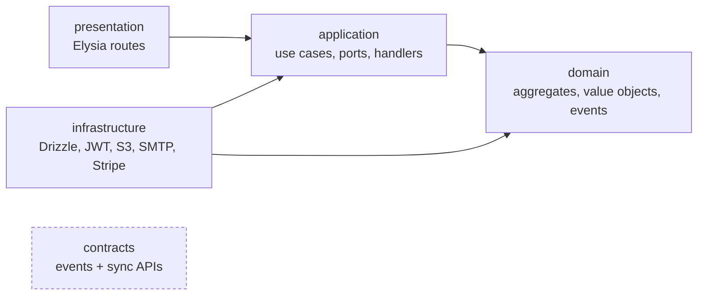
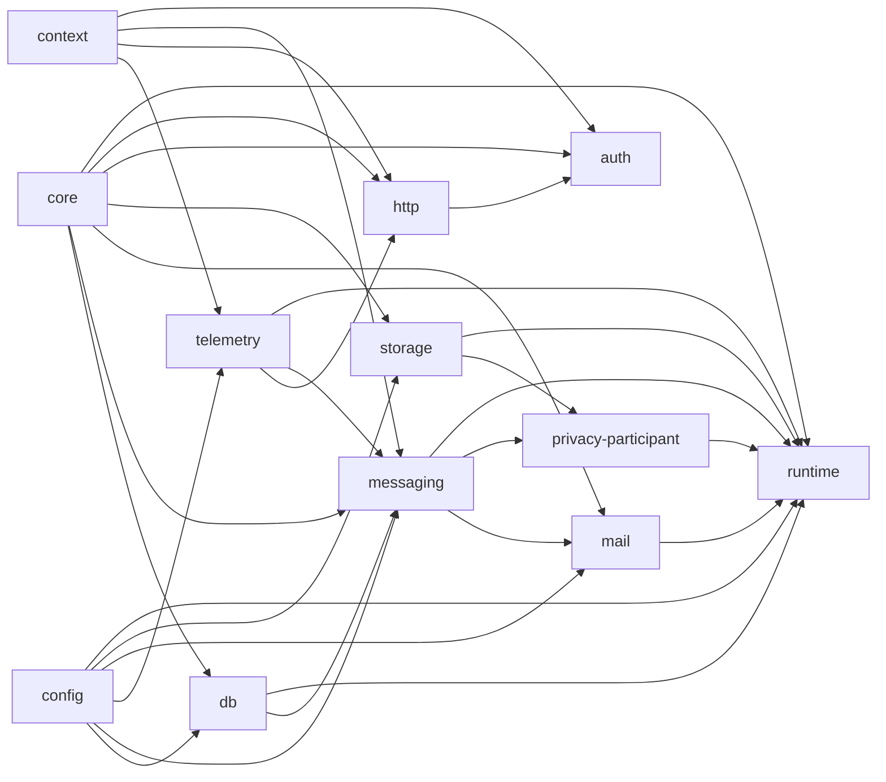
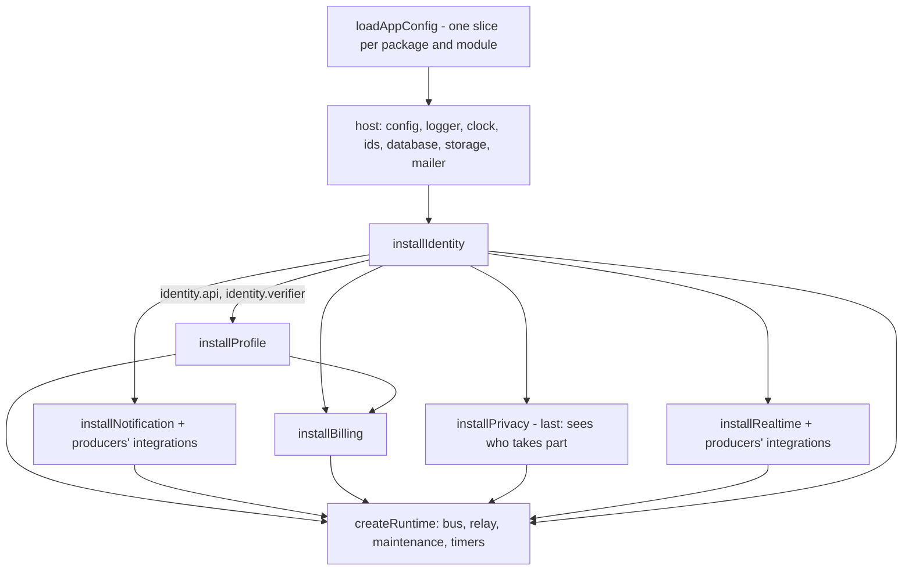
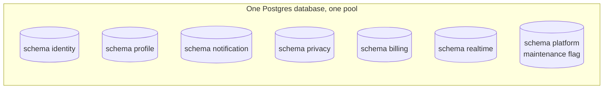
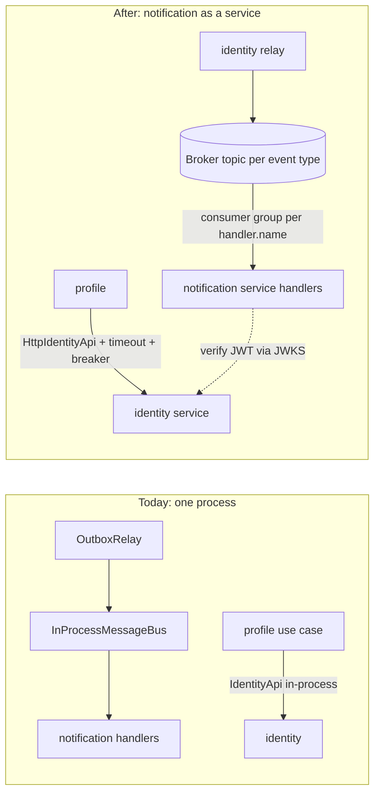

# 1. Modules and boundaries

The API is a **modular monolith**: one deployable, split into modules that behave as if they were already separate services. Since the kit split, the pieces are packages: **infrastructure** in `packages/kit-*` (`@kit/*`), **business modules** in `modules/*` (`@mod/*`), and the **app** (`apps/api`) that installs the modules it wants. This page covers how a module is shaped, which imports are allowed, how modules talk to each other and how one would leave the monolith.

← [Architecture overview](../architecture.md)

## Layers inside a module

Every module under `modules/<name>/src/` has the same five folders:



| Layer | Contains | Must not know about |
| --- | --- | --- |
| `domain` | Aggregates, value objects, domain events, repository interfaces | Anything else, including frameworks |
| `application` | Use cases, ports (interfaces), integration event handlers | `infrastructure`, `presentation`, Elysia, Drizzle |
| `infrastructure` | Drizzle repositories, JWT, S3, SMTP, Stripe, outbox | `presentation` |
| `presentation` | Elysia routes, input validation (`t` schemas), OpenAPI detail | — |
| `contracts` | Event names and payload types, sync interfaces with plain DTOs | Anything inside the module, the kit (except the i18n types and the privacy protocol) |

## The kit: one package per concern

What used to be `apps/api/src/shared` is a set of packages with an exports map each. The graph between them is acyclic and checked (`.dependency-cruiser.packages.cjs`); a package is liftable into its own repository exactly when none of those rules needs bending.



| Package | What it is |
| --- | --- |
| `@kit/core` | Domain events, aggregate root, errors, `Clock`/`IdGenerator`/`UnitOfWork`/`Log` |
| `@kit/config` | Config slices, `loadConfig`, the generated `.env.example` |
| `@kit/context` | Request context (AsyncLocalStorage) |
| `@kit/db` | The pool and ambient transaction, advisory locks, per-module migrations |
| `@kit/telemetry` | Logger and OpenTelemetry tracing |
| `@kit/http` | Error handler, request-context, tracing and maintenance plugins, OpenAPI helpers |
| `@kit/auth` | Token verification, the `auth` macro, `StepUpPolicy` |
| `@kit/messaging` | Outbox, inbox, relay, bus |
| `@kit/mail`, `@kit/storage` | The `Mailer` and `ObjectStorage` ports with SMTP/console and S3/local-disk adapters |
| `@kit/privacy-participant` | The protocol modules speak to take part in export and erasure |
| `@kit/runtime` | `AppModule`, `ModuleHost`, `createRuntime`, health, jobs, the cluster supervisor |
| `@kit/testing` | Fakes and the contract suites that run on them and on the real adapters |
| `@kit/i18n`, `@kit/ui`, `@kit/web-core` | Messages, the design system and the browser plumbing shared by the web app |

Only an adapter may import a framework: Elysia lives in `http`, `auth`, `runtime` and `storage/http`; Drizzle in `db`, `messaging` and `runtime`; nodemailer in `mail`; pino in `telemetry`.


## The rules are enforced, not documented

`bun run check:arch` runs dependency-cruiser three times, with a config for each level. Every rule is `severity: error` and runs in CI.

**Modules** (`.dependency-cruiser.modules.cjs`):

| Rule | From → forbidden target | What it prevents |
| --- | --- | --- |
| `domain-is-pure` | `modules/*/src/domain` → application, infrastructure, presentation, any kit package but `core` and `i18n` | Business rules that need a DB or HTTP to be tested |
| `application-no-infrastructure` | `*/application` → infrastructure, presentation, `http`, `db`, `telemetry`, `runtime`, `config` | Use cases that call Drizzle or Elysia directly instead of a port |
| `modules-talk-only-through-their-exports` | `modules/A/**` → `modules/B/src/**` unless B exports it (contracts, integrations, config, manifest, factory, schema, public, testing) | Reaching into another module's internals, which would make extraction a rewrite |
| `contracts-are-self-contained` | `*/contracts` → module internals, the kit (but the privacy protocol and the i18n types) | A contract that drags the module (or the framework) along when another service imports it |
| `participants-do-not-know-privacy` | any module but `privacy` (and `integrations/`) → `modules/privacy` | A module that cannot exist without privacy; they speak `@kit/privacy-participant` |
| `generic-modules-are-leaves` | `notification`, `realtime` → any other module | The consumer knowing its producers (what it says about a producer lives in the producer's `integrations/`) |
| `integrations-use-contracts-only` | `modules/P/src/integrations` → anything but P's contracts, the consumer's contracts and the kit | Glue that depends on internals |
| `module-core-does-not-load-its-integrations` | a module's core → its own `integrations/` | The consumer silently becoming a hard dependency |
| `no-<framework>-outside-adapters`, `no-circular`, `modules-do-not-import-apps`, `modules-import-only-what-they-can-resolve` | | Frameworks in the wrong layer, cycles, a module reaching into the app, undeclared dependencies |

The trick in `modules-talk-only-through-their-exports` is the capture group: `from: '^modules/([^/]+)/'` and `pathNot: ['^modules/$1/', …]`, so one rule covers every pair of modules. The package `exports` field backs it up at the resolver: `import '@mod/billing/src/domain/…'` does not resolve.

**Packages** (`.dependency-cruiser.packages.cjs`): one rule per package listing the other kit packages it may import, which npm packages only an adapter may import, that every import resolves (so a package cannot use something it does not declare), and that packages do not import `apps/`.

**The app** (`apps/api/.dependency-cruiser.cjs`): nothing imports the composition root, and the app never imports a driver directly (`stripe`, `sharp`, `jose`…).

Test files are excluded and `tsPreCompilationDeps` is on, so type-only imports count too.

→ Reusable recipe: [Enforced architecture boundaries](../patterns/enforced-architecture-boundaries.md)

## Composition root

`apps/api/src/bootstrap/container.ts` (`createContainer`) is the only place that knows concrete adapters and which modules are installed. No DI container is used: the wiring is plain code, read top to bottom.



`createContainer(config, logger, overrides)` takes `ContainerOverrides` (mailer, webPushSender, webauthn, oauth, paymentGateway, maintenanceStore). The e2e tests use it to swap in fakes while keeping the rest of the real graph.

`app.ts` (`buildApp`) mounts the plugins in this order: request context → tracing → error handler → CORS → maintenance gate → OpenAPI (dev only) → local-storage links → health → each module's `routes`, one static `.use()` per module (a loop would turn the Eden client's types into `any`; `app.test.ts` fails when a module with routes is not mounted). `App = ReturnType<typeof buildApp>` is the type the web client infers from (see [Web client](10-web-client.md)).

### The module package

A business module is a package (`modules/<name>`, `@mod/<name>`) with an exports map:

| Export | What it is |
| --- | --- |
| `.` | `create<Name>Module(deps)` and `install<Name>(host)` |
| `./contracts` | Events and sync interfaces: what other modules may rely on |
| `./config` | The module's config slice |
| `./manifest` | Static data for the host: folder, migrations, schema file, outbox table, config |
| `./schema` | The Drizzle schema (drizzle-kit and the dead-letter CLI read it) |
| `./integrations/notification`, `./integrations/realtime` | What the module tells the optional consumers (see below) |
| `./public` | Constants a web client may import (billing, profile) |
| `./testing` | Internals tests and the composition root reach for; not part of the supported API |

`create<Name>Module(deps)` returns an `AppModule` plus its own API:

```ts
export interface ProfileModule extends AppModule<'profile', ReturnType<typeof profileRoutes>> {
  routes: ReturnType<typeof profileRoutes>
  handlers: IntegrationEventHandler[]
  outbox: OutboxSource
  api: ProfileApi
}
```

`AppModule` is what the runtime needs: `routes`, `handlers`, `outbox`, `jobs` (timers the runtime starts and stops as a group, also across maintenance mode), `privacy` (which of the two privacy jobs it takes part in), `docs` (its section of the API docs) and `close()` (live connections, closed before the HTTP server).

`install<Name>(host)` narrows the host to what the module needs (`ModuleHost<{ billing: BillingConfig }> & { modules: { identity: … } }`), so it states its inputs and the app stays free to hold more. A module that depends on another takes it as `modules`.

- Inside, the factory builds its repositories, a `DrizzleOutboxWriter(database, outbox, () => ids.next())`, a `DrizzleInboxGuard(database, inbox)`, and passes `database` as the `UnitOfWork`.
- Variations:
  - `installIdentity` is `async` because it imports the signing keys.
  - `realtime` has no outbox and no inbox.
  - `notification` registers Web Push handlers only when VAPID is configured.
  - `billing` runs read-only when no payment gateway is configured.

### Producers describe themselves to the consumers

`notification` and `realtime` deliver for every module but know none: they are **leaves**. What a producer's events mean to them is the producer's knowledge, so each producer ships it in `integrations/` (`@mod/billing/integrations/notification`, `…/realtime`): plain definitions typed with `import type` from the consumer's contracts (event → in-app notification, event → mail with a template, session ended → drop push subscriptions, event → live push), plus the wording in every language. The app lists the integrations it installs and passes them to the consumer:

```ts
installNotification({ ...host, modules: { identity },
  integrations: [identityNotifications, privacyNotifications, billingNotifications] })
```

At start-up the consumer merges the catalogs (a duplicate key is an error; `messageOverrides` is the one layer allowed to replace a key) and checks that every template has its messages in every language. Leave an integration out and its events simply produce nothing; remove the consumer and the producers keep working, because nothing imports their `integrations/` but the composition root.

### Which modules are installed

`bootstrap/module-catalog.ts` lists the manifests of the installed modules. Scripts (`db:migrate`, `outbox:list`), the config loader (each module's slice appears under `config.<name>`) and drizzle-kit read it without building the container. Removing a module from the app is one line in the catalog, its block in `container.ts`, one `.use(…)` in `app.ts` and its dependency in `package.json`; `bun run kit:remove <name>` does exactly that.

## Contracts: the only thing another module may import

```
modules/identity/src/contracts/
  events.ts                  IdentityEvents + payload types
  identity-api.ts            IdentityApi.getAccount(userId) → plain DTO
  access-token-verifier.ts   TokenVerifier for other modules' routes
  index.ts
```

**Synchronous contracts** (`IdentityApi.getAccount`, `ProfileApi.getDisplayName`) return serialisable DTOs: ISO strings, no entities. Today they are in-process calls (`application/queries/*-api-impl.ts`); tomorrow the same interface can be backed by an HTTP client. Callers must therefore:
- tolerate errors and timeouts (billing resolves the buyer *before* its transaction, so a failure costs the name on an invoice, not the top-up);
- never call one inside a transaction.

**Asynchronous contracts** are integration events named `<module>.<name>.v1`:
- Fields are only ever **added**. A field added later is optional and documented as "absent on older messages = default".
- A breaking change ships as `.v2`, emitted in parallel with `.v1` for a while.
- Payloads carry enough data (for example the email) that a handler never has to call back into the module that emitted the event.
- Events a module sends to itself are kept out of `contracts/` (for example `INTERNAL_EXPORT_COLLECTED` in `privacy/application/privacy-events.ts`).

Each `(module, handler.name)` pair is one **consumer group**. Today that is a name in the in-process bus; on a broker it becomes a real subscription.

## Data ownership



- Each module that persists data has its **own Postgres schema**, with its own `outbox` and `inbox` tables (`outboxTable(schema)` and `inboxTable(schema)` in `@kit/messaging`).
- There are **no cross-module foreign keys or joins**. `profile.profiles.user_id` only holds the value of the user's id.
- There is **one pool and one ambient transaction** for all modules (`Database`, see [Ambient transaction](../patterns/ambient-transaction-async-local-storage.md)).
  - A transaction *can* span modules. By convention it should stay within one, so that splitting later needs no rewrite.
  - Commit `07f7187` replaced the per-module database objects with this single pool. The cost is that cross-module transactions are possible and must be reviewed before extraction.
- `platform.maintenance` is outside every module on purpose (see [Runtime and operations](03-runtime-and-operations.md#maintenance-mode)).

### Migrations per module

- Each module package carries its own `drizzle.config.ts` and `migrations/` folder. It reads the module's `infrastructure/persistence/schema.ts`, filters on its schema, and keeps the history in **schema `drizzle_<m>`, table `__migrations`**.
- `apps/api/scripts/db.ts` is `runDbCli(MODULE_CATALOG)` from `@kit/runtime`: `db:generate` runs drizzle-kit inside each module, `db:migrate` applies each module's migrations in catalog order on one connection with `prepare: false` (so it also works behind PgBouncer), and warns about a module that was migrated here once but is not installed now.
- Migrations travel with the module package (`@mod/<name>/manifest` points at them), so an app that updates a module gets its new migrations. A minor version may only add migrations that are safe on a live table.
- Migrations are a separate job (the compose `migrate` service, or step 4 of `bun run deploy`), never something the app does at boot.

## A small module end to end: profile

`profile` is the simplest module that uses every piece, which makes it a good template.

- **It owns `profile.profiles`**: display name, bio, avatar key, cover key, and an optimistic-lock `version`.
- **It creates its rows from an event.** `identity.user_registered.v1` → `CreateProfileOnUserRegistered`, using the inbox in `transactional` mode. The row therefore appears *after* sign-up.
  - `ProfileLoader` returns an unsaved default profile at version 0 until then, so `GET /me` tolerates a missing profile.
  - A first save that races the creation gets `409 profile_conflict` and retries.
- **`GET /me`** combines the profile with `IdentityApi.getAccount` (email, locale, sign-in methods). This is the module's only synchronous dependency, and why `GET /me` fails during an identity outage.
- **Edits** send `If-Match: <version>`; a stale one is `409 version_conflict` ([Optimistic locking](../patterns/optimistic-locking-with-version.md)).
- **Avatar upload:**
  1. `POST /me/avatar/upload-url` issues a presigned PUT (5 minutes).
  2. The browser PUTs straight to SeaweedFS.
  3. `PUT /me/avatar {key}` checks that the key belongs to the user and `stat`s size and type. A presigned PUT cannot enforce them, so a bad file is deleted.
  4. The module emits `profile.avatar_changed.v1`. Handlers on the worker delete the old file and generate WebP thumbnails with `sharp` at derived keys.

  See [Presigned upload, then verify](../patterns/presigned-upload-then-verify.md).
- **Cover image:** the same flow under `/me/cover` (up to 5 MB). Cover keys live in `<userId>/cover/`, which keeps them apart from avatars. `PUT /me/avatar` refuses a cover key, so each cleanup handler can only ever delete its own kind of file.
- **Privacy:** `ProfileDataExporter` (with the avatar and cover originals as extra files) and `DrizzleProfileDataEraser` (the row, plus every object under `<userId>/`).

## Adding a module

The short way: `bun run gen:module <name>` creates `modules/<name>` from `templates/module` (domain, a use case with its test, a Postgres schema with outbox and inbox, a route, a config slice, a manifest, `install`, its first migration), wires it into the app and prints what is left. Then, by hand:

1. Put the module's rules in `domain/` and its use cases in `application/`, with ports for everything outside.
2. Put events and sync interfaces in `contracts/` only, with versioned names and plain DTOs.
3. Add the tables to `infrastructure/persistence/schema.ts` and run `bun run db:generate`.
4. Write handlers as idempotent integration-event handlers. The inbox guards DB effects, but side effects outside the DB (mail, push, files) must tolerate a retry.
5. If it should reach people, add `integrations/notification.ts` / `integrations/realtime.ts` (see above) and list them in `kit.json`.
6. If it holds anything about a person, take part in privacy:
   - implement a `DataExporter` and a `DataEraser`;
   - build the handlers with `privacyParticipation()` from `@kit/privacy-participant` and return its `privacy` flags: the container derives the participant lists from what the modules declare.

   An account is not "deleted" until every listed module has confirmed, so a module that does not declare itself is a module whose data survives.
7. Run `bun run check:arch`. If it fails, a boundary was crossed.

To add an existing module to another app instead: `bun add @mod/billing`, then `bun run kit:add billing` (it checks that the modules it requires are there, wires the catalog, the container, the routes and the integrations of everything installed, in either order of installation).

## Extracting a module into a service

Nothing in `domain/` or `application/` changes. Only adapters and wiring do:



Example: splitting out `notification` (the simplest) or `profile`.

1. **Data.** Give the service its own database, point its `DATABASE_URL` at it, and run `db:migrate` for that module only (leave the other modules out of the catalog). There are no cross-module FKs, so nothing needs cutting.
2. **Transport.** Implement `MessagePublisher` and a consumer for a real broker (NATS, Kafka, RabbitMQ). The emitting module's relay publishes to the broker, and the new service subscribes per `(module, handler.name)`. Handlers stay unchanged because they are already idempotent.
3. **Synchronous calls.** Write `HttpIdentityApi implements IdentityApi` and change the wiring. Add timeouts, retries and a circuit breaker.
4. **Auth.** The service verifies JWTs against identity's JWKS (`createRemoteJWKSet` on `/api/.well-known/jwks.json`) instead of the in-process verifier.
5. **Deployment.** Reuse the image, set a suitable `APP_ROLES`, and mount only that module's routes and handlers in a new composition root.
6. **Privacy.** The service still consumes `privacy.data_export_requested.v1` and `privacy.account_erasure_requested.v1`, and answers `<module>.data_exported.v1` / `<module>.user_data_erased.v1`. Two things to carry over:
   - it writes its export part to the **same bucket** under the `uploadPrefix` it is given (or privacy needs another way to receive the bytes);
   - it must erase **idempotently**, because the request is re-sent when it is slow.

   While the service is down, a deletion waits, is re-sent, then stalls rather than completing. That is the right failure for "forget me". Keep the module in the participant list until its data is really gone.
7. **Review transactions** that span the extracted module. The single pool made them possible.
8. **Verify.** `check:arch` must stay clean. Rerun e2e over the network; the privacy export and deletion are the test that every module still answers.

## Patterns used here

- [Enforced architecture boundaries](../patterns/enforced-architecture-boundaries.md)
- [Ambient transaction with AsyncLocalStorage](../patterns/ambient-transaction-async-local-storage.md)
- [Transactional outbox](../patterns/transactional-outbox.md) and [Idempotent consumer (inbox)](../patterns/idempotent-consumer-inbox.md)
