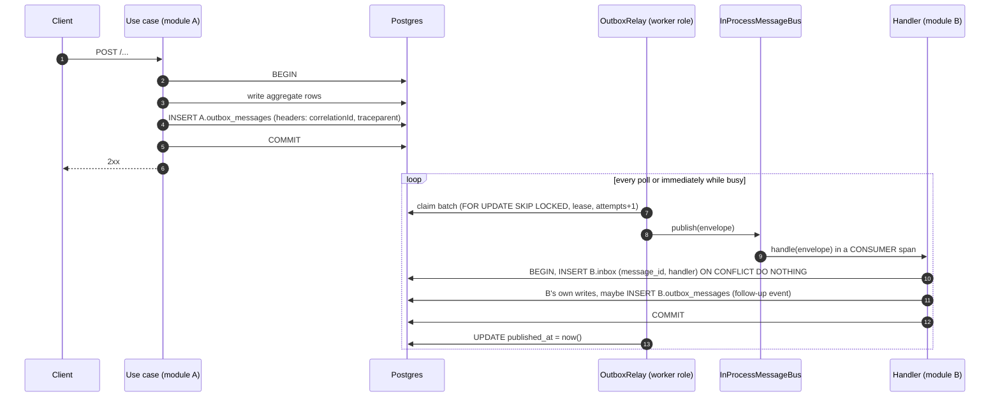
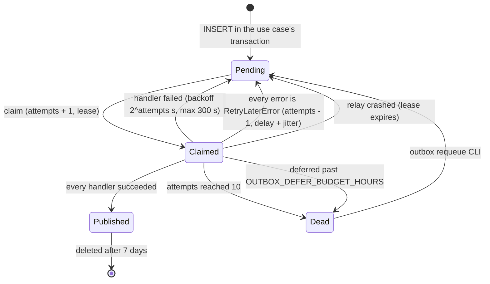
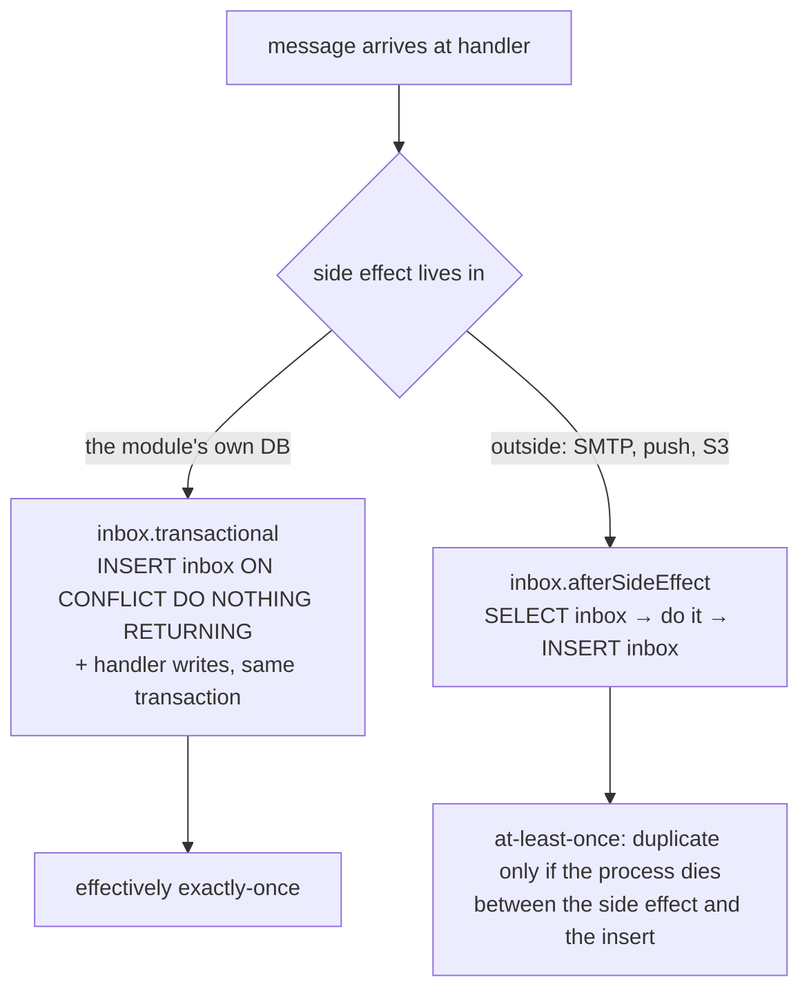

# 2. Messaging: outbox → relay → bus → inbox

All asynchronous work goes through one pipeline. A use case writes its state change and its events in one transaction. A relay publishes the events, and handlers in other (or the same) modules consume them exactly once in effect.

← [Architecture overview](../architecture.md)



## Building blocks

| Piece | File | Role |
| --- | --- | --- |
| `outboxTable(schema)` / `inboxTable(schema)` | `shared/infrastructure/outbox/tables.ts` | One `outbox_messages` and one `inbox` table **per module schema** |
| `OutboxWriter` port, `DrizzleOutboxWriter` | `shared/application/ports`, `shared/infrastructure/outbox/drizzle-outbox-writer.ts` | Adds events inside the current transaction |
| `OutboxRelay` | `shared/infrastructure/outbox/outbox-relay.ts` | Claims, publishes, retries, defers, dead-letters, cleans up |
| `MessagePublisher` port, `InProcessMessageBus` | `shared/messaging/in-process-bus.ts` | Today's transport: calls the subscribed handlers in-process |
| `InboxGuard` port, `DrizzleInboxGuard` | `shared/infrastructure/outbox/drizzle-inbox-guard.ts` | De-duplicates per `(message_id, handler)` |
| `RetryLaterError` | `shared/messaging/errors.ts` | "Not now": defer without spending an attempt |
| `Envelope` | `shared/messaging/envelope.ts` | Transport-independent wire format |

### The outbox row

```
outbox_messages(
  id uuid PK                 -- UUIDv7: time-ordered, so ORDER BY id ≈ ORDER BY time
  type text                  -- identity.user_registered.v1
  aggregate_id text          -- usually the user id; also the ordering key
  payload jsonb, headers jsonb
  occurred_at timestamptz
  attempts int default 0
  next_attempt_at timestamptz default now()
  locked_until timestamptz   -- the lease
  published_at, dead_at timestamptz
  last_error text
)
partial index outbox_pending_idx ON (next_attempt_at) WHERE published_at IS NULL AND dead_at IS NULL
```

Rows are kept only while they are useful: the partial index covers just the pending ones, and published rows are deleted after 7 days.

### The envelope and its headers

```ts
interface Envelope { id; type; source /* emitting module */; aggregateId; occurredAt; payload; headers }
interface MessageHeaders { correlationId?; causationId?; traceparent? }
```

`DrizzleOutboxWriter.add` writes headers from the request context:
- `correlationId`;
- `causationId` (the request id);
- the W3C `traceparent` of the current span, so the relay can continue the trace however late it runs.

It **throws if no transaction is open**: an event written outside the aggregate's transaction would defeat the point of the outbox.

## The relay

### Claiming

One statement claims a batch. It locks the candidate rows with `SKIP LOCKED`, bumps `attempts`, and sets a lease:

```ts
const now = sql`now()`   // one clock: the database's
.update(table).set({
  lockedUntil: sql`now() + make_interval(secs => ${this.leaseSeconds})`,
  attempts: sql`${table.attempts} + 1`,
})
.where(inArray(table.id, db.select({ id: table.id }).from(table)
  .where(and(isNull(table.publishedAt), isNull(table.deadAt), lte(table.nextAttemptAt, now),
             or(isNull(table.lockedUntil), lt(table.lockedUntil, now))))
  .orderBy(table.id).limit(this.batchSize)
  .for('update', { skipLocked: true })))
.returning()
```

- Due-ness and lease expiry are compared with the database's `now()` (``const now = sql`now()` ``), the same clock that sets the lease, so clock skew between app servers and the database cannot shift them.
- `SKIP LOCKED` keeps two relays from claiming the same rows in the same instant. **The lease** keeps them apart afterwards: the statement commits immediately, so it is `locked_until` that hides a claimed row from the next claim.
- A relay that dies mid-batch loses nothing. Its lease expires and another instance claims the rows.
- `attempts` is counted **at claim time**, so a crash still counts as an attempt and a poison message cannot loop forever.
- `run()` loops back immediately while a tick processed something, and sleeps `OUTBOX_POLL_INTERVAL_MS` only when idle.

→ [SKIP LOCKED work claiming](../patterns/skip-locked-work-claiming.md)

### Concurrency per aggregate

`RETURNING` has no defined order, so the batch is re-sorted by UUIDv7 id and grouped by `aggregate_id`. Then up to `concurrency` workers pull whole groups from a queue:

```ts
const queue = [...byAggregate.values()]
const worker = async () => {
  for (let group = queue.shift(); group; group = queue.shift()) {
    for (const row of group) await this.process(source, row)
  }
}
await Promise.all(Array.from({ length: Math.min(this.concurrency, queue.length) }, worker))
```

- Messages of one aggregate never run at the same time and start in id order. Different aggregates run in parallel.
- `concurrency` is capped at `DB_POOL_MAX - 2` in the container, because each in-flight message holds a connection.
- Commit `daff342` introduced this, with the batch going from 50 to 200, and measured about **290 → 1,140 notifications/s**, still with exactly one notification and one inbox row per event.
- Each message is marked published right after its own publish, so concurrency does not widen the redelivery window.
- Ordering is "best effort per aggregate", not strict FIFO. If an earlier message fails, later messages of the same aggregate still run, and the failed one is retried after them. That is deliberate: a mail deferred for a rate limit must not hold up every other event about that user. Handlers must not depend on order (see [trade-offs](13-trade-offs-and-known-gaps.md#architecture)).

### Outcomes of one message



- **Success.** `published_at = now()`, the lease and `last_error` are cleared. If that bookkeeping write fails, the lease expires and the message is delivered again (at-least-once). Bookkeeping errors go through `safely()`, so one bad row never abandons the rest of the batch.
- **Failure.** `next_attempt_at = now() + min(2^attempts, 300)` seconds (2 s, 4 s, 8 s … 5 min), `last_error` is truncated to 2,000 characters, and the row is dead once `attempts >= maxAttempts` (10).
- **Deferral.** If *every* error, after flattening the bus's `AggregateError`, is a `RetryLaterError`, the relay calls `defer()`:
  - the delay is the largest `retryAfterMs` hint, or 30 s by default, plus **0–10 % jitter** so messages deferred together do not return together;
  - `attempts = greatest(attempts - 1, 0)` **gives back** the attempt the claim took, so a long rate-limit spell cannot push mail to dead;
  - the only limit is time: once the message is older than `OUTBOX_DEFER_BUDGET_HOURS` (24 h), measured from `occurred_at`, it is dead;
  - the span is tagged `outbox.deferred=true` instead of being marked as an error, and the bus logs it at `warn` without a stack (commits `9ce50fd`, `e9285c8`).

  A mix of a deferral and a real error counts as a real failure.

→ [Retry-later deferral](../patterns/retry-later-deferral.md)

### Retention cleanup

Published rows are deleted after `retentionDays` (7). Payloads can hold one-time tokens and addresses, so they should not live forever. Cleanup runs at most every 10 minutes per process. Each source is cleaned under `withAdvisoryXactLock(database, 'outbox-cleanup:<module>')`, so only one instance does it and the others skip without waiting.

### Pausing

`pause()` sets a flag and awaits the batch in flight (`this.working`). The loop stays alive and only sleeps. Maintenance mode uses it (see [Runtime and operations](03-runtime-and-operations.md#maintenance-mode)). It is safe to call before `start()`, so a process booted in maintenance mode never claims a first batch. `stop()` ends the loop and waits for it.

## The bus

`InProcessMessageBus.publish` runs every handler subscribed to `envelope.type` with `Promise.allSettled`, each in its own CONSUMER span (`messaging.consumer.group.name = handler.name`).
- If any handler fails, it throws an `AggregateError` and the relay retries **the whole message**.
- Handlers that already succeeded are skipped on the retry by their inbox row.
- Handlers without an inbox, such as the realtime push, run again, which is harmless for them.

Replacing the bus with a broker means implementing `MessagePublisher` (publish to a topic) and a consumer per `handler.name`. Handlers do not change.

## The inbox: two modes



`transactional` (`DrizzleInboxGuard.transactional`):

```ts
await this.database.run(async () => {
  const inserted = await this.database.executor
    .insert(this.table).values({ messageId, handler })
    .onConflictDoNothing()
    .returning({ messageId: this.table.messageId })
  if (inserted.length === 0) return // already processed
  await fn()
})
```

- A concurrent duplicate blocks on the uncommitted inbox row, then sees the conflict and returns.
- The handler's outbox writes join the same transaction. That is how events chain: `CreateNotificationHandler` stores the notification, emits `notification.created.v1`, and records the inbox row in one commit.

`afterSideEffect` is for things that cannot be rolled back: mail, Web Push, thumbnails. Those handlers are written to tolerate a repeat:
- the push `tag`/`topic` is the notification id;
- thumbnails are only generated when missing;
- an expired mail is skipped.

→ [Idempotent consumer (inbox)](../patterns/idempotent-consumer-inbox.md)

## Rules for handlers

- **Assume at-least-once and no ordering.** Two events about the same user may arrive in either order across relay instances. Progress events carry counts (`done`/`total`), not step numbers, so a client keeps the maximum.
- **Do not call back** into the emitting module: the payload must be enough.
- **Throw to retry.** Throw `RetryLaterError(…, retryAfterMs)` for "not now" (rate limit, quota). Swallow-and-log for "never" (a permanent mail failure, an unprocessable image), so a single bad input does not dead-letter the whole event for every consumer.
- **A re-sent request needs a new message id.** The inbox key is `(message_id, handler)`. Privacy nudges write a *new* outbox row, so a module that already saw the first request still processes the second.

## Operating it

```bash
bun run --filter @app/api outbox:list                 # dead rows, with attempts and last_error
bun run --filter @app/api outbox:requeue -- --id <uuid>
bun run --filter @app/api outbox:requeue -- --type identity.magic_link_requested.v1
```

`requeue` sets `dead_at = null, attempts = 0, locked_until = null, last_error = null, next_attempt_at = now()`. It is safe because the inbox blocks every handler that already finished, so only the unfinished ones run again. `apps/api/scripts/outbox.ts` keeps its own list of sources (`SOURCES`), which must match the relay's: add a new module there too.

Configuration: `OUTBOX_POLL_INTERVAL_MS`, `OUTBOX_BATCH_SIZE`, `OUTBOX_CONCURRENCY`, `OUTBOX_LEASE_SECONDS` (raise it when a handler is slow, for example image resizing), and `OUTBOX_DEFER_BUDGET_HOURS`.

## Patterns used here

- [Transactional outbox](../patterns/transactional-outbox.md)
- [Idempotent consumer (inbox)](../patterns/idempotent-consumer-inbox.md)
- [Retry-later deferral](../patterns/retry-later-deferral.md)
- [SKIP LOCKED work claiming](../patterns/skip-locked-work-claiming.md)
- [Trace context across async hops](../patterns/trace-context-across-async-hops.md)
- [Singleton work in a cluster](../patterns/singleton-work-in-a-cluster.md) (cleanup lock)
