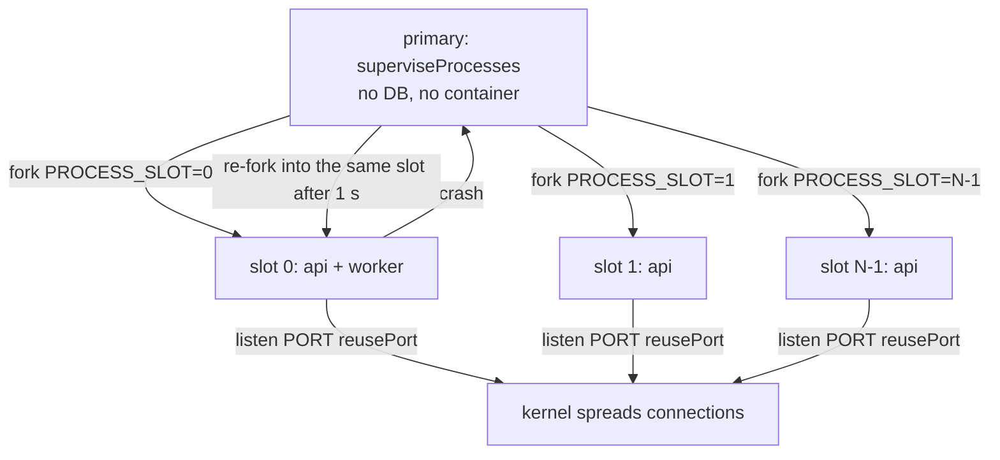
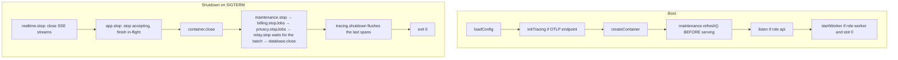
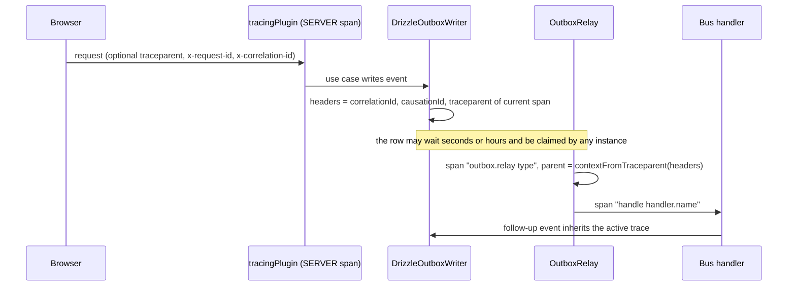
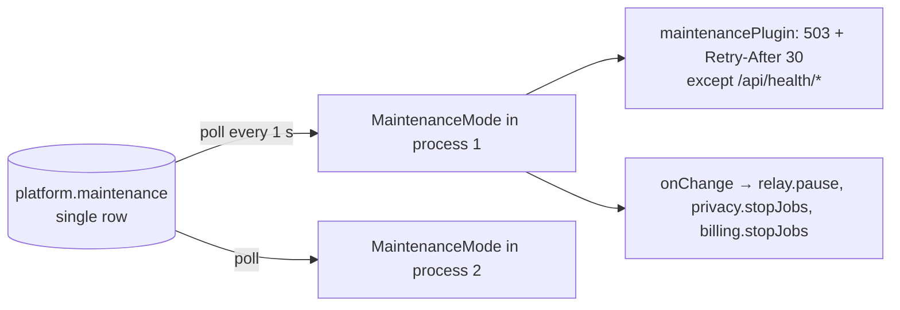
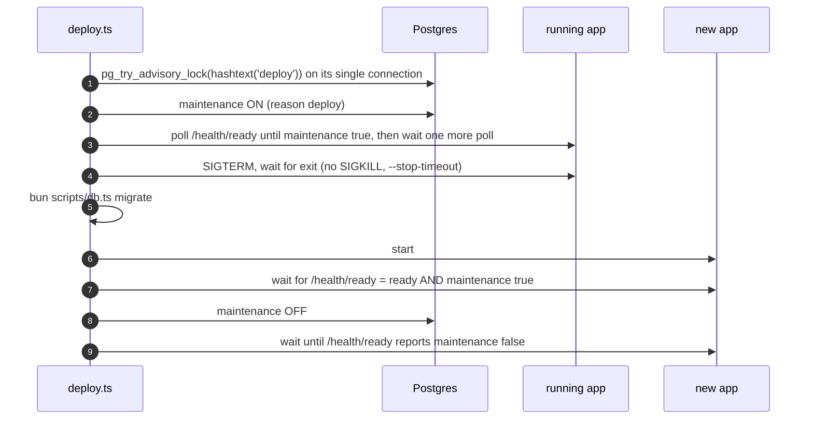

# 3. Runtime and operations

How the API runs as N interchangeable processes: roles, cluster mode, shutdown, observability, maintenance mode and the deploy flow.

← [Architecture overview](../architecture.md)

## Stateless by construction

Nothing is kept in RAM between requests, so any instance can answer any request and no sticky sessions are needed:

| Concern | Where the state lives |
| --- | --- |
| Authentication | ES256 JWT (verified with a public key) + refresh token row in Postgres |
| Rate limits (magic link, step-up codes, mail) | Postgres rows |
| WebAuthn challenges, OAuth state | Postgres rows, single use |
| Uploads | Straight from the browser to S3 via presigned URLs |
| Realtime fan-out | Postgres `LISTEN/NOTIFY` + a replay table |
| Jobs and the outbox | Postgres rows claimed with `SKIP LOCKED` |
| Maintenance flag | One Postgres row, polled by every process |

The only state a process holds is its open SSE sockets and its `LISTEN` connection, and both rebuild themselves on reconnect.

## Process roles

`APP_ROLES` is a comma-separated list, defaulting to `api,worker`:
- `api` listens for HTTP;
- `worker` runs the outbox relay and the job timers (privacy, billing reconciliation).

Splitting a worker out means running the same image with `APP_ROLES=worker`, for example on a box with more CPU for `sharp` thumbnails (commit `1d9081a`). Commit `523472d` renamed the old `relay` role to `worker` and rejects the old name instead of aliasing it.

## Cluster mode

`APP_PROCESSES=N` (or `auto` = `max(2, floor(cpus × 3/4))`) turns `main.ts` into a supervisor that forks N copies of itself with `node:cluster`.



- **Each process is a full instance**: its own container, DB pool, SSE sockets and `LISTEN` connection. Nothing else changes, because instances were already stateless.
- **`reusePort: clustered`** lets every process bind the same port. The kernel spreads connections on Linux; macOS delivers to one process, which is fine for development.
- **The worker role runs only in slot 0.** More relays would be safe (`SKIP LOCKED`), but one per node is enough. A crashed process is re-forked **into the same slot**, so the relay comes back.
- **Crash-loop detection** is a sliding window: more than 5 crashes in 60 s makes the supervisor stop everything and exit 1, so the orchestrator can react.
  ```ts
  crashes.push(now)
  while (crashes[0] !== undefined && now - crashes[0] > CRASH_WINDOW_MS) crashes.shift()
  if (crashes.length > MAX_CRASHES) { logger.fatal(...); stop('SIGTERM'); resolve(1); return }
  ```
- **Signals.** SIGTERM is forwarded to every process. The supervisor's own hard timeout is 30 s, then SIGKILL; this is the only hard kill left in the system.
- **Pool sizing.** `DB_POOL_MAX` is per process, so size Postgres for `APP_PROCESSES × DB_POOL_MAX` per container.

Code: `apps/api/src/bootstrap/cluster.ts` (`superviseProcesses`), `apps/api/src/main.ts`.

## Boot and graceful shutdown



- SSE streams are closed **first**. Otherwise `app.stop()` would wait on connections that never end.
- `relay.stop()` waits for the batch in flight, so a deploy never cuts a handler in half.
- Job timers use `running ??= job().finally(() => running = undefined)`, so a slow pass is never overlapped, and `stopJobs()` awaits the running pass.
- Tracing shuts down last, so the spans of the final batch are exported.

## Health

| Endpoint | Meaning |
| --- | --- |
| `GET /api/health/live` | The process is up. No dependency checks. |
| `GET /api/health/ready` | DB ping with a 2 s timeout. `503` + `degraded` if it fails. Reports `maintenance: true/false` and **stays 200 during maintenance**, so a deploy can tell a booted process from a dead one. |

The tracing plugin skips `/health/*`, so probes do not flood the traces.

## Configuration

Everything comes from the environment, validated with zod in `shared/infrastructure/config.ts` (`loadConfig`). Feature groups are all-or-nothing, and the app refuses to start with half of a group:
- Stripe: `STRIPE_*`;
- Web Push: `VAPID_*`;
- OAuth: `*_CLIENT_ID` + `*_CLIENT_SECRET`.

`DB_PREPARE=false` disables prepared statements for PgBouncer in transaction mode. `LISTEN` still needs a direct connection.

## Observability



- **Request context.** `requestContextPlugin` stores `{ requestId, correlationId, userId }` in an AsyncLocalStorage (`shared/infrastructure/request-context.ts`).
  - Incoming `x-request-id`/`x-correlation-id` are accepted only if they match `^[\w.-]{1,64}$`, which closes log and header injection.
  - `x-request-id` is echoed in the response.
- **Logs.** pino JSON. A `mixin` adds `requestId` and `correlationId` from the ALS to every line. Error bodies carry `requestId` too, so a user's screenshot leads to the logs.
- **Traces.** When `OTEL_EXPORTER_OTLP_ENDPOINT` is set (compose runs Jaeger: UI `:16686`, OTLP/HTTP `:4318`), `initTracing` registers a provider. Otherwise every span call is a no-op.
  - `tracingPlugin` opens a SERVER span per request, continuing an incoming `traceparent`.
  - It renames the span to the route pattern (low cardinality) and marks it as an error **only on 5xx**.
  - Because Elysia hooks cannot wrap the handler, the span context is stored in the request context, and `activeContext()` reads it from there.
- **Across the outbox.** The writer stores the W3C `traceparent` in the message headers inside the same transaction. The relay parents its span from it, however long the message waited and whichever instance claimed it. Retries show up as extra relay spans on the same trace.

- **Correlation across the outbox.** The relay runs each message inside `requestContext.run({ requestId: <message id>, correlationId: <header> })`. A handler's log lines carry the original correlation id, and the events it writes keep it, with `causationId` set to the message that caused them.

→ [Trace context across async hops](../patterns/trace-context-across-async-hops.md)

## Maintenance mode

A deployment-wide switch that makes every process stop starting new work, without any process talking to another.



- **The flag** is one row, `id boolean primary key default true check (id)`, which makes it a singleton by construction. It lives in schema `platform`, **outside every module's migrations**, because it must be settable before and while migrations run. `MaintenanceStore.write` creates the schema and table if missing. `read` treats a missing table (`42P01`/`3F000`) as "off". `since` keeps the original time when the flag is set again while already on.
- **Per process**, `MaintenanceMode` caches the value, so the per-request check costs nothing, and polls every `MAINTENANCE_POLL_INTERVAL_MS` (1 s).
  - A failed read keeps the **last known state**: a DB blip neither opens nor closes the gate.
  - Overlapping reads are skipped.
  - `refresh()` at boot throws instead, because guessing at boot is worse.
- **The HTTP gate** (`maintenancePlugin`, an `onRequest` hook) answers 503 with `{ error: { code: 'maintenance' } }`, `retry-after: 30` and `cache-control: no-store`. It is mounted **after CORS** so the browser can read the 503. Stripe retries its webhooks, and the web client shows a dialog and polls (see [Web client](10-web-client.md#outage-detection)).
- **The worker pauses.** `relay.pause()` finishes the batch in flight and claims nothing new, and the privacy and billing timers stop and wait for their running pass. Flips are serialised through a promise chain, so on → off → on in quick succession cannot interleave:
  ```ts
  maintenance.onChange((active) => {
    transition = transition.then(active ? pauseWorker : resumeWorker).catch(...)
  })
  ```
- **Nothing is lost.** Events written by requests still in flight stay in the outbox for the next process.
- **A new process reads the flag before it listens or pulls** (`main.ts`), so it boots already in maintenance mode.

## Deploys: `bun run deploy`

`apps/api/scripts/deploy.ts` runs a release with a soft stop.



Failure policy:
- **Never SIGKILL.** A process that does not drain within `--stop-timeout` stops the deploy for a human to look at.
- **On any failure, maintenance stays ON.** A half-deployed app must not take traffic. The script prints the tail of the app log and the two ways out.
- **Every step is idempotent.** Running `bun run deploy` again continues; `bun run deploy maintenance off` abandons it.
- **One deploy at a time.** This is a *session* advisory lock on the script's only connection, so a crashed deploy never leaves it behind.
- **The new app must come up ready *and* in maintenance mode.** That proves the gate was on before a single request was let in.

`LocalRuntime` (a pid file and a log under `apps/api/.run`) stands in for the container runtime. In production, replace its `start`/`stop` with `docker run`/`docker stop` of the new image; the rest of the flow stays. Other subcommands: `maintenance on|off|status [--reason]`, `start`, `stop`, `status`.

→ [Maintenance mode and soft deploys](../patterns/maintenance-mode-soft-deploy.md)

## Containers and the edge

- **`apps/api/Dockerfile`**
  - A deps stage copies only the `package.json` files and runs `bun install --production --filter @app/api`.
  - The runtime is `oven/bun:1-slim` running the TypeScript source directly (no build step), as `USER bun`, with a `HEALTHCHECK` on `/api/health/live`.
- **`apps/web/Dockerfile`** builds the SPA into `nginx:alpine`. `config.json` is mounted at run time, so one image serves every environment (see [Web client](10-web-client.md#runtime-config)).
- **`docker/nginx/default.conf`**
  - `resolver 127.0.0.11 valid=5s` + `set $api_upstream` makes nginx re-resolve the compose replicas of `api`.
  - `/api/` uses `proxy_http_version 1.1`, `Connection ""`, `proxy_buffering off` and `proxy_read_timeout 1h` for SSE.
  - `/config.json` is `no-store`. `/sw.js` is `no-cache`, otherwise a fixed service worker would take a day to reach users.
  - SPA fallback through `try_files`.
- **`docker-compose.yml`**
  - Infra: Postgres 17 (host port 5433), Mailpit (`MP_SMTP_DISABLE_RDNS`, because reverse DNS cost about 12 s per message), SeaweedFS (S3) and Jaeger.
  - Profiles: `init` creates the bucket and its CORS; `stripe` is the Stripe CLI; `app` runs `api` with `replicas: 2`, a one-shot `migrate`, and `web`.
  - The API env is shared through a YAML anchor (`x-api-env`).
- **`x-forwarded-for` is trusted** (first entry) for rate limits and device lists. That is only safe behind a proxy you control, such as the compose nginx.

## Patterns used here

- [Maintenance mode and soft deploys](../patterns/maintenance-mode-soft-deploy.md)
- [Singleton work in a cluster](../patterns/singleton-work-in-a-cluster.md)
- [Trace context across async hops](../patterns/trace-context-across-async-hops.md)
- [Outage detection and offline fallback](../patterns/outage-detection-and-offline-fallback.md) (the client side of maintenance)
