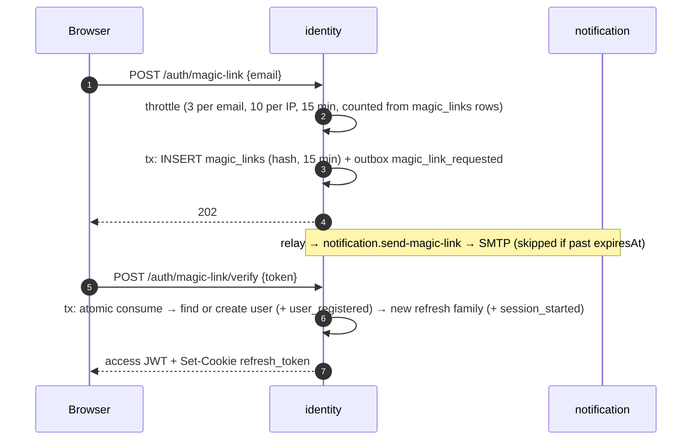
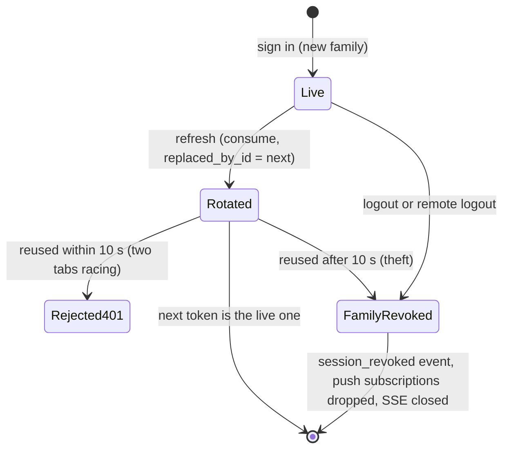
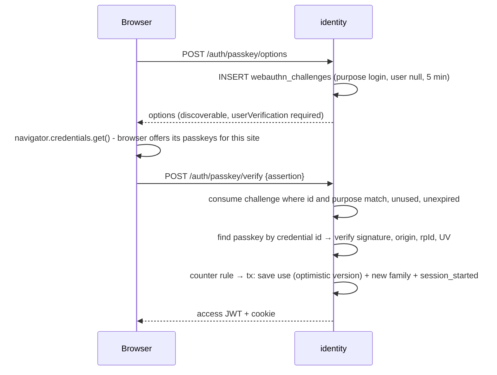
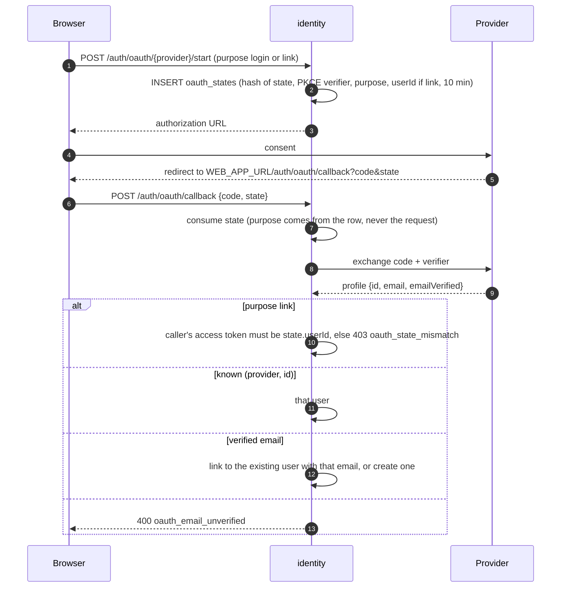
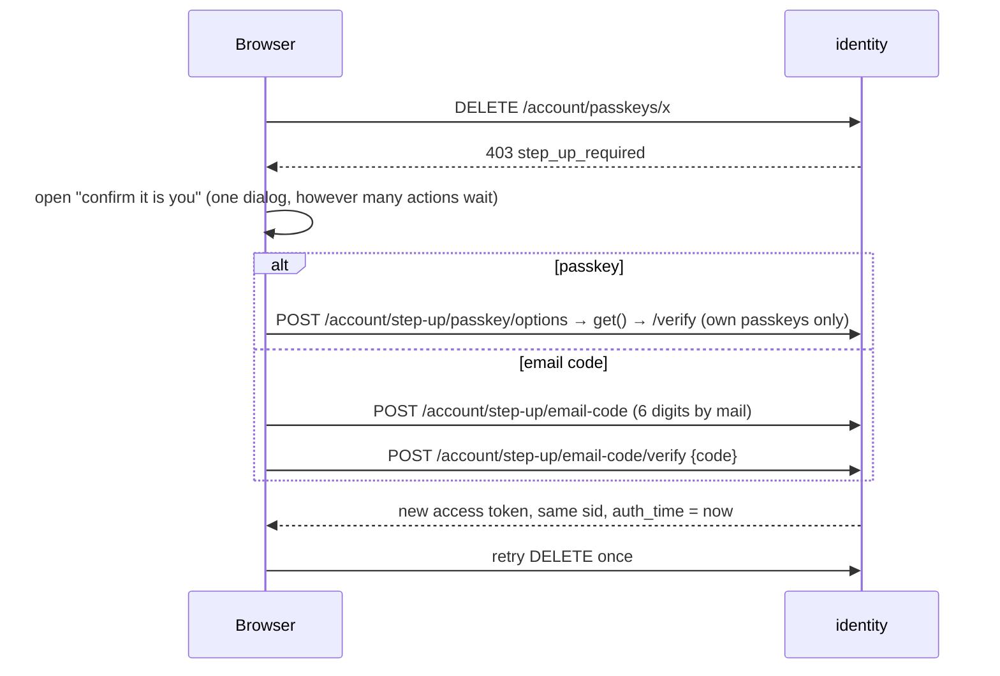

# 4. Identity and sessions

Passwordless sign-in (magic link, passkey, Google/GitHub), sessions as rotating refresh-token families, stateless access tokens that any service can verify, and step-up confirmation before sensitive actions.

← [Architecture overview](../architecture.md)

## What identity owns

- Users and their locale.
- Magic links and email-change requests.
- Refresh-token families (one family = one signed-in device).
- Passkeys and OAuth links.
- Short-lived rows: WebAuthn challenges, OAuth states, step-up codes, throttle counters.

It publishes:
- `magic_link_requested`, `user_registered`;
- `email_change_requested`, `email_changed`;
- `session_started`, `session_revoked`;
- `step_up_code_requested`;
- `passkey_added`, `passkey_removed`;
- `oauth_account_linked`, `oauth_account_unlinked`;
- the privacy answers.

It consumes only the two privacy requests.

## Tokens are stored as hashes

`shared/infrastructure/crypto.ts` creates 32-byte base64url tokens and stores `sha256Hex(token)`. Only the hash reaches a table.
- The raw magic-link token exists in exactly one place: the payload of `identity.magic_link_requested.v1`, which the mail handler needs.
- That payload lives in the outbox until the 7-day cleanup (see [trade-offs](13-trade-offs-and-known-gaps.md)).
- Numeric codes come from `randomInt`, which is uniform.

## Magic link



**Consuming is one statement**, so a link works exactly once even when two tabs click it at the same instant:

```ts
const [row] = await this.database.executor
  .update(magicLinks).set({ consumedAt: now })
  .where(and(eq(magicLinks.tokenHash, tokenHash),
             isNull(magicLinks.consumedAt), gt(magicLinks.expiresAt, now)))
  .returning()
```

The same `UPDATE … WHERE unused AND not expired RETURNING` shape consumes email-change requests, refresh tokens, WebAuthn challenges, OAuth states and step-up codes. → [Atomic single-use tokens](../patterns/atomic-single-use-tokens.md)

**Two links racing to create one account.** If two magic links for a brand-new email are verified at once, both try to create the user.
- The loser hits the unique index (`email_taken`) and its transaction rolls back, so its link is *not* consumed.
- It retries once and finds the user the winner created.
- OAuth sign-in does the same.

**Throttle.** `DrizzleMagicLinkThrottle` counts existing `magic_links` rows per email and per IP over 15 minutes, backed by indexes. There is no extra table and no Redis. A refusal is `429 magic_link_rate_limited` with `Retry-After` set to when the oldest counted request leaves the window (step-up codes do the same). It is count-then-insert, so a few requests can slip through a race. That is enough against spam; something stricter replaces the `MagicLinkThrottle` adapter.

## Session model

| Token | Lifetime | Where | Verified by |
| --- | --- | --- | --- |
| Access token, ES256 JWT | 15 min (`ACCESS_TOKEN_TTL`) | Memory of the web app, `Authorization: Bearer` | Public key, no DB |
| Refresh token, opaque | Days | httpOnly cookie `refresh_token`, `SameSite=Lax`, `Path=/api/auth` | Hash lookup + atomic consume |

The refresh cookie is scoped to `/api/auth`, so it is not even sent to the rest of the API.

### Families and rotation

A **family** is one sign-in on one device. Its id is the `sid` claim of every access token issued for it. Each refresh consumes the current token and issues the next one in the same family. The next token's id is allocated first and written into the old row's `replaced_by_id` by the consuming `UPDATE`.



Reuse detection (`RefreshSession.execute`) returns `null` instead of throwing inside the transaction, so the revocation **commits** before the 401 is reported:

```ts
const old = await this.refreshTokens.consume(hash, nextTokenId, now)
if (!old) {
  const known = await this.refreshTokens.findByHash(hash)
  // A rotated token that is used again → treat as stolen, revoke the whole session.
  if (known && !known.isRecentlyRotated(now)) {
    const revoked = await this.refreshTokens.revokeUserSession(known.userId, known.familyId, now)
    if (revoked) await this.outbox.add([sessionRevoked({ ..., reason: 'token_reuse' }, now)])
  }
  return null
}
```

`isRecentlyRotated` means revoked, with a `replaced_by_id`, no more than `REFRESH_REUSE_GRACE_MS` (10 s) ago. Two tabs refreshing at once are therefore rejected, not treated as theft.
- The web app runs **one refresh at a time** per tab (single flight, see [Web client](10-web-client.md)).
- Across tabs, the losing request gets `401 refresh_token_rotated`, and the route **does not clear the cookie**. Clearing it could wipe the new cookie the winning tab just received, if the loser's response landed last. The client waits 300 ms and retries once with the cookie the browser now holds.

→ [Refresh-token rotation with reuse detection](../patterns/refresh-token-rotation-reuse-detection.md)

### Devices

- **List.** `GET /account/sessions` lists the families that still hold a live token. A `min(created_at)` subquery gives "signed in since", and each refresh row stores the device's user agent and IP for display.
- **Revoke.** `DELETE /account/sessions/{id}` and `DELETE /account/sessions` (all but the current one) are scoped by `user_id`, so one user can never revoke another's session.
- **What revocation does.** It emits `identity.session_revoked.v1`, which:
  - is replayed to the revoked device over SSE (`closeSessionId` hangs up its stream), so the web app signs out immediately instead of after 15 minutes;
  - deletes that session's Web Push subscriptions;
  - refreshes the device list on the user's other devices.

The access token itself stays valid until it expires (≤ 15 min). Making it instant needs a denylist in a fast store, and the project avoids Redis on purpose.

## Access tokens anyone can verify

`JwtTokenService` (`identity/infrastructure/jwt-token-service.ts`):
- **Signs** with ES256, with a `kid` in the header.
- **Claims:** `sub`, `sid`, `jti`, `iss`, `aud`, `exp`, plus `auth_time` only when the user *just* authenticated.
- **Verifies** with the algorithm pinned to `ES256`, plus issuer and audience checks.
- **Publishes** the public key as a JWK at `GET /api/.well-known/jwks.json`. Another service verifies with `createRemoteJWKSet` and no shared secret, and keys can be rotated by `kid`.

`authPlugin` (`shared/http/auth.plugin.ts`) offers two macros, `auth` and `authOptional`.
- `authOptional` gives `null` for a missing token, but still answers 401 for a bad one.
- It reads the header from `request.headers`, because a route that declares a `headers` schema strips undeclared headers.
- `TokenVerifier` is defined in `shared`, so `shared` does not import identity.

`bun run keys:generate` writes the ES256 pair (regenerated on every run) and a VAPID pair (only if missing) into the root `.env`.

## Passkeys (WebAuthn)



- **Challenges live in Postgres**, because the second request may reach another instance.
  - Each is bound to a **purpose** (`register`, `login`, `step_up`) and, for `register` and `step_up`, to a **user**, so a challenge made for one ceremony cannot finish another.
  - It is consumed *before* verification, so it is single use even when the assertion fails.
- **Counter rule** (`Passkey.recordUse`). Synced passkeys (iCloud, Google) always report 0, so a counter that does not move is suspicious only if it ever moved:
  ```ts
  if ((newCounter > 0 || this._counter > 0) && newCounter <= this._counter) {
    throw new DomainError('passkey_counter_regressed', '...', 'unauthorized')
  }
  ```
  Saving the use is an optimistic-version update, so two assertions racing with the same counter cannot both pass.
- **Passkeys are complete on their own.** They are discoverable and always require user verification, so a passkey is a full sign-in.
- Adding one is `POST /account/passkeys/options`, then `POST /account/passkeys`, and needs a recent confirmation.
- `WEBAUTHN_RP_ID` and `WEBAUTHN_ORIGINS` default to `WEB_APP_URL`. **Changing the RP id orphans every registered passkey.**

## Google and GitHub (OAuth 2 + PKCE)



- **The callback is a page of the web app**, like the magic-link page. The redirect URI to register with the provider is `${WEB_APP_URL}/auth/oauth/callback`.
- **Accounts are matched on the provider's stable id**, never on email once linked. A unique `(provider, provider_user_id)` and a unique `(user_id, provider)` back that.
- **Linking by email requires an address the provider vouches for.** That is the same proof a magic link gives, so it does not widen who can take over an account.
  - Google: `email_verified`. The `id_token` comes straight from the token endpoint over TLS, so `iss` and `aud` are checked but the signature is not re-verified (OIDC §3.1.3.7).
  - GitHub: only the *primary, verified* address from `/user/emails`. The profile email is user-typed and ignored.
- **Connecting from settings is bound to the user who started it.** Otherwise a victim could be tricked into attaching their Google account to the attacker's.
- **Email sign-in always remains**, so disconnecting a provider can never lock anyone out.
- A provider is on only when both `*_CLIENT_ID` and `*_CLIENT_SECRET` are set (enforced by config validation).

## Step-up: confirm again before sensitive actions

Access tokens carry `auth_time` (seconds) only when the user just authenticated: magic link, passkey, OAuth, or a step-up. A plain refresh drops it. `StepUpPolicy.assertFresh(authTime)` (`shared/application/step-up-policy.ts`) throws `403 step_up_required` when it is missing or older than `STEP_UP_TTL` (5 min).

The check is **inside the use case**, not in the route, so no new route can forget it. It guards:
- changing the email;
- adding or removing a passkey;
- connecting or disconnecting OAuth;
- requesting and downloading a data export;
- scheduling account deletion.



- **Emailed code.** Hashed together with the user id (`hash(userId:code)`), valid 10 minutes, replaced by the next request.
  - At most 5 wrong guesses: each miss increments `attempts`, and the consuming `UPDATE` requires `attempts < 5`.
  - At most 5 requests per 15 minutes.
  - It proves control of the mailbox, the same root of trust as a magic link: weaker than a passkey, but it still stops anyone who holds only the session.
- A stolen access token older than the window, or a token obtained by stealing only the refresh cookie, cannot reach these actions.
- **OAuth step-up is deliberately not offered.** An attacker holding the victim's browser session usually holds their Google/GitHub session too.

→ [Step-up authentication](../patterns/step-up-authentication.md)

## Short-lived rows clean themselves up

Challenges, OAuth states and step-up codes are written by unauthenticated or frequent calls. Instead of a cron job, inserting a new row first deletes rows that expired more than an hour ago (`PRUNE_AFTER_MS`), backed by an index on `expires_at`. Unlike the magic link, these routes have no per-IP limit; put one on `/api/auth/*` at the proxy if the API is exposed.

## Patterns used here

- [Atomic single-use tokens](../patterns/atomic-single-use-tokens.md)
- [Refresh-token rotation with reuse detection](../patterns/refresh-token-rotation-reuse-detection.md)
- [Step-up authentication](../patterns/step-up-authentication.md)
- [Optimistic locking with a version column](../patterns/optimistic-locking-with-version.md) (passkey counter, user)
- [Single-flight token refresh](../patterns/single-flight-token-refresh.md) (client side)
