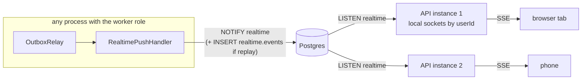
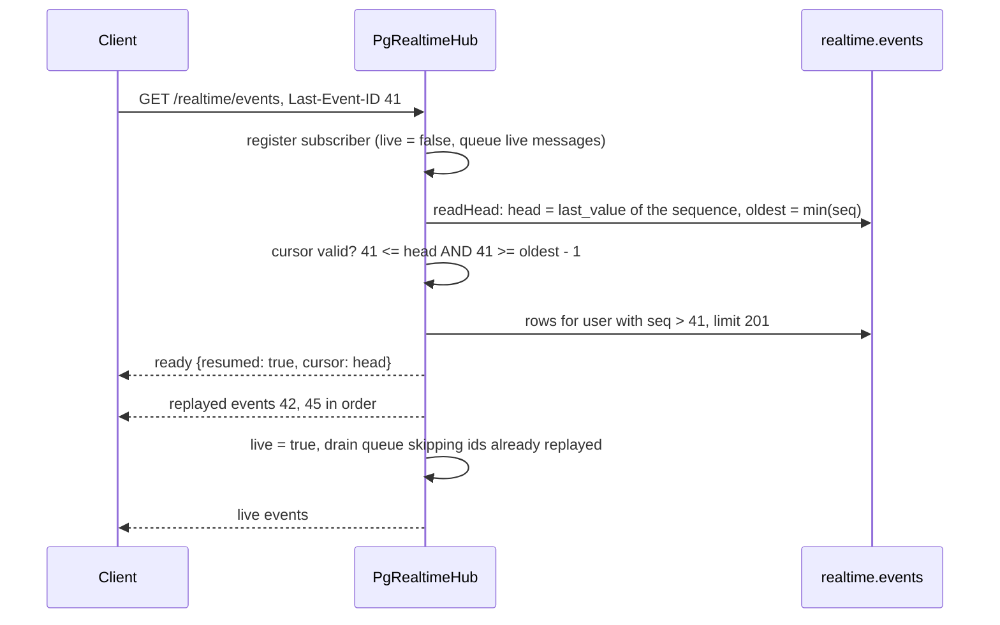

# 5. Realtime (SSE)

The `realtime` module pushes events to clients that are connected right now, across any number of API instances, with no Redis and no sticky sessions. For the few events that must not be lost, it also replays what a reconnecting client missed.

← [Architecture overview](../architecture.md)

## Shape



- **One transport:** SSE on `GET /api/realtime/events`, carrying `{ id?, type, data, at }`. Server → client is all these use cases need, so WebSocket was left out on purpose.
- The client consumes it with `fetch`, not `EventSource`, because `EventSource` cannot send `Authorization: Bearer` (see [Web client](10-web-client.md#sse-over-fetch)).
- **Postgres is the fan-out.** The relay may run in a different process from the API, so the handler `NOTIFY`s and every API instance that holds connections `LISTEN`s and delivers to its own sockets.
- **Realtime only knows contracts.** It subscribes to other modules' events (`session_revoked`, `notification.created/read/seen`, `billing.topup_succeeded/failed`, the `privacy.*` job steps, deletion scheduled/cancelled, `account_deleted`) and never reads their tables. Each mapping is one `RealtimePushHandler(name, eventType, map)` line in `realtime.module.ts`.

## Delivery: `PgRealtimeHub`

`modules/realtime/src/infrastructure/pg-realtime-hub.ts`.

- **Lazy LISTEN.** The dedicated `LISTEN` connection opens on the first registered client. A worker-only process never opens one. If opening fails, the promise is reset, so the next client retries.
- **Payload cap.** Postgres rejects `NOTIFY` payloads of 8,000 bytes or more. `encode` refuses anything over 7,500 bytes and throws, so the relay retries and logs instead of silently dropping it. Events therefore carry ids and small data, never documents.
- **Routing.** The wire format is `{ userId, closeSessionId?, message }`. `dispatch` looks up the local subscribers of `userId` and ignores malformed payloads.
- **Too old to matter.** `RealtimePushHandler` drops events older than 60 s when the relay reaches them, and uses no inbox: a duplicate push means at worst one extra refetch.
- **Streams stay open.** `server.timeout(request, 0)` disables Bun's 10 s idle timeout for the stream, and a `: ping` comment every 20 s keeps proxies from closing it. The response sends `x-accel-buffering: no`, and nginx has `proxy_buffering off` and `proxy_read_timeout 1h`.
- **Authentication** is checked when the stream opens. A revoked session is closed by the server (below), not by re-checking the token.

## Replay is opt-in per event

Most events mean "something changed, refetch". They are neither stored nor given an id, and the client simply refetches that state on every `ready` (connect or reconnect).

Some losses cannot be repaired by a refetch. An event sets `RealtimeEvent.replay = true` when that is the case:

| Event | Why it must be replayed |
| --- | --- |
| `session.revoked` | A device that was offline when it was signed out reconnects with a still-valid access token. It must learn it was signed out, not wait 15 minutes for the token to expire. |
| `privacy.export.progress/ready/failed`, `privacy.deletion.progress` | A tab that was away must still learn how a long job went. |
| `billing.topup` with `status: 'succeeded'` | A tab that was closed when the money arrived must still learn it on reconnect (a failed top-up is not replayed). |

The older version of this doc listed only the first two. The code (`realtime.module.ts`) is the source of truth: search it for `replay: true`. Future candidates: chat messages. Replayed events carry counts and module names, **never secrets**, because the buffer is stored (an export's download link goes only by mail).

History: commit `034ece3` added replay for every event; `5bba78c` made it opt-in and added the `cursor` to `ready`. Commit `e518a84` dropped the `session.started` SSE event: new sign-ins are now covered by an in-app notification and Web Push, so a live toast was only noise.

### Writing a replayable event

```ts
await this.database.db.transaction(async (tx) => {
  // Per-user lock: seq order = commit order for one user, so a reconnecting client never skips an event.
  await tx.execute(sql`select pg_advisory_xact_lock(hashtextextended(${target.userId}, 0))`)
  const [row] = await tx.insert(events).values({ userId, type, data, closeSessionId, createdAt })
    .returning({ seq: events.seq })
  // Delivered when the transaction commits, i.e. after the row is visible to replays.
  await tx.execute(sql`select pg_notify(${CHANNEL}, ${payload})`)
})
```

- **`seq` is a global identity column and becomes the SSE `id:`.** Without the lock, two transactions for one user could commit out of `seq` order. A client that had seen `seq` 11 would then never be sent 10, because it would ask for "after 11".
- **`NOTIFY` inside the transaction** is delivered at commit, so a live message never arrives before its row is visible to a replay.

### Reconnecting



- **Subscribe before reading the buffer.** An event committed between the two steps is both queued and replayed, and `start()` sends it once:
  ```ts
  for (const message of subscriber.queue.splice(0)) {
    if (!message.id || !replayed.has(message.id)) this.deliver(subscriber, message)
  }
  ```
- **When the buffer can be trusted.** The cursor must be ≤ the newest allocated `seq` and ≥ the oldest stored `seq` − 1. Otherwise something right after it may have been pruned.
- **When it cannot.** No, malformed, future or too-old cursor, or more than `MAX_REPLAY` = 200 missed events: `ready` says `resumed: false`, nothing is replayed, and the client resyncs.
- **`ready` always carries a `cursor`** (the head at connect time). A client that never received a replayable event still has something to send back as `Last-Event-ID`; each replayable event then moves it forward.
- **The header is untrusted input.** `parseEventId` accepts only `^\d{1,15}$`, and rows are always filtered by the authenticated user.
- **Replayed `session.revoked` hangs up too.** Rows keep `close_session_id`, so a replay closes the revoked session's connection just like the live event does.
- **The buffer is an optimisation.** If reading it fails, the client gets `resumed: false` and refetches.

### Pruning

- A 60 s timer (`unref`'d) deletes events older than `REALTIME_REPLAY_WINDOW_SECONDS`.
- The default is 900 s, the access-token TTL: after that the device cannot refresh its session anyway.
- On `identity.account_deleted`, `PurgeUserEvents` deletes the user's rows. This is best effort; the window expires them too.

## Closing a revoked session

`session_revoked` is published with `closeSessionId = sid`. Every instance closes the connections opened with that `sid`, live or right after replay. The web app treats its own `session.revoked` as "sign out here" and does not reconnect.

## Limits, by design

- A non-replayable event sent while a client is offline, or while an instance is reconnecting its `LISTEN`, is not delivered. The refetch on `ready` covers it.
- `LISTEN` needs a direct Postgres connection, not PgBouncer in transaction mode.
- On shutdown, `realtime.stop()` runs before the HTTP server stops, otherwise open streams hold it up.

## Patterns used here

- [Postgres pub/sub with replay](../patterns/postgres-pubsub-with-replay.md)
- [Transactional outbox](../patterns/transactional-outbox.md) (events reach the push handler through it)
