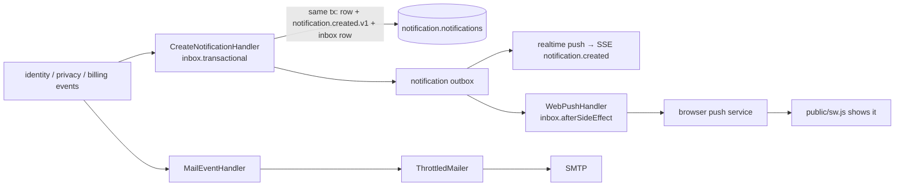

# 6. Notifications: in-app inbox and Web Push

The `notification` module turns other modules' events into three channels: a per-user **in-app inbox**, **Web Push** while the app is closed, and **mail** (covered in [Mail delivery](07-mail-delivery.md)). Nothing outside the module knows these channels exist.

← [Architecture overview](../architecture.md)

## Channels at a glance



## The in-app inbox

**Which events become notifications.** Each source is one `inApp(...)` line in `notification.module.ts` with a draft builder in `application/in-app-notifications.ts`. Returning `null` from the builder skips an event.

| Source event | Notification |
| --- | --- |
| `user_registered` | Welcome |
| `email_changed` | Security alert |
| `session_started` | New sign-in, **except** the account's first session |
| `session_revoked` | Only with reason `token_reuse` (possible theft) |
| `passkey_added` / `passkey_removed`, `oauth_account_linked` / `oauth_account_unlinked` | Security alerts about sign-in methods |
| `privacy.data_export_ready` / `failed`, `account_deletion_scheduled` / `cancelled` | Job results (the export link is **not** in the notification) |
| `billing.topup_succeeded` | Money arrived |

**One transaction per notification.** `CreateNotificationHandler` runs inside `inbox.transactional`, so three things commit together:
- the notification row;
- `notification.created.v1` in the module's outbox;
- the inbox row.

Realtime and Web Push then react to `notification.created.v1`, never to the original event.

**API.**
- `GET /notifications`: newest first. The cursor is the last id, because ids are UUIDv7.
- `GET /notifications/unread-count` and `GET /notifications/unseen-count`.
- `POST /notifications/{id}/read`: idempotent. It returns `marked`, `already_read` or `not_found`, and another user's id is a 404.
- `POST /notifications/read-all`.
- `POST /notifications/seen`.

`notification.read.v1` is emitted only when something actually changed, so the user's other devices clear their badge without being spammed.

### Unseen vs unread

The bell badge counts **unseen**, not unread:
- *unread* = `read_at IS NULL`;
- *unseen* = unread **and** `notified_at > inbox_state.seen_at`.

`notified_at` is the creation time, bumped when a repeat is folded in. Opening the bell popover calls `POST /notifications/seen`:
- it moves `seen_at` forward with an upsert using `greatest(seen_at, excluded.seen_at)`, so a late request can never move it back;
- it emits `notification.seen.v1` only if the badge was showing something, so the user's other open devices clear it too.

Read state is untouched, and `unread-count` still reports it.

### Folding repeats (prepared, unused)

A draft may carry `group: { key, withinMs }`. `CreateNotificationHandler` then folds it into the user's latest unread notification of that group: `count + 1`, the newest content, `notified_at = now`, the **same id**. It re-emits `notification.created.v1`, so the SSE patch replaces the item in place, and the Web Push `tag` replaces the system notification instead of stacking it.

```ts
const target = ex.select({ id: notifications.id }).from(notifications)
  .where(and(eq(userId), eq(groupKey), isNull(readAt), gte(createdAt, since)))
  .orderBy(desc(notifications.id)).limit(1).for('update', { skipLocked: true })
const [row] = await ex.update(notifications)
  .set({ count: sql`${notifications.count} + 1`, notifiedAt: now, /* content */ })
  .where(eq(notifications.id, sql`(${target})`)).returning()
```

Commit `13c8285` used it for repeated sign-ins; `2fd3abc` replaced that with alert throttling (below) and left folding as a capability. Two instances racing on one user can still insert two rows.

### Adding a notification

1. Write a draft function in `application/in-app-notifications.ts`, with a `template` key (see [i18n](11-i18n.md)).
2. Register one `inApp(...)` handler in `notification.module.ts`.
3. Add the template to both web catalogs and to `features/notifications/text.ts`.

Retention of old notifications is not implemented yet.

## Web Push

System notifications while the app is closed ride the same event: `notification.created.v1` → `WebPushHandler` → `WebPushSender` port (adapter: the `web-push` package with VAPID) → the browser's push service → `apps/web/public/sw.js`.

**Opt-in per browser.**
- The toggle (`PushToggle`, on the notification settings page) asks for permission and subscribes with the key from `GET /notifications/push/public-key`.
- It registers the subscription with `PUT /notifications/push/subscription` (idempotent). `DELETE` with the endpoint removes it.
- Web Push is enabled only when `VAPID_PUBLIC_KEY`, `VAPID_PRIVATE_KEY` and `VAPID_SUBJECT` are all set. Otherwise the key endpoint returns `null`, the toggle is hidden, and no handler is registered.

**A subscription belongs to a login session.**
- Each row stores the `sid` that registered it.
- `identity.session_revoked.v1` (logout, "sign out that device", token theft) deletes it, so a signed-out device stops receiving the account's notifications.
- The browser's endpoint is unique across users: if another account signs in on the same browser, it takes the subscription over.
- At most 10 per user; the oldest is dropped.

**The server POSTs to a URL the client supplied**, so `PushSubscription` validates it as an SSRF guard (`domain/push-subscription.ts`):
- `https:` only;
- no userinfo;
- no IP literal (IPv4 digits, or any `:` for IPv6);
- the host must contain a dot and must not end in `.local` or `.internal`;
- keys must be base64url, ≤ 256 characters.

→ [Outbound URL SSRF guard](../patterns/outbound-url-ssrf-guard.md)

**Delivery** (`WebPushHandler`, `infrastructure/web-push-sender.ts`):

| Push service answer | Action |
| --- | --- |
| 2xx | Done (inbox row written after the send) |
| 404 / 410 | Subscription is `gone` → delete it |
| 429, 5xx, network error | Rethrow → the relay retries the message |
| Other 4xx | `rejected` → log, drop this message |

- The VAPID `topic` is the notification id without dashes, so the push service collapses a pending duplicate.
- The service worker uses `tag: message.id` with `renotify`, so a repeat replaces the earlier notification instead of duplicating it.
- Pushes older than 15 minutes are skipped; the in-app inbox still has them.
- The text is rendered at send time, in the account's language *at that moment*.
- `notificationclick` focuses an existing window and only navigates within the same origin.
- `sw.js` must not be cached (`docker/nginx/default.conf`).

### Alert throttling

Many events at once (a script signing in 20 times) must not mean 20 buzzes. Every event still becomes its own stored notification, so the inbox and the badge stay exact; only the *alert* is limited.

`WebPushHandler` cuts time into fixed buckets of `PUSH_QUIET_WINDOW_SECONDS` (default 30; `0` pushes everything) and pushes only the **first** notification of a user per bucket. The decision is computed from the *previous stored notification*, not from a counter, so a retry of the same message reaches the same verdict:

```ts
const previous = await this.notifications.createdAtBefore(p.userId, p.notificationId) // id < this id (UUIDv7)
if (!previous) return false
const bucketStart = Math.floor(Date.parse(p.createdAt) / this.quietWindowMs) * this.quietWindowMs
return previous.getTime() >= bucketStart   // true = stay quiet
```

`security_alert` is always pushed. The web client applies the same rule to toasts: one per 30 s, security alerts excepted. Mail is separate: it is rate-limited and deferred, never merged.

→ [Deterministic throttle on retry](../patterns/deterministic-throttle-on-retry.md)

## Patterns used here

- [Idempotent consumer (inbox)](../patterns/idempotent-consumer-inbox.md): `transactional` for the inbox row, `afterSideEffect` for push
- [Deterministic throttle on retry](../patterns/deterministic-throttle-on-retry.md)
- [Outbound URL SSRF guard](../patterns/outbound-url-ssrf-guard.md)
- [Store templates, not text](../patterns/store-templates-not-text-i18n.md)
- [Optimistic mutations with rollback](../patterns/optimistic-mutations-with-rollback.md) (mark read, client side)
