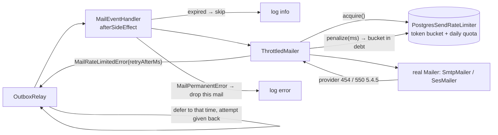

# 7. Mail delivery and rate limiting

Mail goes through the outbox, so it never slows down or breaks a request. The work is in sending it in a way the provider will not reject: a shared rate limit, backing off together, deferring instead of failing, and not sending mail that has become pointless.

← [Architecture overview](../architecture.md)

## Four layers



1. **Proactive limit.** `ThrottledMailer` asks `PostgresSendRateLimiter` for a token before every send: `MAIL_RATE_PER_SECOND`, burst `MAIL_BURST` (default `ceil(rate)`), and a `MAIL_DAILY_QUOTA` per UTC day.
   - The state lives in Postgres and each request is **one atomic statement**, so N instances share one limit.
   - When it says no, it says **for how long**, and the provider is never touched.
2. **Adaptive.** If the provider still reports overload (SES `454 Throttling failure`, Gmail `550 5.4.5`…), the bucket is put **in debt** (`penalize`). Every instance backs off together instead of continuing to hammer.
3. **The relay understands "retry later".** `MailRateLimitedError extends RetryLaterError`, so the relay defers the message to the suggested time (+ ≤ 10 % jitter) and **gives back** the attempt.
   - It gives up only when the message is older than `OUTBOX_DEFER_BUDGET_HOURS` (24 h).
   - Ordinary errors (lost connection, bad credentials 535…) still follow exponential backoff, up to 10 attempts. See [Messaging](02-messaging.md#outcomes-of-one-message).
4. **Pointless mail is not sent.**
   - Magic links, email-change links, step-up codes, export links and deletion notices carry `expiresAt`. A mail deferred past it is skipped instead of sending a dead link.
   - A permanent failure for one address (550/554) drops only that mail and logs `error`. It does not send the whole event to dead or block other consumers.

## The token bucket in one statement

```sql
insert into notification.rate_buckets as b (key, tokens, updated_at)
values ($key, $cap - 1, now())
on conflict (key) do update
  set tokens = least($cap, b.tokens + extract(epoch from (now() - b.updated_at)) * $rate) - 1,
      updated_at = now()
  where least($cap, b.tokens + extract(epoch from (now() - b.updated_at)) * $rate) >= 1
returning tokens
```

- The refill is computed lazily from `updated_at`, so no timer is needed.
- The `WHERE` on the `DO UPDATE` makes the statement update nothing when there is less than one token. **Zero rows returned = no token.**
- The row lock taken by `ON CONFLICT` serialises concurrent callers, so the rate is never exceeded.
- On "no", a second query computes `wait_ms = (1 - refilled) / rate × 1000`, plus 0–100 ms jitter so callers rejected together do not come back together.

**The daily quota is counted in the same transaction:**

```sql
insert into notification.mail_quota as q (key, day, sent)
values ($key, (now() at time zone 'utc')::date, 1)
on conflict (key, day) do update set sent = q.sent + 1 where q.sent < $quota
returning sent
```

Zero rows throws inside the transaction, which **rolls back the token just taken**. The caller is told to retry after `min(time to UTC midnight + 1 s, 1 h)`.

**Penalize as debt:**

```sql
insert into notification.rate_buckets as b (key, tokens, updated_at) values ($key, -($ms/1000) * $rate, now())
on conflict (key) do update set tokens = least(b.tokens, -($ms/1000) * $rate), updated_at = now()
```

Negative tokens mean refill time has to pass before the next `acquire` succeeds. `least` keeps a bigger existing debt.

→ [Postgres token-bucket rate limit](../patterns/postgres-token-bucket-rate-limit.md)

## Classifying SMTP errors

`classifySmtpError` (`@kit/mail`) is checked in this order:

| Order | Condition | Kind | What happens |
| --- | --- | --- | --- |
| 1 | 4xx/5xx and the text matches `throttl\|rate.?limit\|too many\|quota\|sending rate\|frequency` | `rate_limited` | Penalize + defer |
| 2 | Code in {421, 450, 451, 452, 454} | `rate_limited` | Penalize + defer |
| 3 | Code in {550–555} | `permanent` | Drop this mail, log `error` |
| 4 | Anything else (timeouts, 535 auth…) | `transient` | Normal backoff |

The text is checked **before** the code because Gmail reports a quota as `550 5.4.5`, which would otherwise read as permanent.

`SmtpMailer` always sets connection, greeting and socket timeouts (10 s, 10 s, 20 s). A hung SMTP call would otherwise hold a relay worker for good.

## Which mail exists

`MailEventHandler(name, eventType, build)` lines in `notification.module.ts`:
- magic link;
- welcome (`user_registered`);
- email change requested / changed;
- step-up code;
- export ready (with the link);
- deletion scheduled (with a cancel link, expires at `scheduledFor`), cancelled, and the goodbye mail after `account_deleted`.

Mail is rendered server-side in the recipient's language; see [i18n](11-i18n.md).

## Operating it

- Dead mail shows up in `outbox:list`. `outbox:requeue` is safe: the inbox blocks handlers that already finished, so nothing is sent twice.
- All mail types share one bucket, so a magic link can queue behind welcome mail under load (see [trade-offs](13-trade-offs-and-known-gaps.md)). To prioritise, split buckets by type (the limiter's `key` option) or order by priority when claiming.

### Using Amazon SES

- **Quick way, no code.** SES has an SMTP interface.
  - Set `SMTP_HOST=email-smtp.<region>.amazonaws.com`, `SMTP_PORT=587`, `SMTP_REQUIRE_TLS=true`, `SMTP_USER`/`SMTP_PASSWORD` (the SES SMTP credentials), and `MAIL_FROM` to a verified address.
  - Set `MAIL_RATE_PER_SECOND` to the account's *maximum send rate* and `MAIL_DAILY_QUOTA` to its *24-hour sending quota* (sandbox: 1/second, 200/day).
  - `454` is recognised as a rate limit. `554 Message rejected` (for example, a recipient not verified in the sandbox) is permanent.
- **The SES API (AWS SDK)**, when you need a configuration set, tags or bounce tracking:
  - write `SesMailer implements Mailer`;
  - map `ThrottlingException`, `Maximum sending rate exceeded` and `Daily message quota exceeded` → `MailRateLimitedError`;
  - map `MessageRejected` and `MailFromDomainNotVerified` → `MailPermanentError`;
  - pass it to `createContainer(config, logger, { mailer })`.

  The bucket, deferral, expiry and dead-letter behaviour stay the same.
- **Bounces and complaints** arrive via SNS. Add an endpoint that records bounced addresses and blocks resending (a suppression list). This is not in the project yet.

## Patterns used here

- [Postgres token-bucket rate limit](../patterns/postgres-token-bucket-rate-limit.md)
- [Retry-later deferral](../patterns/retry-later-deferral.md)
- [Idempotent consumer (inbox)](../patterns/idempotent-consumer-inbox.md) (`afterSideEffect`)
