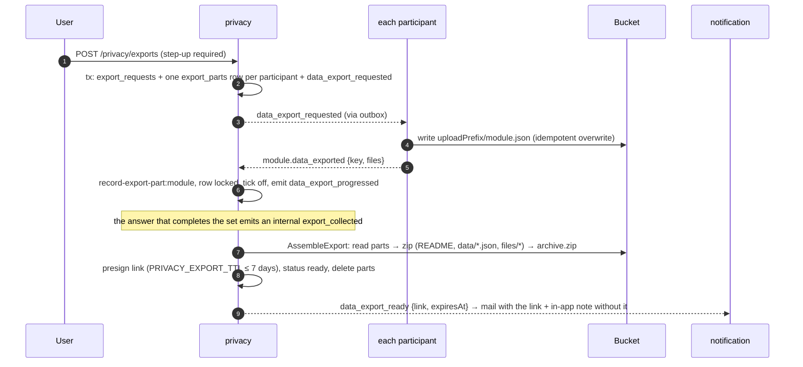
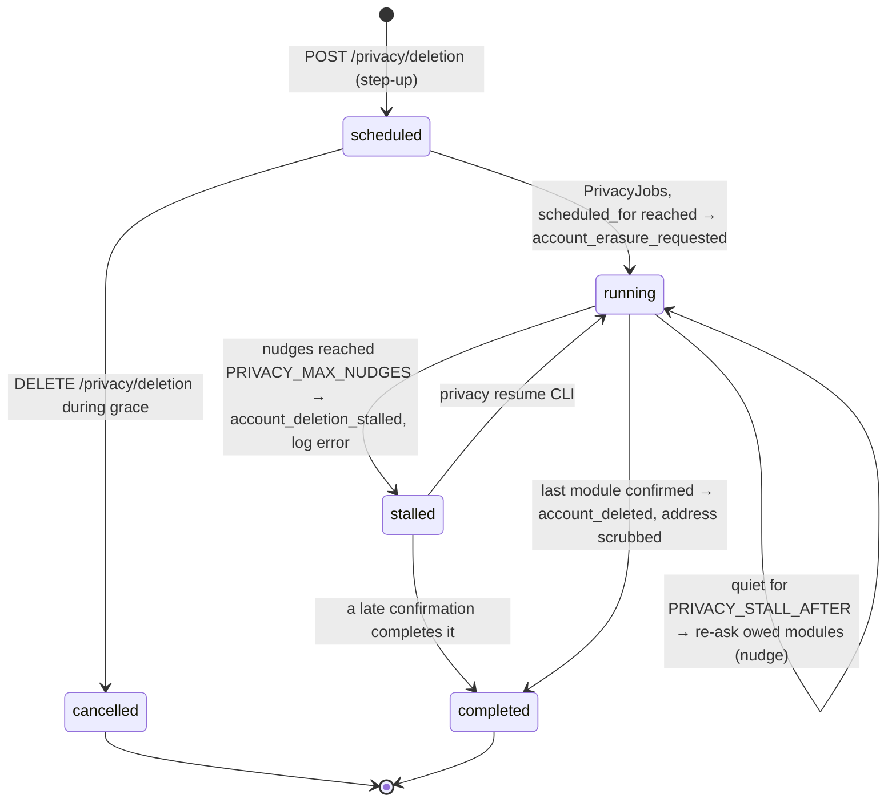

# 8. Privacy: data export and account deletion

Two jobs that run *through* every module. The `privacy` module owns the process and its progress. It never reads or deletes another module's data: it asks, and each module answers with an event. That is a **choreographed saga with a ledger**, and it keeps working unchanged when a module becomes a separate service.

← [Architecture overview](../architecture.md)

## What privacy owns

- The **ledger** of the two jobs, never the data itself:
  - `export_requests` + `export_parts` (one row per participant);
  - `account_deletions` + `deletion_steps`.
- Archives in the bucket under `exports/<userId>/<exportId>/{parts/, archive.zip}`. Because everything sits under the user, erasing them is one prefix delete.

Participants are what the modules **declare**: each returns `privacy: { exports, erases }` (from `privacyParticipation()` in `@kit/privacy-participant`) and the container reads those flags when it installs privacy, which is installed last:

```ts
participants: { exports: participants('exports'), erases: participants('erases') }
// today: exports ['billing','identity','notification','profile'], erases the same plus 'privacy' itself
```

## The request/answer contract

| Privacy asks | Each participant answers | Payload |
| --- | --- | --- |
| `privacy.data_export_requested.v1` | `<module>.data_exported.v1` | `exportId`, `key` of its JSON in S3, `size`, extra `files` |
| `privacy.account_erasure_requested.v1` | `<module>.user_data_erased.v1` | `deletionId`, `erasedAt` |

- `participantEvents(module)` in `@kit/privacy-participant` builds the answer names by convention; `privacy/contracts` re-exports the protocol.
- A request may carry `modules: [...]`: only the modules still owed. Empty or absent means everyone.
- Participants do not write this plumbing themselves. They implement two ports and reuse two handlers from `@kit/privacy-participant` (one call, `privacyParticipation()`, builds both):
  - `DataExporter.collect(userId)` → `ExportUserDataHandler`;
  - `DataEraser.erase(userId)` (must be idempotent) → `EraseUserDataHandler`.

## Export



- **One export at a time per user.** A partial unique index on active exports means two clicks cannot both win.
- **Write the file before answering.** The participant writes `<uploadPrefix><module>.json` before it emits its answer, so an answer always points at a file. A retry overwrites the same key.
- **Exactly one assembler.** `RecordExportPart` ticks a module off with the export row **locked** (`FOR UPDATE`). Two modules answering at once are applied one after the other, so exactly one of them sees the set complete:
  ```ts
  // Locked: two modules answering at once must not both conclude that the other one is still missing.
  const dataExport = await this.exports.findById(answer.exportId, { lock: true })
  if (!dataExport || dataExport.userId !== answer.userId) return
  // `module` comes from the wiring, not the payload: a module can only answer for itself.
  const outcome = dataExport.recordPart({ ...answer, module: this.module }, now)
  ```
  There is one `record-export-part:<module>` handler per participant: its own consumer group, inbox key and retries.
- **Assembly** (`AssembleExport`).
  - It builds the zip in memory with `fflate` (the data per user is bounded) and writes it to a fixed key.
  - It re-checks `status === 'assembling'` under the lock before marking it ready.
  - It fetches the email through `IdentityApi.getAccount`, because privacy does not store addresses for exports.
  - Part files are deleted afterwards, best effort.
- **The link only goes by mail.** The mailbox is the same root of trust as a magic link, and notification keeps `expiresAt` so a late mail is skipped rather than sent dead.
  - The in-app notification only points to `/settings/account`.
  - From that page, `GET /privacy/exports/{id}/download` issues a fresh 15-minute link and, like the request, needs a recent confirmation: an access token alone cannot take the archive.
- **Expiry.** After `PRIVACY_EXPORT_TTL`, the jobs mark the export `expired` and delete its folder.

## Account deletion



- **Scheduling only schedules.**
  - It stores the row, the address (kept to say goodbye) and the account's language, and emits `account_deletion_scheduled`.
  - That event becomes a mail with a cancel link (it expires at `scheduled_for`) and a security-alert notification.
  - Signing in during the grace period does **not** cancel it. `GET /privacy/deletion` is how a client finds out and offers to cancel; the web app's `/settings/account` does.
- **Cancel** works only while `scheduled`. Once `running`, it answers `409 deletion_in_progress`: erasing cannot be undone, and half-undoing it would be worse than finishing.
- **Each module erases in one transaction with its confirmation.** `EraseUserDataHandler` runs `eraser.erase(userId)` and writes `<module>.user_data_erased.v1` inside `inbox.transactional`. A confirmation is therefore never sent for data that is still there, and a crash in between only means erasing twice, which is harmless.
- **What a module erases.** Everything it holds about the user, **and the published outbox rows about them** (`erasePublishedOutbox`), because they keep addresses and tokens until retention cleanup:
  - profile: the row and every file under `<userId>/`, including uploads never set as avatar;
  - notification: notifications, push subscriptions, mail state;
  - identity: sessions, passkeys, links, challenges;
  - billing: see below.

  Messages *not yet published* are left: they are still owed to their consumers.
- **No event announces the erased sessions.** A "you were signed out" notification for a deleted account would be new data about them. The module's own confirmation (ids and a time) stays in its outbox.
- **Privacy takes part in its own erasure**: archives and their records, and the addresses of earlier, cancelled deletions. The running deletion's row stays as proof the erasure happened, with the address scrubbed on completion.
- **Billing keeps financial records.** It sets `user_id` to null on top-ups, ledger entries and documents, blanks the buyer, and deletes balances (see [Billing](09-billing.md)).
- **Realtime has no outbox**, so it cannot confirm. It purges the user's replay rows on `account_deleted` (best effort; the buffer expires anyway).

## The clock is a job, not an event

Nothing "happens" when a grace period ends or a module stays silent, so something has to look. `PrivacyJobs.runOnce` runs on a timer in the worker role (`PRIVACY_JOBS_INTERVAL_SECONDS`):

1. In one transaction:
   - claim due deletions → `start` + erasure request;
   - claim quiet deletions → nudge, or stall after `maxNudges`;
   - claim quiet exports → nudge the owed modules while `collecting`, only record the nudge while `assembling` (the assembly retries itself through the relay), or fail after `maxNudges`.
2. Expire exports past their TTL: mark them in one transaction, then delete their folders outside it. Deleting objects is slow and idempotent, and must not hold row locks. If a delete fails, it is logged, and the leftovers go with the user's folder when the account is erased.

Rows are claimed with `FOR UPDATE SKIP LOCKED`, so any number of instances can tick without repeating each other's work. The timer uses `running ??= jobs.runOnce()`, so a slow pass is never overlapped.

**Nudges go only to the owed modules, with a new message id.** `erasureRequestFor(deletion)` sends `modules: deletion.pendingModules()`. The outbox writer gives every row a new id, so the inbox key `(message_id, handler)` does not swallow the re-send in a module that saw the first one.

**Failures.**
- A handler that throws is retried by the relay with backoff, like any other. That is the common case, handled below privacy.
- What the relay cannot see is a module that **never answers** (message dead-lettered, service down). After `PRIVACY_STALL_AFTER` without progress, the request is re-sent to the modules still owed, up to `PRIVACY_MAX_NUDGES`. Then:
  - the deletion becomes `stalled`;
  - `account_deletion_stalled` is emitted and an `error` is logged;
  - a person has to look.

  To the user, a stalled deletion looks like a running one.
- An export that never gets all its parts is **failed** instead. The user is told and may ask again: nothing was lost, only a copy not made.

### Operator runbook

```bash
bun run --filter @app/api privacy:list                     # unfinished deletions (with pending modules) and exports
# fix the cause; if a message is dead:
bun run --filter @app/api outbox:requeue -- --id <uuid>
bun run --filter @app/api privacy:resume -- --id <deletion uuid>   # stalled → running, nudges reset
```

## Progress in the browser

The job steps are **replayable** realtime events: `privacy.export.progress`, `privacy.export.ready/failed`, `privacy.deletion.progress`. A tab that was away reconnects with `Last-Event-ID` and still learns how the job went (see [Realtime](05-realtime.md)).
- They carry counts and module names, never the download link, because the buffer is stored.
- `done` is a **count**, not a step number. Delivery is not ordered across relay instances, so a client keeps the highest value (the web app simply refetches).
- When `done === total` on a deletion, the web app signs out.

## Patterns used here

- [Choreographed saga with a ledger](../patterns/choreographed-saga-with-ledger.md)
- [SKIP LOCKED work claiming](../patterns/skip-locked-work-claiming.md)
- [Idempotent consumer (inbox)](../patterns/idempotent-consumer-inbox.md)
- [Postgres pub/sub with replay](../patterns/postgres-pubsub-with-replay.md) (progress)
- [Step-up authentication](../patterns/step-up-authentication.md)
