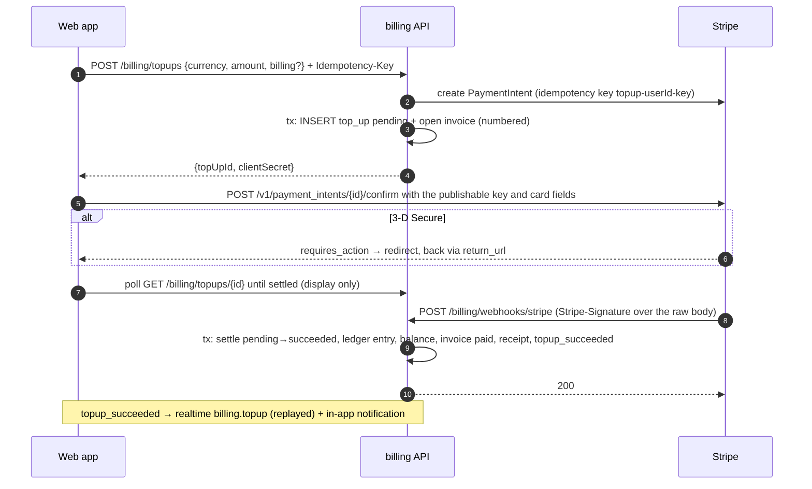
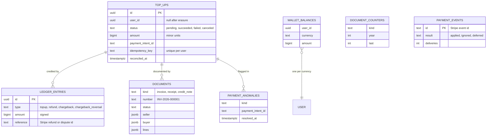
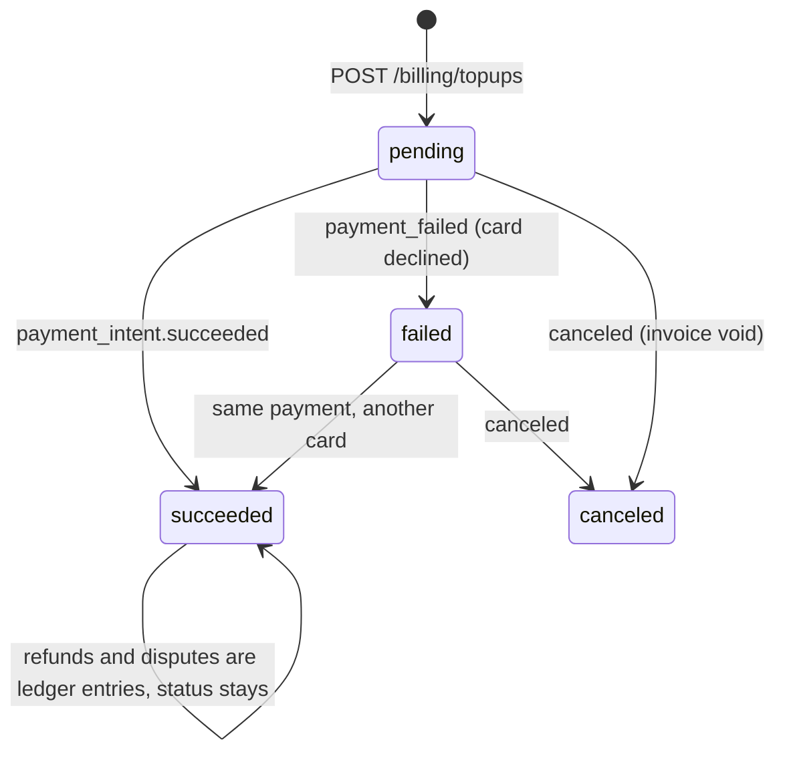

# 9. Billing: topping up a wallet with Stripe

Money only moves on Stripe's word, exactly once, and never without its paper trail. This page covers the top-up flow, the ledger, idempotency at three levels, refunds and disputes, reconciliation, and the numbered documents.

← [Architecture overview](../architecture.md)

## Flow



- **The card never reaches the server.** The web app has its own card form and confirms the intent by calling Stripe's API directly with the publishable key (see [Web client](10-web-client.md#card-form)). Stripe must allow raw card data on the account.
- **The return page never credits anything.** Only the webhook (or reconciliation) does; the page the buyer lands on only polls the top-up.
- **The webhook route** has no bearer token. `parse: 'text'` keeps the raw body, and `constructEventAsync(rawBody, signature, secret)` is the authentication. A bad signature is `400 invalid_signature`.

## The data



- **Integers only.** Amounts are integers in the currency's smallest unit (cents, whole dong).
  - `@app/shared-types` (`TOPUP_CURRENCIES`) lists the offered currencies with min, max and presets.
  - The API enforces the range; the web app only reads it for presets.
  - One balance per currency, no conversion.
- **The ledger is append-only.** The balance is a cached sum, updated in the same statement sequence as the entry.

## Exactly once, at every level

### 1. Starting a top-up is idempotent

`POST /billing/topups` takes an optional `Idempotency-Key` header (8–64 characters of `A-Za-z0-9_-`).
- Same user + same key + same body returns the first top-up and a fresh client secret instead of creating a second payment.
- The key, scoped to the user (`topup-${userId}-${key}`), is also **Stripe's idempotency key**. Two requests racing therefore reach the same PaymentIntent. The loser's insert hits the unique `(user_id, idempotency_key)` index, and it reloads the winner.
- The same key with another amount or currency is `409 idempotency_key_reused`: a key stands for one request, so reusing it for another is a client bug, not a retry.
- The web form keeps one key per choice of currency, amount and invoice details, and makes a new one when the choice changes.

### 2. Settling is a conditional move

```ts
export const SETTLEABLE_FROM = {
  succeeded: ['pending', 'failed'],
  failed: ['pending'],
  canceled: ['pending', 'failed'],
} as const
```



- The repository applies the move as `UPDATE … WHERE id = ? AND status IN (from) RETURNING`.
- `findByPaymentIntent` takes `FOR UPDATE`, so a second delivery of the same event waits for the first to commit and then finds the top-up already settled.
- A late `failed` after `succeeded` matches nothing and is ignored.

### 3. Booking is unique

Inside the same transaction, `HandlePaymentEvent` (`application/use-cases/handle-payment-event.ts`) settles the top-up, then:
- posts the ledger entry;
- updates the balance;
- issues the receipt;
- writes `billing.topup_succeeded.v1`.

```ts
const booked = await db.insert(ledgerEntries).values(entry).onConflictDoNothing().returning({ id })
if (booked.length === 0) return null            // already booked: the balance must not move twice
const [row] = await db.insert(walletBalances).values({ userId, currency, amount: entry.amount, ... })
  .onConflictDoUpdate({ target: [userId, currency], set: { amount: sql`${walletBalances.amount} + ${entry.amount}` } })
  .returning({ amount: walletBalances.amount })
```

Two partial unique indexes make a repeat a no-op:
- `(top_up_id, type) WHERE type = 'topup'`;
- `(type, reference) WHERE reference IS NOT NULL` (one refund or dispute id is booked once).

→ [Idempotent webhooks and a money ledger](../patterns/idempotent-webhooks-and-money-ledger.md)

## Never trust the amount twice

- **The webhook's amount and currency must equal the top-up's**, or nothing is credited. Stripe's `amount_received` is used for success.
- **Money that cannot be explained** is written to `billing.payment_anomalies` (unique per payment and kind, `ON CONFLICT DO NOTHING`) and logged at `error`. Nothing is fixed automatically; a person looks. The kinds:
  - `unknown_payment`: a success naming a top-up we do not have;
  - `amount_mismatch`;
  - `paid_after_erasure`;
  - `adjustment_mismatch`: a refund in another currency;
  - `negative_balance`.
- **Every event is recorded** in `billing.payment_events` with its result and number of deliveries, to answer "why was this not credited?".

## Refunds and disputes

They adjust a settled top-up through the same webhook path. The top-up itself stays `succeeded`.

| Stripe | Ledger entry | Document |
| --- | --- | --- |
| `refund.created` / `refund.updated`, counted only once the refund is `succeeded` | `refund`, negative | Credit note against the invoice |
| `charge.dispute.created` / `updated` (not won) | `chargeback`, negative | Credit note |
| `charge.dispute.closed` with status `won` | `chargeback_reversal`, positive | The credit note is voided |
| Disputes in a `warning_*` status | ignored | — |

The mapping lives in `StripePaymentGateway` (`infrastructure/stripe-payment-gateway.ts`). Its event list must stay in step with `EVENTS` in `scripts/stripe.ts`, which tells the Stripe CLI what to forward.

- **Out-of-order events are bounced back.** An adjustment that arrives before its payment is settled, or a reversal before the dispute's opening was booked, returns `deferred`. The route turns that into `409 payment_not_settled_yet`, so **Stripe delivers it again later**.
- **A balance may go below zero.** The money really left, so the debit is booked anyway and raises a `negative_balance` anomaly.

## A lost webhook is made up for

`ReconcileTopUps.runOnce` runs on a worker timer (`BILLING_RECONCILE_INTERVAL_SECONDS`):
1. It claims open top-ups (`pending`, or `failed` and still completable) older than `BILLING_SETTLE_GRACE` and younger than `BILLING_RECONCILE_MAX_AGE`, with `FOR UPDATE SKIP LOCKED` inside an `UPDATE … SET reconciled_at = now()`. Instances and passes therefore do not repeat each other.
2. It asks Stripe for each PaymentIntent.
3. It feeds the answer through **the same `HandlePaymentEvent`** as the webhook, with a stable id `reconcile:<pi>:<outcome>`. The two paths cannot double-credit, and the audit trail shows one row however many passes saw it.

## Invoices, receipts and credit notes

- **Issued in the same transaction as the money movement** they document, by `DocumentIssuer`. There is never a wallet change without its paper, nor the reverse.
  - Starting a top-up stores an `open` **invoice**.
  - The crediting webhook marks it `paid` and issues one **receipt**.
  - A declined card leaves the invoice open; a canceled payment makes it `void`.
  - A refund or a lost dispute issues a **credit note** against it, once per Stripe refund or dispute id; winning the dispute voids the credit note.
  - A top-up that began before invoices existed is billed, already paid and with a blank buyer, when it succeeds.
- **Immutable snapshots.** Seller (`SELLER_NAME`, `SELLER_ADDRESS`, `SELLER_TAX_ID`, `SELLER_EMAIL`), buyer and lines are frozen as jsonb when issued. Only an invoice's or credit note's `status` moves. `BillingDocument.issue` checks that the lines sum to the amount.
- **The buyer is resolved before the transaction** through the `IdentityApi` and `ProfileApi` contracts (the profile name and account email), or from the company name, tax id and address typed in the optional `billing` object. A failure costs the name, not the top-up.
- **Gapless numbers** (`INV-2026-000001`, `RCT-…`, `CN-…`), consecutive per kind and year:
  ```ts
  .insert(documentCounters).values({ kind, year, last: 1 })
  .onConflictDoUpdate({ target: [kind, year], set: { last: sql`${documentCounters.last} + 1` } })
  .returning({ last: documentCounters.last })
  ```
  - The counter row stays locked until the money transaction commits, and a rollback gives the number back. So there are no gaps, at the cost of documents of one kind being issued one transaction after the other.
  - The issuer checks whether a document already exists *before* taking a number, so a repeated webhook does not burn one.
- **Reading.** `GET /billing/documents` (filter by `kind` or `topUpId`, cursor paging) and `GET /billing/documents/:id`. The web app renders a printable page for each, which the browser saves as a PDF. No tax is computed: the amount is the total.

→ [Gapless document numbering](../patterns/gapless-document-numbering.md)

## Erasure keeps the records

A payment is a financial document. Erasing an account:
- sets `user_id` to null on its top-ups, ledger entries and documents;
- blanks the buyer (name, email, address, tax id), keeping seller, number and amount;
- deletes the balances.

Nothing points back to the person. Stripe keeps its own copy, with the user id in the payment's metadata, under its retention rules. A user's data export includes their documents.

## Configuration and local tooling

- **Off without keys.** `STRIPE_SECRET_KEY`, `STRIPE_PUBLISHABLE_KEY` and `STRIPE_WEBHOOK_SECRET` are set together or not at all (config validation). Without them, balances and history still read, and top-ups answer `404 billing_disabled`.
- **`bun run dev`** also runs the Stripe CLI forwarding webhooks to the API when `STRIPE_SECRET_KEY` is set (`scripts/stripe.ts`). It uses the `stripe` binary if installed, otherwise the `stripe-cli` compose service, with the forwarding host chosen to match.
- **`bun run stripe:secret`** prints the signing secret for `STRIPE_WEBHOOK_SECRET` and warns when `.env` holds a different one.
- **`bun run test:stripe`** pays with Stripe's test cards against the running stack (`apps/api/scripts/stripe-smoke.ts`).

## Patterns used here

- [Idempotent webhooks and a money ledger](../patterns/idempotent-webhooks-and-money-ledger.md)
- [Gapless document numbering](../patterns/gapless-document-numbering.md)
- [SKIP LOCKED work claiming](../patterns/skip-locked-work-claiming.md) (reconciliation)
- [Transactional outbox](../patterns/transactional-outbox.md)
