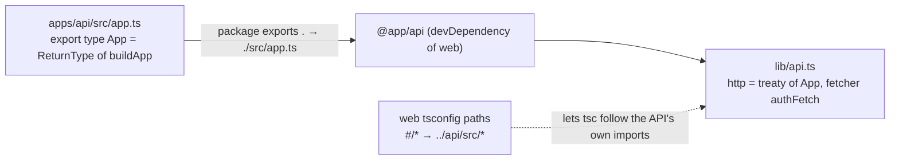
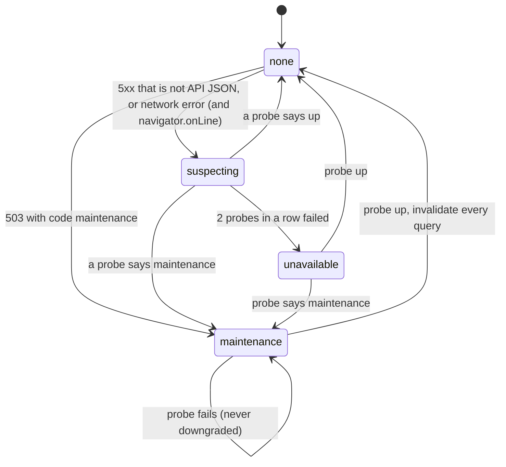

# 10. Web client

`apps/web` is a React SPA (Vite, TanStack Router and Query, Tailwind). It talks to the API through a client whose types are inferred from the API itself, keeps live state in sync over SSE, and degrades gracefully when the API is in maintenance, unreachable, or the device is offline.

← [Architecture overview](../architecture.md)

## End-to-end types with no codegen



- `import type { App } from '@app/api'` resolves to the API's source, so a route's params, body, query and response types reach the components with no generator step.
- `apps/web/tsconfig.json` maps `#/*` to `../api/src/*`, because the API's files import each other through `#/`. Vite never needs it, since only types cross.
- Side effect: `bun --filter` saw web depend on the API and waited for the API's `dev` script, which never exits. `scripts/dev.ts` runs the workspaces with `--parallel` (commit `771a9f3`).
- The CI image filter for `web` includes `apps/api/**` for the same reason.

## Runtime config

`index.html` starts fetching `/config.json` with an inline script while the bundle downloads (`window.__config`). `main.tsx` awaits it, then imports the app and router dynamically and runs `router.load()` before the first render. One build therefore serves every environment, and nginx serves `config.json` with `no-store`.

Two more details:
- The theme is applied by an inline script before first paint, so there is no flash.
- The boot splash only fades in after 0.4 s, so fast loads show nothing.

## Requests: `authFetch`

`lib/api.ts`:
- Sends `Authorization: Bearer <access token>` from an in-memory `authStore`. The token is never stored in `localStorage`, which keeps it off the XSS surface. The refresh token is the httpOnly cookie.
- Sends `Accept-Language: <current locale>` on every request, and `credentials: 'include'`.
- On a 401 that is not `/api/auth/*`, when a token exists, it calls `refreshSession()` and **retries once**.
- Hands every response and every network failure to the outage detector (below) without delaying the caller.
- In development only, adds 300–800 ms of fake latency to mutations, so optimistic UI is visible. It is skipped under `navigator.webdriver`.

**Single-flight refresh** (`lib/session.ts`). Many requests hitting 401 together refresh once, because the refresh token rotates and parallel refreshes would trip reuse detection:

```ts
let inflight: Promise<boolean> | null = null

export function refreshSession(): Promise<boolean> {
  inflight ??= (async () => {
    try {
      let res = await postRefresh()   // raw fetch, not the api client: no interceptor loop
      // Another tab of this browser rotated the token a moment ago; the server kept the cookie its response set.
      // Give that response time to land, then try once more with the current cookie.
      if (res.status === 401 && (await errorCode(res)) === 'refresh_token_rotated') {
        await new Promise((resolve) => setTimeout(resolve, ROTATED_RETRY_MS))   // 300 ms
        res = await postRefresh()
      }
      if (!res.ok) { clearSession(); return false }
      applySession((await res.json()) as SessionResponse); return true
    } catch { clearSession(); return false } finally { inflight = null }
  })()
  return inflight
}
```

Across tabs, single flight does not help: two tabs can still refresh at once. The losing one gets `401 refresh_token_rotated` (the server leaves the cookie alone), waits 300 ms for the winner's `Set-Cookie` to land, and retries once.

→ [Single-flight token refresh](../patterns/single-flight-token-refresh.md)

**Errors.**
- `unwrap()` throws `ApiError(code, message, status)`. The message is `t('errors.<code>')` when the catalog knows the code, else the server's English text, else a generic line.
- Shared limits (`DISPLAY_NAME_MAX`, …) are interpolated into the messages.
- The query client never retries an `ApiError` with status < 500, and retries others up to twice.

`lib/once.ts` is a keyed once-per-key promise, so a one-time magic-link token is not consumed twice by React StrictMode's double effects.

## SSE over fetch

`lib/realtime.ts` reads the stream with `fetch`, because `EventSource` cannot send `Authorization`.
- `readStream` splits on blank lines, `parseFrame` reads `event:`/`data:`/`id:`, and heartbeat comments are skipped.
- **Cursor.** It is taken from `ready.data.cursor`, then from each event's `id`, and sent back as `last-event-id` on reconnect.
- **Outcomes** of one connection are `'again' | 'retry' | 'stop'`:
  - a 401 refreshes the session and reconnects at once, or stops if the refresh fails;
  - the connection's own `session.revoked` means stop;
  - anything else backs off `min(1000 · 2^attempt, 15 s)`, with the attempt counter reset on `ready`.
- The sleep between attempts can be aborted, so signing out ends it at once.

**Patching the query cache from events** (`features/realtime/use-live-session.ts`, `features/notifications/live-cache.ts`):

| Event | Effect |
| --- | --- |
| `ready` | Invalidate devices, notifications, privacy and billing: non-replayable events missed while away are recovered by refetching |
| `session.revoked` for this session | `signOutHere()`: clear the session and `queryClient.clear()` |
| `session.revoked` for another session | Refetch the device list |
| `notification.created` | `applyCreated`: insert on page 0, or replace in place if the id exists (a fold); refetch only the two counts |
| `notification.read` | `applyRead`: flip `read` for one id, or all when `null` |
| `notification.seen` | Invalidate the badge count |
| `privacy.deletion.progress` with `done === total` | Sign out (the account is gone) |
| `billing.topup` | Refetch wallet and history |

Toasts for new notifications are throttled like the server's pushes: one per 30 s, security alerts always shown.

## Optimistic writes

Mark read, mark all read, sign out a device and sign out other devices update the cache first, roll back from a snapshot if the request fails, and resync with the server **only when the last in-flight mutation of that kind settles**:

```ts
const refetch = () => {
  if (queryClient.isMutating({ mutationKey: READ_KEY }) <= 1)
    void queryClient.invalidateQueries({ queryKey: ['notifications'] })
}
// useMutation({ mutationKey: READ_KEY, onMutate: readOptimistically, onError: (_, __, undo) => undo?.rollback(), onSettled: refetch })
```

- An earlier refetch would land while a later optimistic update is still in flight and undo it on screen.
- `readOptimistically` cancels the queries, snapshots everything under `['notifications']`, and decrements unread only if the item really was unread.
- Forms, uploads and the push toggle stay **pessimistic**: the server can reject them, or the browser must answer first.

→ [Optimistic mutations with rollback](../patterns/optimistic-mutations-with-rollback.md)

## Edit conflicts

The profile form sends `If-Match: <version>`, and a mismatch is `409 version_conflict` (`features/profile/edit-profile-form.tsx`).
- The form keeps `base`, the server version being edited. When the cached profile changes underneath, an untouched form resets; an edited one is rebased only when the fields it shows did not change.
- On a 409, it fetches the latest version with `staleTime: 0`:
  - if the fields this form shows did not change elsewhere, it **silently retries** on the new version;
  - otherwise it shows `ConflictNotice` with a field-by-field comparison, and "load latest" or "overwrite".
- What the user typed is never lost (commit `da39e05`).

→ [Optimistic locking with a version column](../patterns/optimistic-locking-with-version.md)

## Step-up as a promise

`features/auth/step-up.ts` turns `403 step_up_required` into a dialog that resolves a promise:
- `withStepUp(action)` runs the action, opens the confirm dialog on that error, and retries **once** after confirmation;
- the dialog opens once however many actions are waiting;
- cancelling throws `StepUpCancelled`, which callers ignore quietly.

## Outage detection

The app must tell apart "a deploy is running", "the API is unreachable", "this request failed" and "you are offline", and show a blocking dialog only for the first two.



`lib/maintenance.ts`:
- `watchResponse(res)` reads `res.clone().json()`, so it never consumes the caller's body.
  - An API error code other than `maintenance` means the API is up and this is an ordinary failure.
  - Non-JSON means a proxy talking (nginx's 502/504 page, the dev proxy's empty 500), which only makes the app *check*.
- `suspectOutage` does nothing while `navigator.onLine === false`, because the user's own connection is the likely culprit. It is de-duplicated, so many failing requests start one check, and it needs `CONFIRM_PROBES = 2` failed probes of `/health/ready` before showing anything.
- While the dialog is up, the app probes every 2 s. `/health/ready` answers 200 in maintenance, so the probe can tell maintenance from down. A failing probe never turns `maintenance` back into `unavailable`, so a deploy reads "updating", not "can't reach the server".
- `MaintenanceDialog` is a native `<dialog role="alertdialog">` with no close path: no Esc, no backdrop click, no button. When it closes, `queryClient.invalidateQueries()` refetches everything.

**Offline page** (`public/sw.js`, commit `3814fb9`).
- The service worker precaches `/offline.html` on install (`cache: 'reload'`) and calls `skipWaiting`. On activate it deletes old caches and calls `clients.claim`.
- It serves the page **only for navigations whose fetch rejects**. A 502 or 503 passes through, because those belong to the dialog.
- `offline.html` is self-contained: theme and language from `localStorage`/`navigator.languages`, inline en/vi strings, and it reloads on `online`.
- The worker is registered on every load, after the first render. Otherwise a first visit made while offline would find nothing to serve it.

→ [Outage detection and offline fallback](../patterns/outage-detection-and-offline-fallback.md)

## Card form

The app has its own card form instead of Stripe.js (commit `a443ab8`).

`lib/stripe.ts` `confirmCardPayment`:
- POSTs form-encoded `payment_method_data[card][…]` to `https://api.stripe.com/v1/payment_intents/{id}/confirm`, with the **publishable key** as the bearer.
- Takes the intent id from `clientSecret.split('_secret_')[0]`.
- Maps the result: `requires_action` with `redirect_to_url` → redirect (3-D Secure); `succeeded` or `processing` → done.

`lib/card.ts` handles the input:
- Luhn check;
- Amex 4-6-5 grouping and a 4-digit CVC;
- expiry auto-padding (`4` → `04 / `), valid through the last day of the month.

The idempotency key is kept per choice: the invoice details are part of the "choice" because the server keeps the first body it saw for a key.

```ts
const keyFor = (c, a) => {
  const choice = JSON.stringify([c, a, billing])
  if (attempt.current?.choice !== choice) attempt.current = { choice, key: crypto.randomUUID() }
  return attempt.current.key
}
```

`lib/money.ts` reads the number of decimals from `Intl.NumberFormat(...).resolvedOptions().maximumFractionDigits`, so amounts stay in minor units everywhere.

## Smaller touches worth copying

- **Crop before upload** (`lib/crop.ts`, `features/profile/image-crop-dialog.tsx`, commit `7560ffe`).
  - Only the cropped canvas is uploaded (512 px avatar, 1600 px cover, WebP 0.9), so a 20 MB phone photo is fine.
  - `clampCrop` keeps the frame inside the image, so there is never an empty strip.
  - Wheel zoom is exponential, through a native `wheel` listener with `{ passive: false }` (React's is passive). Dragging uses pointer capture, and arrows and +/- work from the keyboard.
- **Theme reveal** (`lib/theme.ts`).
  - Uses `document.startViewTransition`. The new root animates a radial-gradient mask from the click point to the farthest corner (`Math.hypot`), with a feathered edge and a blur crossfade.
  - It is skipped with `prefers-reduced-motion`, when unsupported, or when the resolved look does not change. It follows other tabs through the `storage` event.
- **Push permission.** `lib/push.ts` asks the Permissions API before `Notification.permission`, because headless Chromium misreports the latter.

## Patterns used here

- [Single-flight token refresh](../patterns/single-flight-token-refresh.md)
- [Optimistic mutations with rollback](../patterns/optimistic-mutations-with-rollback.md)
- [Outage detection and offline fallback](../patterns/outage-detection-and-offline-fallback.md)
- [Optimistic locking with a version column](../patterns/optimistic-locking-with-version.md)
- [Postgres pub/sub with replay](../patterns/postgres-pubsub-with-replay.md) (client half)
