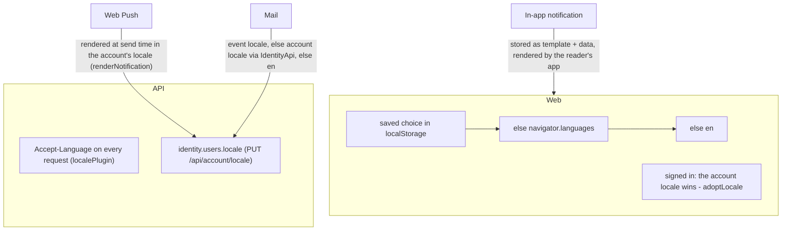

# 11. Languages (i18n)

English and Vietnamese, everywhere a user reads text: the app, in-app notifications, Web Push and mail. The rule that makes it work is to **decide the language as late as possible**, and to store data rather than sentences.

← [Architecture overview](../architecture.md)

## One list of languages

`packages/shared-types/src/i18n.ts` is shared by API and web:
- `LOCALES = ['en', 'vi'] as const` and `DEFAULT_LOCALE = 'en'`;
- `LOCALE_NAMES`, each name written in its own language;
- `isLocale`;
- `matchLocale('vi-VN') → 'vi'`;
- `negotiateLocale(acceptLanguage)`, q-weighted with a stable order. The API runs it on `Accept-Language`, and the web runs it on `navigator.languages`.

Adding a language takes four things: a locale there, a catalog next to each of the two catalogs below, and a registration line in each `index`.

## Where each piece of text gets its language

### Web

`apps/web/src/i18n` uses i18next + react-i18next. Catalogs are TypeScript files in `locales/<lang>.ts`.
- `en.ts` is `as const`, and `i18next.d.ts` sets `CustomTypeOptions.resources = { translation: typeof en }`, so `t('profile.titel')` **fails to compile**.
- `vi.ts` ends with `satisfies Catalog`.
- `initAsync: false`, because catalogs are bundled.
- `<html lang>` is kept in sync, and a `storage` listener follows a language change made in another tab.
- Every API request carries the language as `Accept-Language`.
- The API's error `code` is translated by the web (`errors.<code>`), falling back to the server's English message for a code it does not know.

### Account language

`identity.users.locale` decides what **mail and notifications** are written in. It is set with `PUT /api/account/locale` and returned by `GET /api/me`.
- A new account starts with the language of the browser that created it.
- Signing in adopts the account's language in the app.
- Picking a language while signed in saves it on the account.

### In-app notifications store templates, not text

A notification row holds a `template` key (for example `passkeyAdded`) plus raw `data`: a name, a provider id, an ISO date, a user agent. `title` and `body` are empty strings. The web app writes the message from `notifications.templates.<name>`, so **changing the language also changes notifications that already exist**.

A custom notification has no template and keeps its text in `title`/`body`. So does a row from before templates, or a template this web build does not know yet; that is the fallback.

Adding a template means three edits:
1. A key in `TEMPLATES` in `notification/application/in-app-notifications.ts`, which also renders it for Web Push.
2. Its entry in both web catalogs.
3. A line in `features/notifications/text.ts`.

→ [Store templates, not text](../patterns/store-templates-not-text-i18n.md)

### Web Push

A push leaves the app as finished text, so the server writes it at send time from the same template and data, in the account's language **at that moment** (`renderNotification`).

### Mail

Mail is written server-side (`notification/application/messages`), because it leaves the request. The language is chosen in this order:
1. The event's own `locale`, when it carries one:
   - a magic link follows the page that asked for it;
   - privacy events carry the account's language;
   - the deletion ledger keeps it for the goodbye mail sent after the account is gone.
2. Otherwise the account's locale, looked up through `IdentityApi` (`IdentityLocaleResolver`).
3. Otherwise English.

`compose()` renders text and HTML from one key. All values are escaped; only an explicit `markup` map injects HTML.

## Catalog parity is a test

`diffCatalogs(base, other)` (`packages/shared-types/src/i18n-catalog.ts`):
- flattens both catalogs to keys;
- folds plural suffixes (`_one`, `_other`, …) into one key, so a Vietnamese catalog with only `_other` passes;
- compares the `{{placeholder}}` sets, ignoring `count`;
- reports `missing:`, `unknown:` and `placeholders differ:`.

A unit test on each side runs it (`apps/web/src/i18n/catalogs.test.ts` and `apps/api/src/bootstrap/messages.test.ts`), so a missing key or a dropped placeholder fails CI.

## Patterns used here

- [Store templates, not text](../patterns/store-templates-not-text-i18n.md)
