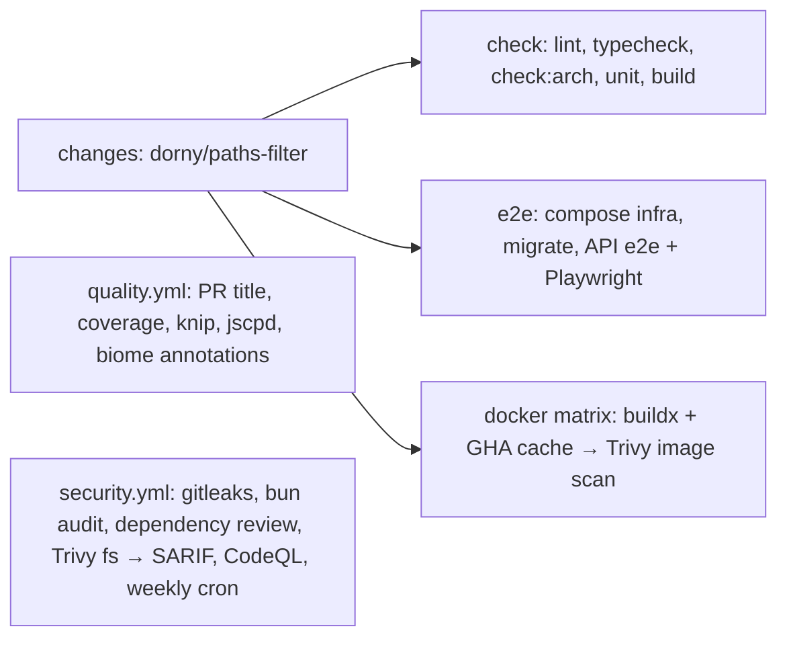

# 12. Testing and CI

The architecture pays for itself in tests. Use cases depend on ports, so they run against in-memory fakes in milliseconds. The composition root is a function, so e2e tests build the real app without a listener. CI runs only what a change can affect.

← [Architecture overview](../architecture.md)

## The test pyramid

| Level | Command | What it proves |
| --- | --- | --- |
| Domain + use cases | `bun run test` | Business rules and orchestration against in-memory fakes, with no I/O. Privacy's choreography runs here end to end with a hand-rolled relay, including a participant that "lives in another service" and one that fails or goes silent. |
| Architecture | `bun run check:arch` | The layer and module rules ([Modules and boundaries](01-modules-and-boundaries.md)) |
| API e2e | `bun run test:e2e` (api) | The real app against real Postgres, S3 and Mailpit: full flows, outbox retry and dead-letter, mail throttling, SSE, Web Push (fake sender), privacy (a real zip from S3, erasure across modules, the jobs on the real tables), billing with a fake gateway |
| Web unit | `bun test src` (web) | Outage detection, card validation, money formatting, catalog parity |
| Web e2e | `bun run test:e2e` (web) | Playwright journeys: sign-in, passkeys, profile, realtime sign-out, notifications, i18n, billing, maintenance, offline |
| Hygiene | `lint`, `quality:unused`, `quality:dup` | Biome, knip (dead code and dependencies), jscpd (duplication) |

## Unit tests and fakes

Tests sit next to the code (`src/**/*.test.ts`). `apps/api/src/shared/testing/fakes.ts` provides:

| Fake | Behaviour |
| --- | --- |
| `FakeClock` | Fixed time with `advance(ms)`; returns copies, so tests cannot mutate "now" by accident |
| `SequentialIds` | UUIDv7-shaped (`00000000-0000-7000-8000-…`), so ordering by id still works |
| `InMemoryOutbox` | Collects events; `types()` for assertions |
| `PassthroughUnitOfWork` | Runs the function, no transaction |
| `FakeStorage` | Tracks metadata and bytes separately, plus a `deleted` log |
| `InMemoryInbox` | Marks a key as processed only after `fn` succeeds, like a rolled-back transaction |

Repositories are faked inline per test file (for example `MemUsers` in `identity.use-cases.test.ts`), which keeps each fake as small as its test. `shared/testing` is the only part of `shared` allowed to import modules.

## API e2e harness

`apps/api/tests/e2e/helpers.ts`:

```ts
const config = loadConfig({ ...process.env, OUTBOX_POLL_INTERVAL_MS: '200', LOG_LEVEL: 'silent',
  MAIL_RATE_PER_SECOND: '200', PUSH_QUIET_WINDOW_SECONDS: '0', ...env })
const container = await createContainer(config, logger, overrides)
container.startWorker()
const app = buildApp(container)        // no listen(): requests go through app.handle(new Request(...))
```

- **The real composition root** with real infrastructure. `ContainerOverrides` swaps only what cannot run locally: the mailer (or Mailpit), the Web Push sender, WebAuthn, OAuth, the payment gateway, and the maintenance store.
- **`client()`** sends a random `x-forwarded-for` per test, so per-IP limits do not bleed between tests, and it carries the refresh cookie across calls.
- **`eventually()`** polls for asynchronous outcomes: an outbox row marked published, a mail in Mailpit, a notification row.
- **An SSE client over `app.handle`** reads the stream frame by frame.
- **`software-authenticator.ts`** is a software WebAuthn authenticator (ES256, `none` attestation). Its `syncedPasskey` mode always reports counter 0.
- Lessons from the history:
  - the profile row is created asynchronously after sign-up, so a first save can race it (commit `a67d268`);
  - a mail can arrive before the relay marks its row published, so tests poll `publishedAt` (commit `acb6eb5`).
- These suites share the database and outbox with a running `bun run dev`. Stop the dev server before running them, or web-push, mail-throttling and tracing can fail at random.

## Playwright

`apps/web/playwright.config.ts`:
- `webServer` starts the API (waiting on `/api/health/live`) and Vite, reusing them if already running.
- One worker, not parallel. On CI: 2 retries and a 10 s expect timeout. Traces are kept on failure.
- Every request sends `x-forwarded-for: TEST_IP`.

The specs worth reading:
- **Mailpit helpers** (`e2e/support.ts`): `linkFromMail` and `codeFromMail` poll the Mailpit search API, so magic links and step-up codes are read from real mail.
- **Passkeys** use Chromium's virtual authenticator through CDP (`security.spec.ts`).
- **Maintenance** (`maintenance.spec.ts`) fakes `/health/ready` and 503/502 responses with `page.route`, and asserts that Escape and backdrop clicks do not close the dialog.
- **Offline** (`offline.spec.ts`) waits for `caches.match('/offline.html')`, reloads so the service worker controls the page, then toggles `context.setOffline`.

## Quality gates

- **Biome** (`biome.json`): single quotes, no semicolons, width 100, cognitive complexity limit 15 (warn), `noFloatingPromises` and `noMisusedPromises`, security rules as errors.
- **knip** has entry points per workspace (scripts, e2e).
- **jscpd** uses at least 10 lines / 70 tokens with a 3 % threshold, ignoring generated and UI-kit code.
- **Coverage threshold** of 0.85 lines and functions (`apps/api/bunfig.toml`).
- **gitleaks** with an allowlist for the public Web Push example keys used as fixtures.

## CI on GitHub Actions



**Path gating by the pushed range** (`.github/actions/changes/action.yml` + `.github/filters.yml`):
- Pull requests and pushes are filtered. A push is diffed against `github.event.before`, so **every commit in the pushed range counts**, not only the last one.
- A schedule, a manual run, or a push with no usable `before` (a new branch) reports everything as changed. Missing information means "run it all".
- The outputs `code`, `deps`, `e2e` and a `docker_matrix` (built with `jq`) gate the jobs. `image_web` includes `apps/api/**`, because the web image compiles against the API's types.

**Concurrency.** Only PR runs cancel each other: `group: ci-${{ PR ? ref : sha }}`. A push run is diffed against the previous push, so cancelling one would leave its changes unchecked forever.

**On e2e failure**, CI uploads Playwright traces and dumps `docker compose logs`.

**Dependabot** covers bun, actions and docker, and ignores TypeScript majors. TS 7 is a Go binary pulled into the production image through Elysia's peer dependency, and Trivy flags its Go standard library.

## Patterns used here

- [Enforced architecture boundaries](../patterns/enforced-architecture-boundaries.md)
- [Idempotent consumer (inbox)](../patterns/idempotent-consumer-inbox.md) (requeue-safety is tested e2e)
