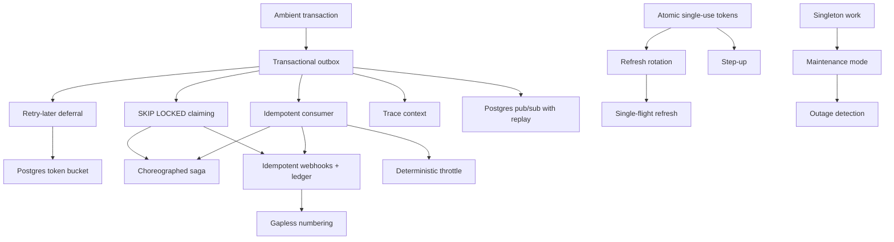

# Pattern catalog

Techniques from this codebase written as **standalone recipes** that can be lifted into other projects. Each page has the same sections: problem, when to use, solution (with a diagram), implementation (real code from this repo), edge cases and pitfalls, variations, where it lives here, and a reuse checklist.

For how these fit together in *this* system, see the [architecture overview](../architecture.md).

Most backend patterns need only **Postgres**: no Redis, no broker. That is a deliberate choice, and it is fine up to a moderate scale; each page says where it stops being fine.

## Data and messaging

| Pattern | Problem in one line | Use when |
| --- | --- | --- |
| [Transactional outbox](transactional-outbox.md) | State change and event must both happen or neither | Anything async after a write |
| [Idempotent consumer (inbox)](idempotent-consumer-inbox.md) | At-least-once delivery must take effect once | Every handler |
| [Retry-later deferral](retry-later-deferral.md) | Rate limits should not count as failures | Calling throttled providers from a queue |
| [Ambient transaction with AsyncLocalStorage](ambient-transaction-async-local-storage.md) | Use cases need transactions without knowing the ORM | Layered Node/Bun backends |
| [Trace context across async hops](trace-context-across-async-hops.md) | One trace from click to mail, through queues | Outbox / queue / jobs with OpenTelemetry |

## Concurrency

| Pattern | Problem in one line | Use when |
| --- | --- | --- |
| [SKIP LOCKED work claiming](skip-locked-work-claiming.md) | N workers on one table without double work | Table-as-queue, scheduled jobs |
| [Singleton work in a cluster](singleton-work-in-a-cluster.md) | Exactly one runner, without a coordinator | Cleanups, deploys, per-key ordering, timers |
| [Optimistic locking with a version column](optimistic-locking-with-version.md) | Lost updates from concurrent edits | Forms, read-modify-write aggregates |
| [Atomic single-use tokens](atomic-single-use-tokens.md) | A link or code must work exactly once | Magic links, challenges, OAuth state, codes |

## Security

| Pattern | Problem in one line | Use when |
| --- | --- | --- |
| [Refresh-token rotation with reuse detection](refresh-token-rotation-reuse-detection.md) | Stolen refresh tokens go unnoticed | Cookie sessions with short JWTs |
| [Step-up authentication](step-up-authentication.md) | A stolen session should not reach sensitive actions | Email change, sign-in methods, export, deletion |
| [Presigned upload, then verify](presigned-upload-then-verify.md) | Presigned PUTs cannot enforce size, type or ownership | Direct-to-S3 uploads |
| [Outbound URL SSRF guard](outbound-url-ssrf-guard.md) | The server calls a URL the user gave | Web Push, user webhooks |

## Delivery

| Pattern | Problem in one line | Use when |
| --- | --- | --- |
| [Postgres token-bucket rate limit](postgres-token-bucket-rate-limit.md) | One provider limit shared by N instances | Mail, SMS, partner APIs |
| [Postgres pub/sub with replay](postgres-pubsub-with-replay.md) | Live updates across instances; don't lose the important ones | SSE without Redis |
| [Deterministic throttle on retry](deterministic-throttle-on-retry.md) | "Alert at most once per window" inside a retried handler | Push and toast throttling, digests |

## Workflows and money

| Pattern | Problem in one line | Use when |
| --- | --- | --- |
| [Choreographed saga with a ledger](choreographed-saga-with-ledger.md) | A job that must reach every module or service and finish | GDPR export and erasure, offboarding |
| [Idempotent webhooks and a money ledger](idempotent-webhooks-and-money-ledger.md) | Credit exactly once from unordered, repeated, lost events | Payments, payouts, credits |
| [Gapless document numbering](gapless-document-numbering.md) | Consecutive invoice numbers with no gaps | Invoices, receipts, credit notes |

## Ops and tooling

| Pattern | Problem in one line | Use when |
| --- | --- | --- |
| [Maintenance mode and soft deploys](maintenance-mode-soft-deploy.md) | Migrate with nothing writing, without hard kills | Self-hosted deploys with migrations |
| [Enforced architecture boundaries](enforced-architecture-boundaries.md) | Layer and module rules erode silently | Any layered or modular codebase |

## Frontend

| Pattern | Problem in one line | Use when |
| --- | --- | --- |
| [Single-flight token refresh](single-flight-token-refresh.md) | Parallel 401s trigger parallel refreshes | SPAs with rotating refresh tokens |
| [Optimistic mutations with rollback](optimistic-mutations-with-rollback.md) | Instant UI without flicker or stale rollbacks | Mark read, delete, toggle |
| [Outage detection and offline fallback](outage-detection-and-offline-fallback.md) | Tell deploy vs down vs one bad request vs offline | SPAs on self-deployed APIs |
| [Store templates, not text](store-templates-not-text-i18n.md) | Stored messages frozen in the wrong language | Notifications, feeds, audit logs |

## How the patterns combine

