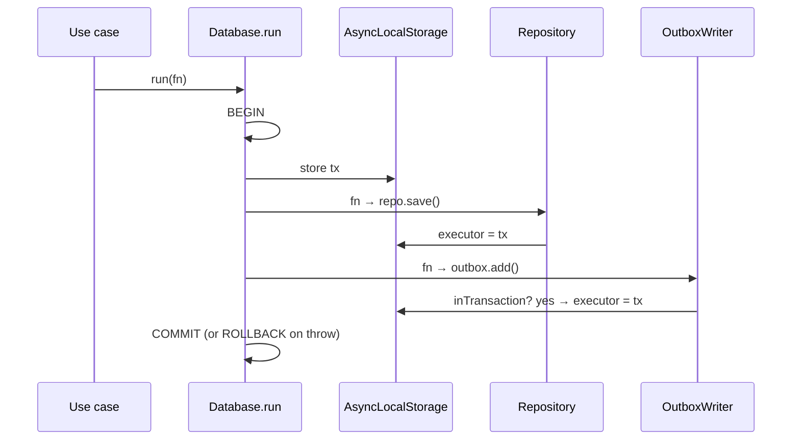

# Ambient transaction with AsyncLocalStorage

← [Pattern catalog](README.md) · Category: Data & messaging

## Problem

Use cases should say "these writes are one transaction" without knowing what a transaction is: no `tx` parameter threaded through every repository method, no Drizzle in the application layer. Repositories, the outbox writer and the inbox guard must all join whatever transaction is open, and must refuse (or fall back to the pool) when none is.

## When to use

Node/Bun backends with a layered or hexagonal design, where repositories are injected once at startup but must run inside a per-call transaction.

## Solution

Keep the current transaction in an `AsyncLocalStorage`. A `UnitOfWork.run(fn)` port opens a transaction and runs `fn` inside the storage. Every adapter asks `database.executor` for "the transaction if one is open, else the pool". A nested `run` **joins** the outer transaction.



## Implementation

```ts
export class Database implements UnitOfWork {
  private readonly txStorage = new AsyncLocalStorage<Executor>()

  /** The current transaction if inside `run`, otherwise the pool. */
  get executor(): Executor { return this.txStorage.getStore() ?? this.db }
  get inTransaction(): boolean { return this.txStorage.getStore() !== undefined }

  /** When nested, joins the outer transaction (no savepoint). */
  async run<T>(fn: () => Promise<T>): Promise<T> {
    if (this.inTransaction) return fn()
    return this.db.transaction((tx) => this.txStorage.run(tx as unknown as Executor, fn))
  }
}
```

- The port the application sees is only `interface UnitOfWork { run<T>(fn: () => Promise<T>): Promise<T> }`.
- In unit tests it is `PassthroughUnitOfWork`, which just calls `fn`.
- `Executor` is `Pick<DrizzleDb, 'select' | 'insert' | 'update' | 'delete' | 'execute'>`, so a transaction and the pool are interchangeable to callers.

A small helper makes driver errors usable through the ORM's wrapping:

```ts
export function isPgError(err: unknown, ...codes: string[]): boolean {
  let current: unknown = err
  for (let depth = 0; depth < 3 && current; depth++) {
    const code = (current as { code?: string }).code
    if (code && codes.includes(code)) return true
    current = (current as { cause?: unknown }).cause
  }
  return false
}
```

## Edge cases and pitfalls

- **Nested `run` has no savepoint.** A throw anywhere rolls back everything, which is usually what you want. If an inner step must be allowed to fail, catch inside it or use an explicit savepoint.
- **Returning `null` instead of throwing commits.** Use it when a write must survive the error path. For example, revoking a token family on reuse commits, and *then* the use case throws 401 outside `run`.
- **Do not do slow I/O inside `run`** (HTTP to another service, S3 deletes, zipping). It holds a connection and row locks. Fetch before, act after.
- **Code that must be outside a transaction** (a `LISTEN` connection, a lock that must outlive it) should use the pool directly (`database.db`), not `executor`.
- **Fire-and-forget work started inside `run` inherits the store.** Do not start background work from inside a transaction.
- **One pool for all modules** means a transaction *can* cross module schemas. Keep it within one module by convention if you plan to split services.

## In this repo

- `apps/api/src/shared/infrastructure/db/database.ts` (`Database`, `isPgError`, `isUniqueViolation`)
- `apps/api/src/shared/application/ports/index.ts` (`UnitOfWork`)
- Commit `07f7187` replaced per-module databases with this single ambient transaction.

## Reuse checklist

- [ ] `UnitOfWork.run` port in the application layer
- [ ] `executor` getter used by every adapter
- [ ] The outbox writer asserts `inTransaction`
- [ ] Nested runs join; no slow I/O inside
- [ ] A passthrough fake for unit tests
