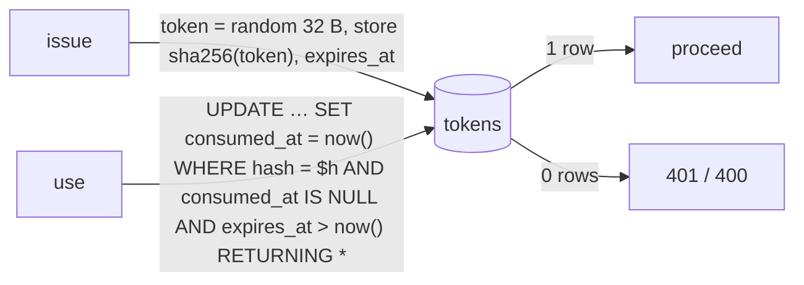

# Atomic single-use tokens

← [Pattern catalog](README.md) · Category: Concurrency / Security

## Problem

Magic links, email-change links, refresh tokens, WebAuthn challenges, OAuth `state` values and emailed codes must each work **once**, before they expire. A naive `SELECT` (is it unused?) followed by an `UPDATE` (mark it used) lets two concurrent requests both pass the check. Storing the raw token also means a database leak hands out working links.

## When to use

Any bearer secret that is consumed: links, codes, challenges, nonces, one-time download tokens.

## Solution

1. **Store only a hash** (`sha256` of a 32-byte random token). The raw value lives only in the URL or mail.
2. **Consume with one conditional statement** that checks unused + unexpired (+ purpose + owner) and marks it used. The row that comes back *is* the permission; no row means no.
3. **Clean up opportunistically**: delete long-expired rows on the next insert, instead of a cron job.



## Implementation

```ts
const [row] = await this.database.executor
  .update(magicLinks).set({ consumedAt: now })
  .where(and(eq(magicLinks.tokenHash, tokenHash),
             isNull(magicLinks.consumedAt), gt(magicLinks.expiresAt, now)))
  .returning()
```

**Bind the token to its context** in the `WHERE`, so it cannot be replayed into another ceremony:
- WebAuthn challenge: `id`, `purpose` (`register`/`login`/`step_up`), user.
- OAuth state: the hash of `state`, plus the stored `purpose` (`login`/`link`) and initiating user. The flow type is read from the row, never from the request.
- Step-up code: `user_id` and `attempts < max`. On a miss, increment `attempts` with the same "live" predicate.

```ts
const live = and(eq(stepUpCodes.userId, userId), isNull(stepUpCodes.consumedAt),
                 gt(stepUpCodes.expiresAt, now), lt(stepUpCodes.attempts, maxAttempts))
const [hit] = await ex.update(stepUpCodes).set({ consumedAt: now })
  .where(and(live, eq(stepUpCodes.codeHash, codeHash))).returning({ id: stepUpCodes.id })
if (hit) return true
await ex.update(stepUpCodes).set({ attempts: sql`${stepUpCodes.attempts} + 1` }).where(live)
```

**Prune on insert:** before inserting a challenge, `DELETE … WHERE expires_at < now() - interval '1 hour'`, backed by an index on `expires_at`.

## Edge cases and pitfalls

- **Consume before verifying** when verification is expensive or can fail (WebAuthn). A failed attempt still burns the challenge, so it cannot be retried with variations.
- **A consume inside a transaction that later rolls back un-consumes the token.** That is usually right: a magic-link verification that loses a race on creating the user rolls back, keeps its link, and retries once.
- **Short secrets need attempt limits.** A 6-digit code has 10^6 values: limit wrong guesses per code and codes per window, and hash with a server-side secret (HMAC), not plain SHA-256 (see [known gaps](../architecture/13-trade-offs-and-known-gaps.md#known-gaps)).
- **One live code per user.** Issuing a new code consumes the previous pending one.
- **The raw token in an outbox payload** is data at rest until cleanup. Keep retention short, or encrypt it.
- **Unauthenticated inserts** (challenges, OAuth state) need a rate limit somewhere, or prune-on-insert becomes the only defence against table growth.

## In this repo

- `packages/kit-auth/src/crypto.ts` (tokens, `sha256Hex`, numeric codes)
- `modules/identity/src/infrastructure/persistence/drizzle-repositories.ts` (magic links, email change, refresh tokens)
- `modules/identity/src/infrastructure/persistence/drizzle-security-repositories.ts` (challenges, OAuth states, step-up codes, prune-on-insert)
- `modules/identity/src/domain/auth-challenge.ts` (purposes and TTLs)

## Reuse checklist

- [ ] Hash at rest; the raw value only in transit
- [ ] Consume = one `UPDATE … WHERE unused AND unexpired AND <context> RETURNING`
- [ ] Bound to purpose and owner
- [ ] Attempt limits for short codes
- [ ] Prune on insert, or a periodic delete
