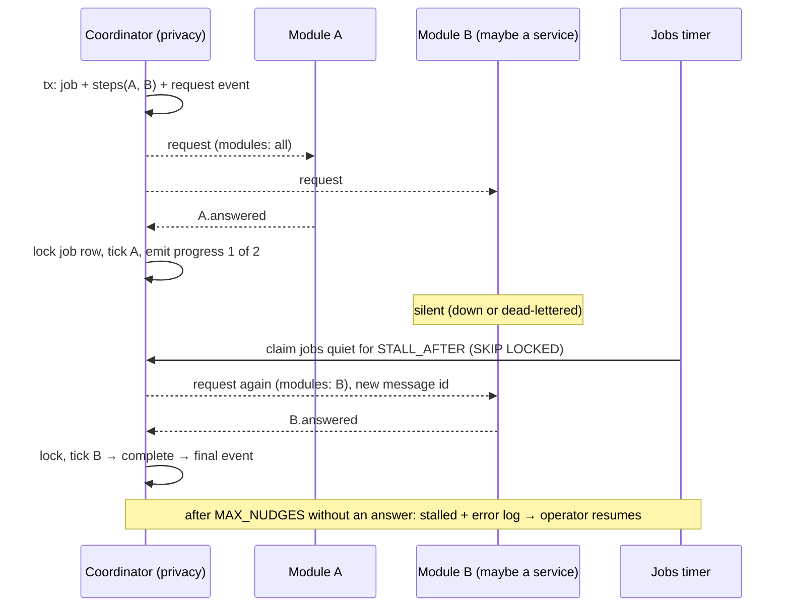

# Choreographed saga with a ledger

← [Pattern catalog](README.md) · Category: Workflows

## Problem

"Export all my data" or "delete my account" spans every module, and later every service. A central coordinator that reads and deletes everyone's tables couples itself to every schema and breaks the moment a module moves out. Yet *someone* must know whether the job is finished, re-ask modules that went silent, and tell the user.

## When to use

Workflows that must reach N independent participants and complete only when all have answered: GDPR export and erasure, tenant offboarding, cross-service cleanup.

## Solution

- A **coordinator owns a ledger** (the job plus one row per participant), never the data itself.
- It **broadcasts a request event**. Each participant does its own part and **answers with its own event**. The coordinator ticks the participant off.
- **Time-based steps** (grace periods, silence) are handled by a **job** that claims rows with `SKIP LOCKED`. It re-sends the request **only to participants still owed**, with a new message id, and finally **stalls** for a human.



## Implementation

**Participants reuse two shared handlers.** A module only implements `collect(userId)` or `erase(userId)`:

```ts
// owed: empty/absent list = everyone; a nudge names only the modules still owed
protected requestFor(message: Envelope): TRequest | null {
  const request = message.payload as unknown as TRequest
  return owed(request.modules, this.options.module) ? request : null
}

// erase and confirm in ONE transaction: a confirmation never precedes the erasure
await this.inbox.transactional(message.id, this.name, async () => {
  await this.eraser.erase(request.userId)
  await this.outbox.add([{ type: answerType, aggregateId: request.userId, payload: { deletionId, userId, module, erasedAt } }])
})
```

**The coordinator ticks under a row lock**, so exactly one answer sees "complete":

```ts
const dataExport = await this.exports.findById(answer.exportId, { lock: true })   // SELECT … FOR UPDATE
if (!dataExport || dataExport.userId !== answer.userId) return
// `module` comes from the wiring, not the payload: a module can only answer for itself.
const outcome = dataExport.recordPart({ ...answer, module: this.module }, now)
if (dataExport.isCollected()) { dataExport.beginAssembly(now); events.push(exportCollected(...)) }
```

**There is one answer handler per participant** (`privacy.record-export-part:<module>`), so each has its own consumer group, inbox key and retries.

**The clock is a job, not an event:**

```ts
await this.uow.run(async () => {
  await this.startDueDeletions(now, report)   // claimDue … FOR UPDATE SKIP LOCKED → start + request
  await this.nudgeDeletions(now, report)      // claimStalled → re-send to pendingModules(), or stall
  await this.nudgeExports(now, report)
})
await this.expireExports(now, report)          // slow object deletes outside the transaction
```

**The state machine lives in the domain** (`scheduled → running ⇄ stalled → completed`, `scheduled → cancelled`), and accepts late or duplicate confirmations in any non-final state.

## Edge cases and pitfalls

- **Participants are named in configuration**, not discovered. A missing name means data that survives "deletion". Keep a module in the list until its data is really gone, even while it is down: the right failure for "forget me" is to stall, not to complete.
- **Nudges need new message ids**, or the inbox swallows them.
- **Erasing must be idempotent**, because nudges re-send.
- **Answers carry pointers, not data.** An export part writes its JSON to the shared bucket *first* (an idempotent overwrite), then answers with the key, so an answer always points at a file.
- **Progress is a count, not a step.** Delivery is not ordered across workers, so clients keep the max.
- **Cancellation has a point of no return.** Allow it only before the request goes out (`409 deletion_in_progress` after).
- **The job's final record is evidence.** Keep the ledger row with ids and timestamps, and scrub personal data from it on completion.
- **Erase the outbox trail too.** Published messages about the user still hold their data until retention; unpublished ones must stay, because they are still owed.

## Variations / when not to use

- **Orchestration** (the coordinator calls each participant's API) is simpler when every participant is always up and synchronous. Choreography with a ledger survives participants that are down for days.
- For two participants in one database, a single transaction is enough.

## In this repo

- `apps/api/src/shared/application/privacy.ts` (`ExportUserDataHandler`, `EraseUserDataHandler`, ports)
- `apps/api/src/modules/privacy/application/handlers/record-export-part.ts`, `record-erasure.ts`, `assemble-export.ts`
- `apps/api/src/modules/privacy/application/privacy-jobs.ts`
- `apps/api/src/modules/privacy/domain/account-deletion.ts`, `data-export.ts`
- `apps/api/scripts/privacy.ts` (`list`, `resume`)
- Commit `18329d3`. Explained in [Privacy](../architecture/08-privacy.md).

## Reuse checklist

- [ ] Ledger: job + one step per participant; a partial unique index for "one active per user"
- [ ] A request event with an optional `modules` filter; answer events named by convention
- [ ] Shared participant handlers; the effect and the answer in one transaction
- [ ] Ticks under a row lock; the participant identity comes from the wiring
- [ ] Jobs with SKIP LOCKED: start, nudge the owed only, stall after N; an operator CLI to list and resume
