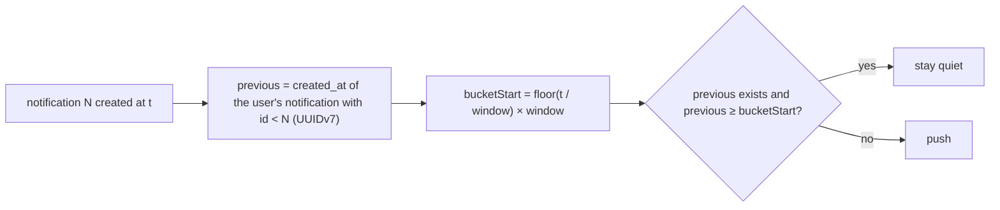

# Deterministic throttle on retry

← [Pattern catalog](README.md) · Category: Delivery

## Problem

You want to alert a user at most once per 30 s however many events arrive (20 sign-ins from a script must not mean 20 phone buzzes). The obvious implementation, "remember when I last pushed", breaks under at-least-once delivery:
- a retried message sees the timestamp its own first attempt wrote, and stays quiet the second time even though the first push never got out;
- two workers handling neighbouring events race on the same counter.

## When to use

Any suppression or "first of N" decision made inside an idempotent, retryable handler: alert throttling, digests, rate-limited side effects.

## Solution

Derive the decision **only from facts that are already stored and do not change on retry**. Here those are the event's own creation time and the creation time of the *previous* stored item. Cut time into fixed buckets, and act only for the first item of a user in each bucket.



## Implementation

```ts
const ALWAYS_PUSH_KINDS: ReadonlySet<string> = new Set(['security_alert'])

private async isInQuietWindow(p: NotificationCreatedPayload): Promise<boolean> {
  if (this.quietWindowMs <= 0 || ALWAYS_PUSH_KINDS.has(p.kind)) return false
  const previous = await this.notifications.createdAtBefore(p.userId, p.notificationId) // id < this id
  if (!previous) return false
  const bucketStart =
    Math.floor(Date.parse(p.createdAt) / this.quietWindowMs) * this.quietWindowMs
  return previous.getTime() >= bucketStart
}
```

- **Same message → same verdict**, however many times it is retried and on whichever worker.
- **Every event is still stored.** Only the *alert* is throttled, so the inbox and the unread count stay exact.
- **Critical kinds bypass the throttle** (`security_alert`).
- **The client mirrors it** for toasts: `if (kind === 'security_alert' || now - lastToastAt >= 30_000) toast(...)`.

## Edge cases and pitfalls

- **Fixed buckets, not a sliding window.** A sliding window ("nothing in the last 30 s") would depend on which notifications were *pushed*, which is exactly the mutable state to avoid. With buckets, two events 1 s apart across a boundary can both push; that is accepted.
- **Ordering comes from ids.** UUIDv7 ids are time-ordered, so "previous" is `id < this id`, with no clock comparison between rows.
- **Delete-and-recreate** (folding) changes the facts. Fold *or* throttle; this repo moved from folding to throttling in commit `2fd3abc`.

## In this repo

- `apps/api/src/modules/notification/application/handlers/web-push-handler.ts`
- `apps/web/src/features/realtime/use-live-session.ts` (toasts)
- `PUSH_QUIET_WINDOW_SECONDS` (default 30, `0` = push all)

## Reuse checklist

- [ ] The decision uses only immutable stored facts
- [ ] Fixed time buckets
- [ ] Items always stored; only the side effect is suppressed
- [ ] A bypass for critical kinds
