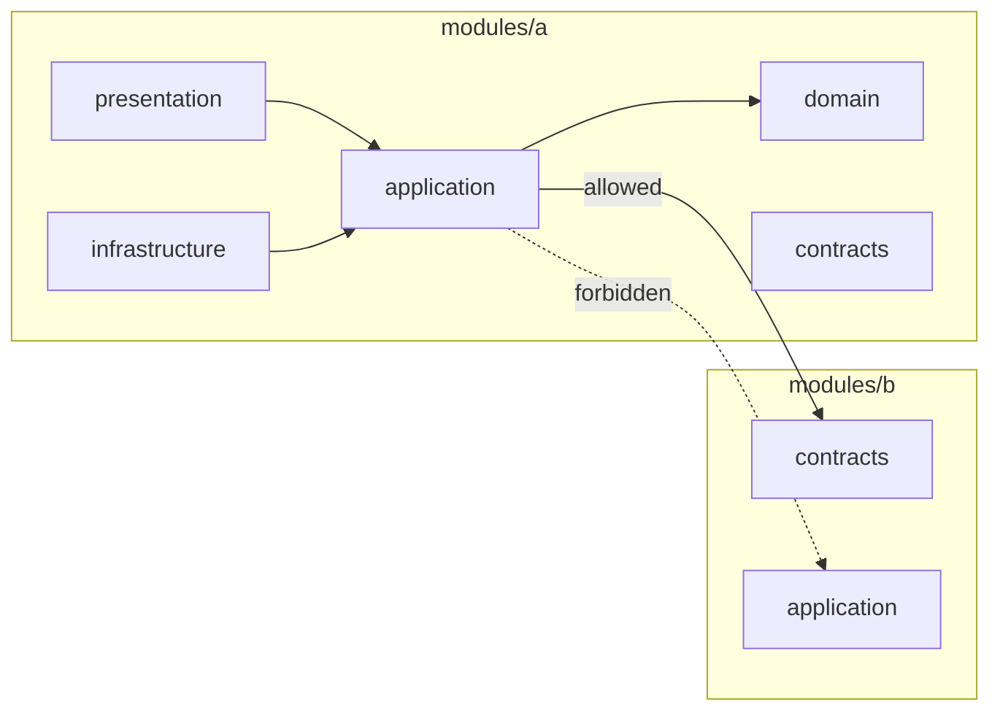

# Enforced architecture boundaries

← [Pattern catalog](README.md) · Category: Tooling

## Problem

Layering and module rules written in a README erode one convenient import at a time: a use case imports Drizzle "just this once", module A reaches into module B's repository. By the time someone wants to extract a service, the boundaries exist only on paper.

## When to use

Any codebase with intended layers (domain, application, infrastructure) or modules that should stay separable.

## Solution

Encode the rules as **dependency-cruiser** `forbidden` rules, run them in CI as an error, and keep them few and explainable. The one rule that covers every pair of modules uses a **capture group back-reference**.

```js
const FRAMEWORKS =
  'node_modules/(elysia|@elysiajs|drizzle-orm|drizzle-kit|postgres|nodemailer|jose|pino|@simplewebauthn|arctic|stripe)/'
const ROOT = '^src/(app|main|bootstrap)'

module.exports = {
  forbidden: [
    { name: 'domain-is-pure', severity: 'error',
      from: { path: ['^src/modules/[^/]+/domain/', '^src/shared/domain/'] },
      to: { path: ['^src/modules/[^/]+/(application|infrastructure|presentation)/',
                   '^src/shared/(application|infrastructure|presentation|http|messaging)/', ROOT, FRAMEWORKS] } },
    { name: 'application-no-infrastructure', severity: 'error',
      from: { path: ['^src/modules/[^/]+/application/', '^src/shared/application/'] },
      to: { path: ['^src/modules/[^/]+/(infrastructure|presentation)/',
                   '^src/shared/(infrastructure|presentation|http)/', ROOT, FRAMEWORKS] } },
    { name: 'modules-talk-only-through-contracts', severity: 'error',
      from: { path: '^src/modules/([^/]+)/' },
      to: { path: '^src/modules/[^/]+/', pathNot: ['^src/modules/$1/', '^src/modules/[^/]+/contracts/'] } },
    { name: 'contracts-are-self-contained', severity: 'error',
      from: { path: '^src/modules/[^/]+/contracts/' },
      to: { path: ['^src/modules/[^/]+/(domain|application|infrastructure|presentation)/', '^src/shared/', ROOT] } },
    { name: 'shared-knows-no-module', severity: 'error',
      from: { path: '^src/shared/', pathNot: '^src/shared/testing/' }, to: { path: '^src/modules/' } },
    { name: 'only-composition-root-wires-modules', severity: 'error',
      from: { path: '^src/(modules|shared)/' }, to: { path: ROOT } },
    { name: 'no-circular', severity: 'error', from: {}, to: { circular: true } },
  ],
  options: { tsPreCompilationDeps: true, exclude: { path: '\\.test\\.ts$' }, tsConfig: { fileName: 'tsconfig.json' } },
}
```



## Edge cases and pitfalls

- **`tsPreCompilationDeps: true`**, so type-only imports count. Otherwise `import type { Drizzle… }` slips through.
- **Frameworks are a deny-list of packages** for the inner layers. Decide deliberately what is allowed there. Here `@app/shared-types` is used by domain code on purpose (limits, locales, statuses), and `zod`, `@opentelemetry/*` and `bun` are simply not on the list. Keep the list in one constant.
- **Exempt test helpers explicitly** (`@kit/testing` is a `devDependency`, never imported by production code), rather than loosening a rule.
- **Contracts must not import `shared`**, or a service that imports a contract drags your shared kernel along.
- **Composition root.** Only `app.ts`/`main.ts`/`bootstrap` may import concrete classes. That keeps wiring in one place, and makes `buildApp(container)` reusable by e2e tests.
- **Scripts are not checked** (`depcruise src`). Keep business logic out of `scripts/`.

## In this repo

- `.dependency-cruiser.packages.cjs`, `.dependency-cruiser.modules.cjs` and `apps/api/.dependency-cruiser.cjs` (the kit, the modules, the composition root), run as `bun run check:arch` in CI
- Explained in [Modules and boundaries](../architecture/01-modules-and-boundaries.md)

## Reuse checklist

- [ ] Rules for: pure domain, application without infrastructure, cross-module via contracts only, self-contained contracts, shared ⇸ modules, only the root wires, no cycles
- [ ] Type imports counted; tests excluded
- [ ] Runs in CI as an error
