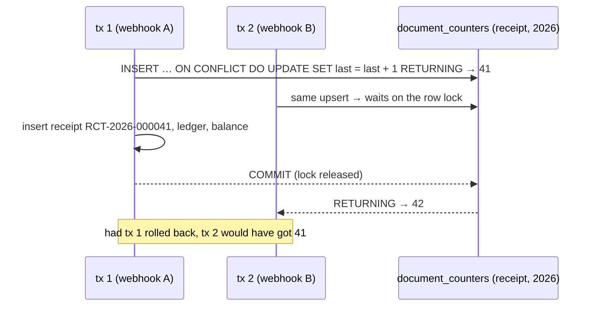

# Gapless document numbering

← [Pattern catalog](README.md) · Category: Workflows / money

## Problem

Invoices, receipts and credit notes often must be numbered **consecutively, without gaps**, per kind and per year (`INV-2026-000001`, `INV-2026-000002`, …). A Postgres `SEQUENCE` is not transactional: a rolled-back transaction burns its number and leaves a gap. Retries of the same event must not consume a second number.

## When to use

Legal or accounting documents with consecutive numbering requirements. Not for ids in general: use UUIDv7 there.

## Solution

Keep a **counter row per (kind, year)** and take the next number with an upsert that increments it **inside the same transaction** that stores the document and the money movement.
- The row stays locked until commit, so concurrent issuers wait.
- A rollback undoes the increment, so no gap.

Check whether the document already exists *before* taking a number, so a retry does not burn one either.



## Implementation

```ts
async nextSequence(kind: DocumentKind, year: number): Promise<number> {
  const [row] = await this.database.executor
    .insert(documentCounters)
    .values({ kind, year, last: 1 })
    .onConflictDoUpdate({
      target: [documentCounters.kind, documentCounters.year],
      set: { last: sql`${documentCounters.last} + 1` },
    })
    .returning({ last: documentCounters.last })
  if (!row) throw new Error('the document counter returned nothing')
  return row.last
}
// number = `${PREFIX[kind]}-${year}-${String(seq).padStart(6, '0')}`
```

- **Idempotent issuing.** The issuer checks whether a document already exists for `(top_up_id, kind)` (or for the provider's refund or dispute id) *before* calling `nextSequence`, and a partial unique index backs the check.
- **Immutable snapshots.** Seller, buyer and lines are frozen as jsonb at issue time, and only `status` moves (`open → paid | void`). Validate that the lines sum to the amount when issuing.
- **Resolve slow inputs before the transaction** (the buyer's name, through another module's API), so the counter lock is held only briefly.

## Edge cases and pitfalls

- **Issuing is serialised per kind and year.** That is fine for normal volumes. At very high volume, issue documents asynchronously from a queue, or use per-branch series.
- **Take the number as late as possible** in the transaction, right before the insert, so the lock is held for the shortest time.
- **A year boundary** creates a new counter row automatically (the `INSERT` side of the upsert).
- **Never delete documents.** Void them. On account erasure, blank the personal fields and keep the number and amount.

## In this repo

- `modules/billing/src/infrastructure/persistence/drizzle-billing-repositories.ts` (`DrizzleDocumentRepository.nextSequence`)
- `modules/billing/src/application/document-issuer.ts`
- `modules/billing/src/domain/document.ts`
- Commit `d5a7228`

## Reuse checklist

- [ ] A counter table keyed by series (kind, year)
- [ ] Upsert-increment inside the business transaction
- [ ] Existence check before numbering; unique index per source
- [ ] Snapshots, status-only mutations, void instead of delete
