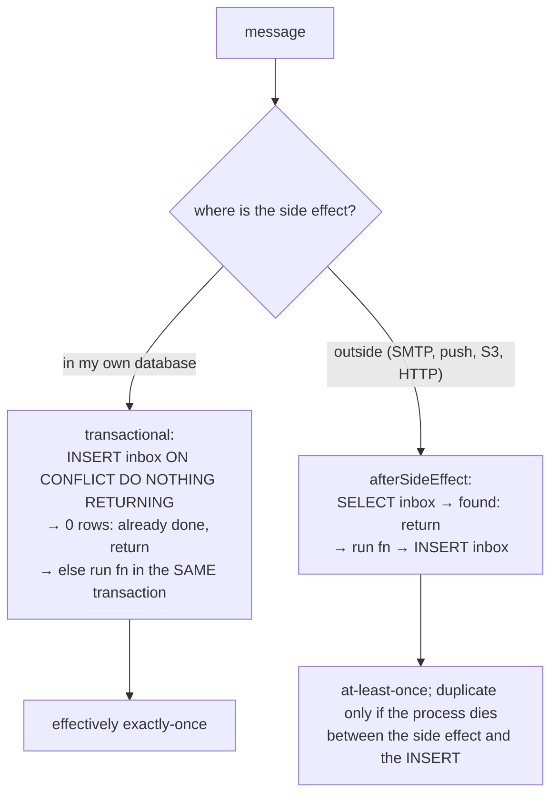

# Idempotent consumer (inbox)

← [Pattern catalog](README.md) · Category: Data & messaging

## Problem

At-least-once delivery means every handler will, sometimes, see the same message twice. Causes include a relay crash after publishing, a lease that expired during a slow handler, another handler of the same message failing (so the whole message is retried), or an operator requeueing a dead message. A handler that inserts a row, sends a mail or moves money must take effect **once**.

## When to use

Every consumer of an outbox, queue or webhook.

## Solution

Record `(message_id, handler)` in an **inbox** table owned by the consuming module. How the record relates to the side effect depends on where the side effect lives:



## Implementation

```sql
create table <schema>.inbox (
  message_id uuid not null,
  handler text not null,             -- = consumer group name
  processed_at timestamptz not null default now(),
  primary key (message_id, handler)
);
```

```ts
async transactional(messageId: string, handler: string, fn: () => Promise<void>) {
  await this.database.run(async () => {
    const inserted = await this.database.executor
      .insert(this.table).values({ messageId, handler })
      .onConflictDoNothing()
      .returning({ messageId: this.table.messageId })
    if (inserted.length === 0) return // already processed
    await fn()
  })
}

async afterSideEffect(messageId: string, handler: string, fn: () => Promise<void>) {
  const done = await this.database.executor.select(...).where(and(eq(messageId), eq(handler))).limit(1)
  if (done.length > 0) return
  await fn()
  await this.database.executor.insert(this.table).values({ messageId, handler }).onConflictDoNothing()
}
```

**A handler that chains an event** writes its follow-up event to its own outbox inside `fn`. The row, the follow-up event and the inbox record commit together. Simplified from `CreateNotificationHandler`:

```ts
await this.inbox.transactional(message.id, this.name, async () => {
  const notification = /* fold into the group, or insert a new row */
  await this.outbox.add([notificationCreated(notification)])
})
```

## Edge cases and pitfalls

- **Insert first, not select first**, in the transactional mode. A concurrent duplicate then blocks on the uncommitted primary key and, once the first commits, sees the conflict. Select-then-insert would let both pass.
- **The key includes the handler name.** One message has several consumers, and each must be de-duplicated on its own. When one handler fails and the message is retried, the others are skipped by their own rows.
- **A deliberate re-send needs a new message id.** A "nudge" that re-asks a silent participant must be a *new* message, or the inbox swallows it in modules that already saw the first one.
- **Make external side effects tolerate a repeat anyway**, because `afterSideEffect` has a crash window:
  - push notifications with a stable `tag`/`topic` (the push service collapses duplicates);
  - generate files only if missing, at deterministic keys;
  - skip mail whose link has expired.
- **Decide outcomes deterministically.** A throttling decision computed from a counter would differ on retry; compute it from stored facts instead ([Deterministic throttle on retry](deterministic-throttle-on-retry.md)).
- **Swallow permanent errors** (a rejected address, an undecodable image) and log them. Throwing would dead-letter the whole message and block the other consumers.
- Inbox rows can be pruned after the outbox retention period (no message older than that can come back).

## Variations / when not to use

- A **natural idempotency key** (a unique index on `(top_up_id, type)`, a conditional `UPDATE … WHERE status = 'pending'`) can replace the inbox row for one handler. Billing uses both.
- Handlers whose effect is harmless to repeat (an SSE "refetch" nudge) need no inbox.

## In this repo

- `apps/api/src/shared/infrastructure/outbox/drizzle-inbox-guard.ts`
- `transactional`: `CreateNotificationHandler`, `CreateProfileOnUserRegistered`, `RecordExportPart`, `RecordErasure`, `AssembleExport`, and the shared `ExportUserDataHandler` / `EraseUserDataHandler`
- `afterSideEffect`: `MailEventHandler`, `WebPushHandler`, `GenerateAvatarThumbnails`, `DeleteOldAvatar`, `DeleteOldCover`
- The fake `InMemoryInbox` (`shared/testing/fakes.ts`) does not simulate the crash window (see [known gaps](../architecture/13-trade-offs-and-known-gaps.md#known-gaps)).

## Reuse checklist

- [ ] Inbox table per consuming module, PK `(message_id, handler)`
- [ ] DB side effects: insert-first, same transaction
- [ ] External side effects: check → do → record, and make the effect itself tolerate a repeat
- [ ] Re-sends get new message ids
- [ ] Permanent errors swallowed and logged, transient ones thrown
