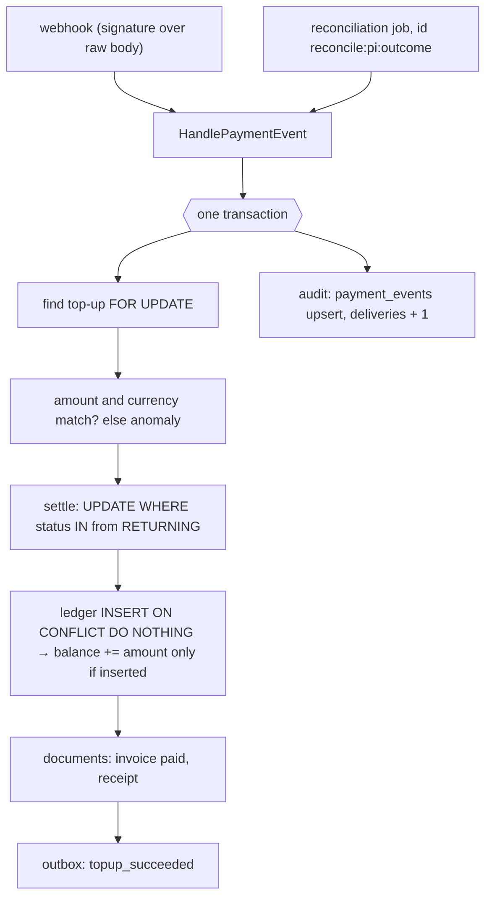

# Idempotent webhooks and a money ledger

← [Pattern catalog](README.md) · Category: Workflows / money

## Problem

A payment provider tells you about money by webhook. Delivery is at least once, in no promised order, sometimes never. Clients double-click "Pay" and retry on timeouts. You must credit a wallet **exactly once**, never credit the wrong amount, handle refunds and disputes that arrive before the payment they refer to, and be able to explain every cent afterwards.

## When to use

Any integration where an external system's events move money or other countable value: payments, payouts, credits, entitlements.

## Solution

Make every step a **conditional move with a unique key**, all inside one transaction, and route every source of truth through **one code path**.

| Threat | Defence |
| --- | --- |
| Double click / client retry | `Idempotency-Key` header, scoped to the user, stored with a unique index and reused as the provider's idempotency key |
| Duplicate webhook | Settle is `UPDATE … WHERE status IN (allowed from) RETURNING`; the row is locked `FOR UPDATE` first |
| Out-of-order events | A transition table (`SETTLEABLE_FROM`); a late `failed` after `succeeded` matches nothing |
| Refund or dispute before its payment | Answer `409` so the provider redelivers later |
| Double booking | Ledger unique on `(top_up_id, type)` and `(type, provider_reference)`; `ON CONFLICT DO NOTHING`, and the balance moves only if a row was inserted |
| Wrong amount | Compare with the stored request; never credit a mismatch; raise an anomaly |
| Lost webhook | A reconciliation job asks the provider and feeds the answer through the *same* handler |
| "Why was I not credited?" | An audit row per provider event (`result`, `deliveries`), and an anomalies table |



## Implementation

**Starting a payment:**

```ts
if (key) { const earlier = await topUps.findByIdempotencyKey(userId, key); if (earlier) return replay(earlier) }
const intent = await gateway.createPaymentIntent({ ..., idempotencyKey: key ? `topup-${userId}-${key}` : `topup-${topUpId}` })
const stored = await uow.run(async () => (await topUps.insert(topUp)) && (await documents.issueInvoice(...), true))
if (!stored) return replay(await topUps.findByIdempotencyKey(userId, key))   // lost the race: same PaymentIntent
// replay(): a different amount/currency under the same key → 409 idempotency_key_reused
```

**Allowed transitions:**

```ts
export const SETTLEABLE_FROM = {
  succeeded: ['pending', 'failed'],
  failed: ['pending'],
  canceled: ['pending', 'failed'],
} as const
```

**Booking once:**

```ts
const booked = await db.insert(ledgerEntries).values(entry).onConflictDoNothing().returning({ id })
if (booked.length === 0) return null            // already booked: the balance must not move twice
const [row] = await db.insert(walletBalances).values({ userId, currency, amount: entry.amount, updatedAt })
  .onConflictDoUpdate({ target: [walletBalances.userId, walletBalances.currency],
                        set: { amount: sql`${walletBalances.amount} + ${entry.amount}` } })
  .returning({ amount: walletBalances.amount })
```

**Not yet:**

```ts
if (props.status === 'pending' || props.status === 'failed') return 'deferred'      // refund before success
if (event.adjustment === 'chargeback_reversal' && !(await ledger.hasReference('chargeback', event.reference)))
  return 'deferred'                                                                  // won before opened
// route: deferred → 409 payment_not_settled_yet → the provider retries
```

**Webhook route:** parse the body as **text** (signature verification needs the raw bytes), use no bearer auth, and treat the signature as the authentication.

## Edge cases and pitfalls

- **The return URL is not proof of payment.** Only the webhook or reconciliation credits; the page polls.
- **Integers only, in minor units**, with the currency next to every amount. VND has zero decimals.
- **Acknowledge what retrying cannot fix.** A mismatched amount returns 200 (with an anomaly). Only "not yet" returns non-2xx.
- **Balances may go negative.** The refund really happened, so book it and flag it.
- **Erasure.** Keep financial rows, null the user id, blank personal fields. Records outlive accounts.
- **Paper in the same transaction.** Invoices and receipts are written with the money movement, so neither exists without the other ([Gapless document numbering](gapless-document-numbering.md)).
- **Feature-flag by config.** Without provider keys, reads still work and writes answer `404 billing_disabled`.

## In this repo

- `modules/billing/src/application/use-cases/create-top-up.ts`, `handle-payment-event.ts`, `reconcile-top-ups.ts`
- `modules/billing/src/domain/top-up.ts` (`SETTLEABLE_FROM`)
- `modules/billing/src/infrastructure/persistence/drizzle-billing-repositories.ts`
- `modules/billing/src/infrastructure/stripe-payment-gateway.ts`
- Commits `ee344d6` and `5d3c77c`. Explained in [Billing](../architecture/09-billing.md).

## Reuse checklist

- [ ] Idempotency key per user, unique index, forwarded to the provider, 409 on body mismatch
- [ ] Row lock + conditional transition table
- [ ] Ledger with unique booking keys; balance updated only on insert
- [ ] `409` for "not yet"; 2xx for "never"
- [ ] Reconciliation through the same handler, with stable synthetic event ids
- [ ] Audit and anomaly tables; amounts as integers in minor units
