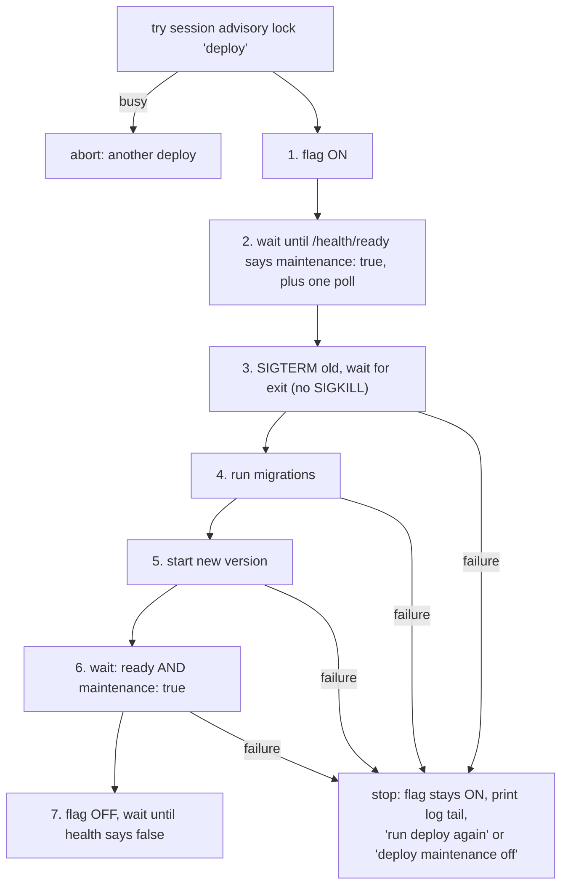

# Maintenance mode and soft deploys

← [Pattern catalog](README.md) · Category: Ops

## Problem

A release with migrations needs a moment when **nothing is writing**. Otherwise the old code writes rows the new schema does not expect, or a relay batch dies mid-handler when the process is killed. With N replicas and M processes each, "stop everything" usually means a hard kill, and a failed deploy leaves a half-migrated app taking traffic.

## When to use

Self-hosted deploys with schema migrations, any number of replicas, and a database every process already talks to.

## Solution

- **A flag in the database** that every process polls. While it is on:
  - HTTP answers `503 + Retry-After` (health probes excepted);
  - background workers finish what they are doing and claim nothing new.
- **A deploy script** that sets the flag, waits for confirmation, stops the old version *softly*, migrates, starts the new version, checks it came up ready *and still gated*, then clears the flag.
- **On any failure, the flag stays on.**



## Implementation

**The flag is a singleton row outside the migrated schemas**, so it can be set before and during migrations:

```sql
create table if not exists platform.maintenance (
  id boolean primary key default true check (id),     -- only one row can exist
  active boolean not null default false, reason text, since timestamptz);
insert into platform.maintenance (id, active, reason, since) values (true, $active, $reason, case when $active then now() end)
on conflict (id) do update set active = excluded.active, reason = excluded.reason,
  since = case when excluded.active then coalesce(platform.maintenance.since, now()) end;
```

A missing table reads as "off" (`42P01`/`3F000`), and the writer creates it.

**Per process:**
- cache the value (the per-request check is free);
- poll every second;
- on a read error, **keep the last known state**;
- notify listeners only on a flip;
- read the flag **before** listening or starting workers, so a new process boots already gated.

**HTTP gate**, mounted after CORS so browsers can read the 503:

```ts
new Elysia({ name: 'maintenance' }).onRequest(({ request, set }) => {
  if (!mode.active) return
  if (new URL(request.url).pathname.startsWith(HEALTH_PREFIX)) return
  set.status = 503
  set.headers['retry-after'] = String(retryAfterSeconds)
  set.headers['cache-control'] = 'no-store'
  return { error: { code: 'maintenance', message: '…', requestId } }
})
```

**Pausing workers**, serialised so quick flips cannot interleave:

```ts
const pauseWorker = async () => { await relay.pause(); await privacy.stopJobs(); await billing.stopJobs() }
let transition: Promise<unknown> = Promise.resolve()
maintenance.onChange((active) => {
  transition = transition.then(active ? pauseWorker : resumeWorker).catch(...)
})
```

`relay.pause()` sets a flag and awaits the batch in flight; nothing is lost, because unpublished events stay in the outbox.

**Readiness stays 200 in maintenance** and reports `maintenance: true`. That is how the script tells "booted and gated" from "dead".

## Edge cases and pitfalls

- **Never SIGKILL in the deploy.** If a process does not drain in time, stop and let a human look. A hard kill is the very thing this avoids.
- **Every step is idempotent**, so re-running the script continues where it failed.
- **Use a session advisory lock on a dedicated connection** for "one deploy at a time". It disappears if the script crashes.
- **Clients need to cope.** Callers that retry (webhooks) just work. A web app should show a non-dismissable "updating" state and poll ([Outage detection and offline fallback](outage-detection-and-offline-fallback.md)).
- **Tolerate old builds.** An old build that never reports `maintenance` in its health check: give up waiting for confirmation, and rely on SIGTERM being soft.
- **The runtime is pluggable.** `LocalRuntime` (a pid file) stands in for `docker run`/`docker stop`; the flow is the same with containers.

## In this repo

- `packages/kit-runtime/src/maintenance-mode.ts` (`MaintenanceStore`, `MaintenanceMode`)
- `packages/kit-http/src/maintenance.plugin.ts`
- `packages/kit-runtime/src/runtime.ts` (`startWorker`), `apps/api/src/main.ts`
- `apps/api/scripts/deploy.ts`
- Commit `acbfc5a`. Explained in [Runtime and operations](../architecture/03-runtime-and-operations.md#maintenance-mode).

## Reuse checklist

- [ ] A singleton flag row outside migrations; missing = off
- [ ] Cached and polled per process; read before serving
- [ ] 503 + Retry-After except health; mounted after CORS
- [ ] Workers pause by draining; transitions serialised
- [ ] A 7-step script: lock, on, confirm, soft stop, migrate, start + verify gated, off; failure leaves it on
