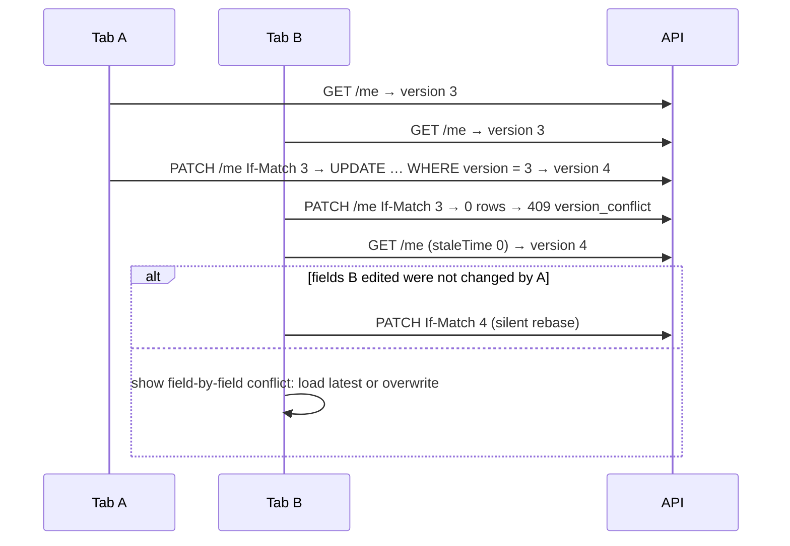

# Optimistic locking with a version column

← [Pattern catalog](README.md) · Category: Concurrency

## Problem

Two devices edit the same profile. Both read version 3 and both save, and the second silently overwrites the first: a lost update. Pessimistic locks across an HTTP round trip are not an option.

## When to use

Records edited through a form, aggregates saved after a read-modify-write, and any "last write wins" that would surprise a user.

## Solution

Every row has a `version`. A save is `UPDATE … SET version = version + 1 WHERE id = ? AND version = ?`. Zero rows updated means someone else saved first, which becomes **409 `version_conflict`**. The HTTP layer carries the version as `If-Match`, and the client decides what to do with a conflict.



## Implementation

**Aggregate.** `AggregateRoot(id, version)`, where version 0 means "not persisted yet".

**Repository** (`DrizzleProfileRepository.save`, shape):

```ts
if (profile.version === 0) {
  try { await ex.insert(profiles).values({ ...row, version: 1 }) }
  catch (err) { if (isUniqueViolation(err)) throw new ConflictError('profile_conflict', '…'); throw err }
} else {
  const updated = await ex.update(profiles).set({ ...row, version: sql`${profiles.version} + 1` })
    .where(and(eq(profiles.userId, profile.userId), eq(profiles.version, profile.version))).returning()
  if (updated.length === 0) throw new VersionConflictError()
}
profile.version += 1
```

**HTTP.** Parse `If-Match` leniently (strip `W/` and quotes) into `expectedVersion`. The use case compares it with the loaded version before applying the change, so a stale form fails even when nothing raced in between.

**Client** (`edit-profile-form.tsx`):
- keep `base`, the server version the form started from;
- when the cache changes underneath, reset an untouched form, or rebase an edited one if only fields it does not show changed;
- on a 409, refetch and either retry silently or show the conflict. What the user typed is never lost.

## Edge cases and pitfalls

- **Racing first inserts** (two handlers creating the same profile) hit the unique key, not the version. Map that to a conflict too.
- **Default objects.** If the row may not exist yet, because it is created asynchronously by an event, return an unsaved default at version 0 so the first save is an insert. This repo's `ProfileLoader` does that.
- **Counters and other hot fields** do not belong in an optimistically locked aggregate if they change often. Every bump would conflict with every edit.
- **The same technique stops concurrent use of a passkey.** Saving the new counter with a version check means two assertions racing on the same counter cannot both pass.

## In this repo

- `packages/kit-core/src/aggregate-root.ts`
- `packages/kit-core/src/errors.ts` (`VersionConflictError`)
- `modules/profile/src/infrastructure/persistence/drizzle-profile-repository.ts`
- `modules/profile/src/presentation/routes.ts` (`parseIfMatch`)
- `modules/identity/src/infrastructure/persistence/drizzle-security-repositories.ts` (passkey use)
- `apps/web/src/features/profile/edit-profile-form.tsx`, commit `da39e05`

## Reuse checklist

- [ ] `version` column; version 0 = new
- [ ] Conditional update; zero rows → 409 with a stable code
- [ ] `If-Match` in, version out
- [ ] The client rebases or shows a diff, and never drops input
