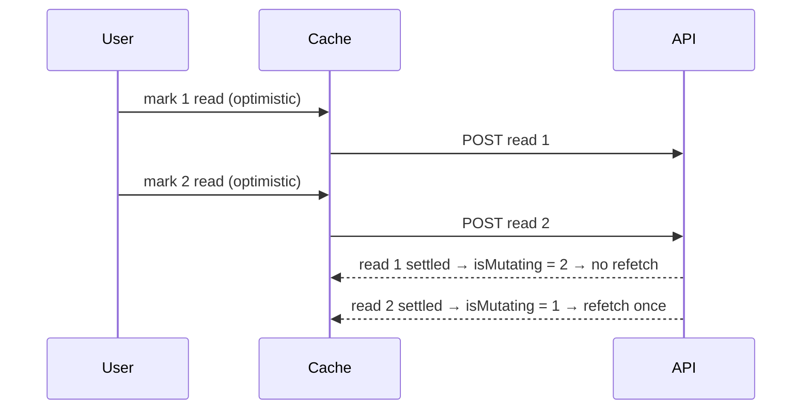

# Optimistic mutations with rollback

← [Pattern catalog](README.md) · Category: Frontend

## Problem

Marking a notification read, or signing out a device, should feel instant. Optimistic updates with TanStack Query look simple, but two details are usually wrong:
- rolling back restores a stale snapshot over other changes;
- invalidating after *each* mutation refetches while later optimistic updates are still in flight, so the screen flickers back to the old state.

## When to use

Small, very likely to succeed mutations on lists and counters. Not for forms that the server validates, uploads, or permission prompts: keep those pessimistic.

## Solution

1. `onMutate`: **cancel** in-flight queries for the key, **snapshot** every affected query, patch the cache, and return a `rollback` function.
2. `onError`: call `rollback`.
3. `onSettled`: **refetch only when this is the last in-flight mutation of its kind** (`isMutating({ mutationKey }) <= 1`).



## Implementation

```ts
export async function readOptimistically(queryClient: QueryClient, id: string | null) {
  await queryClient.cancelQueries({ queryKey: ['notifications'] })
  const snapshot = queryClient.getQueriesData({ queryKey: ['notifications'] })
  // patch pages: flip read; decrement unread only if the item really was unread
  ...
  return { rollback: () => { for (const [key, data] of snapshot) queryClient.setQueryData(key, data) } }
}

const READ_KEY = ['notifications', 'mark-read']
const refetch = () => {
  if (queryClient.isMutating({ mutationKey: READ_KEY }) <= 1)
    void queryClient.invalidateQueries({ queryKey: ['notifications'] })
}
useMutation({
  mutationKey: READ_KEY,
  mutationFn: (id) => markRead(id),
  onMutate: (id) => readOptimistically(queryClient, id),
  onError: (_err, _id, undo) => undo?.rollback(),
  onSettled: refetch,
})
```

**Live events patch the same cache.** With SSE, server-pushed changes use the same helpers:
- `applyCreated` inserts on page 0, or replaces in place by id;
- `applyRead` flips state;
- only the cheap counters are refetched.

On (re)connect, everything is refetched, because live events are not replayed.

## Edge cases and pitfalls

- **Use `isMutating() <= 1`, not `=== 0`.** In `onSettled` the current mutation still counts.
- **Snapshot every query under the prefix**, not just one: lists, counts and badges.
- **Make counters conditional** (decrement unread only if it was unread), or a double click drives them negative.
- **Make the server idempotent** for these endpoints (`POST /read` on an already-read item → 200, `already_read`). Optimistic UIs retry and double-fire.
- **Emit "changed" events only when something changed**, so other devices do not refetch for nothing.

## In this repo

- `apps/web/src/features/notifications/live-cache.ts`
- `apps/web/src/features/notifications/notifications-panel.tsx`
- `apps/web/src/features/account/sessions-list.tsx` (sign out a device)
- `apps/web/src/features/notifications/notification-bell.tsx` (optimistic `unseen = 0`)
- Commit `7bb9975`

## Reuse checklist

- [ ] Cancel, snapshot all, patch, return rollback
- [ ] Rollback on error
- [ ] Refetch when the last one settles
- [ ] Idempotent server endpoints; conditional counters
