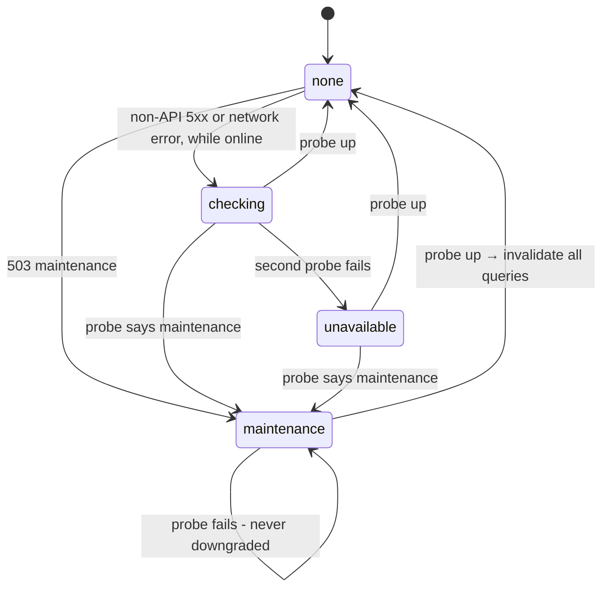

# Outage detection and offline fallback

← [Pattern catalog](README.md) · Category: Frontend

## Problem

When requests fail, the UI usually shows a toast per failed request, or nothing. The user cannot tell a bug from a deploy from their own Wi-Fi. During a deploy the app half-works: some queries fail, mutations get lost. When the device is offline, a reload shows the browser's dinosaur.

## When to use

Any SPA backed by an API you deploy yourself (maintenance windows, rolling restarts) and used on flaky networks.

## Solution

Classify every failure into one of four cases, and show a **blocking, non-dismissable dialog** only for the two that are about the server:

| Signal | Meaning | UI |
| --- | --- | --- |
| `503` with the API's JSON `code: maintenance` | A deploy is running | Dialog "updating" at once |
| A 5xx that is *not* the API's JSON (proxy 502/504, dev proxy's empty 500), or a network error, **and two consecutive health probes fail** | The API is unreachable | Dialog "can't reach the server" |
| A 5xx *with* an API error code | The API is up; one request failed | Ordinary error handling |
| `navigator.onLine === false` | The user is offline | No dialog; the service worker serves an offline page on navigation |

While the dialog is up, probe `/health/ready` every 2 s. Close it when the API is up and not in maintenance, then **invalidate every query**.



## Implementation

```ts
export async function watchResponse(res: Response, pollMs = 2000): Promise<void> {
  if (res.status < 500) return
  try {
    const body = (await res.clone().json()) as { error?: { code?: string } }   // clone: never consume the caller's body
    if (body.error?.code === 'maintenance') return enterMaintenance(pollMs)
    if (body.error?.code) return          // the API itself answered: it is up, this is an ordinary failure
  } catch { /* not JSON: a proxy's error page */ }
  await suspectOutage(pollMs)
}

async function suspectOutage(pollMs: number) {
  if (navigator.onLine === false) return   // the user's own connection is the likely culprit
  if (kind || suspecting) return           // many failures → one check
  suspecting = true
  try {
    for (let i = 0; i < CONFIRM_PROBES; i++) {   // 2
      const state = await probe()                // /health/ready: 200 even in maintenance, and says so
      if (state === 'up') return
      if (state === 'maintenance') return enterMaintenance(pollMs)
      if (i < CONFIRM_PROBES - 1) await sleep(pollMs)
    }
    set('unavailable'); watch(pollMs)
  } finally { suspecting = false }
}
```

- **The dialog** is a native `<dialog role="alertdialog">` with no close path: Escape is prevented, there is no backdrop handler and no button. Its state lives in a tiny external store read with `useSyncExternalStore`.
- **The server side** must cooperate: the maintenance 503 carries a JSON code and is readable through CORS, and readiness stays 200 during maintenance while reporting it ([Maintenance mode and soft deploys](maintenance-mode-soft-deploy.md)).

**Offline page** (`public/sw.js`):

```js
self.addEventListener('install', (event) =>
  event.waitUntil(
    caches.open(OFFLINE_CACHE)
      // `reload`: take the page from the network, not from an HTTP cache that may hold an older copy.
      .then((cache) => cache.add(new Request(OFFLINE_URL, { cache: 'reload' })))
      .then(() => self.skipWaiting()),
  ),
)
// Only page loads, and only when the network itself fails (fetch rejects). A response — even a 502 or 503 from a deploy —
// is passed through untouched: that is the app's maintenance dialog's business, not "offline".
self.addEventListener('fetch', (event) => {
  const { request } = event
  if (request.mode !== 'navigate') return
  event.respondWith(fetch(request).catch(async () => (await caches.match(OFFLINE_URL)) ?? Response.error()))
})
```

`activate` deletes every other cache and calls `clients.claim()`, so the new worker controls open pages at once.

The offline page is self-contained (inline styles, both languages, theme from `localStorage`) and reloads on the `online` event. Register the worker on **every** load, after the first render, so the very first visit installs it.

## Edge cases and pitfalls

- **Never downgrade maintenance to unavailable.** During a deploy the app restarts, and probes fail for a few seconds. The text should keep saying "updating".
- **Ignore `AbortError`.** A cancelled request is not an outage.
- **Serve `sw.js` with `no-cache`**, or a fixed worker takes a day to reach users.
- **Test it.** Playwright `page.route` can fake 503/502 and health responses, and `context.setOffline()` covers the offline page.

## In this repo

- `packages/kit-web-core/src/outage.ts`, `outage.test.ts` (`@kit/web-core`, wired in `apps/web/src/lib/maintenance.ts`)
- `apps/web/src/components/layout/maintenance-dialog.tsx`
- `apps/web/public/sw.js`, `public/offline.html`
- `apps/web/e2e/maintenance.spec.ts`, `e2e/offline.spec.ts`
- Commits `47aa42b`, `e2a0b64` and `3814fb9`

## Reuse checklist

- [ ] Inspect every response and network error centrally
- [ ] Distinguish API JSON errors from proxy errors
- [ ] Confirm with two probes; never while offline
- [ ] Non-dismissable dialog; poll; refetch everything on close
- [ ] A service-worker offline page for navigations only
