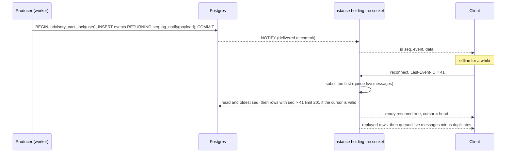

# Postgres pub/sub with replay

← [Pattern catalog](README.md) · Category: Delivery

## Problem

You run N API instances, and a user's SSE stream is connected to one of them. An event produced anywhere (a worker, another instance) must reach that socket. Redis pub/sub or sticky sessions are the usual answers. In addition, some events must not be lost while the client is briefly offline, such as "you were signed out" or "your export is ready".

## When to use

Live updates for a modest number of users and events, when Postgres is already the system of record and you want no extra infrastructure.

## Solution

- **Fan-out with `LISTEN/NOTIFY`.** The producer `NOTIFY`s a channel, and every instance that has connected clients holds one `LISTEN` connection and delivers to its local sockets by `userId`.
- **Opt-in replay.** For events marked `replay`, the producer also inserts into a small table with a global `seq` (the SSE `id`), in the same transaction as the `NOTIFY`, under a per-user advisory lock. A reconnecting client sends `Last-Event-ID`, and the server replays what it missed, if the buffer can vouch for it.
- **Everything else is "refetch on (re)connect".** Most events just mean "something changed".



## Implementation

**Publish:**

```ts
if (!event.replay) { await client.notify(CHANNEL, encode(target, message)); return }
await db.transaction(async (tx) => {
  // Per-user lock: seq order = commit order for one user, so a reconnecting client never skips an event.
  await tx.execute(sql`select pg_advisory_xact_lock(hashtextextended(${userId}, 0))`)
  const [row] = await tx.insert(events).values({ userId, type, data, closeSessionId, createdAt }).returning({ seq: events.seq })
  await tx.execute(sql`select pg_notify(${CHANNEL}, ${encode(target, { id: String(row.seq), type, data, at })})`)
})
```

**Validate the cursor** before trusting the buffer:

```ts
// head = last_value of the identity sequence (0 if never called); oldest = min(seq) still stored
if (cursor === undefined || cursor > head || cursor < oldest - 1) return undefined   // → resumed: false
const rows = await select().from(events).where(and(eq(events.userId, userId), gt(events.seq, cursor)))
  .orderBy(asc(events.seq)).limit(MAX_REPLAY + 1)
if (rows.length > MAX_REPLAY) return undefined
```

**Subscribe before reading, then de-duplicate:**

```ts
for (const message of replay.messages) { deliver(message); replayed.add(message.id) }
subscriber.live = true
for (const message of subscriber.queue.splice(0)) {
  if (!message.id || !replayed.has(message.id)) deliver(message)
}
```

**Always send a cursor in `ready`** (the head at connect time), so a client that never saw a replayable event still has something to send back. **Prune** rows older than the replay window on a timer.

## Edge cases and pitfalls

- **Without the per-user lock**, two transactions can commit `seq` 11 before 10. A client that saw 11 asks for "after 11" and never gets 10.
- **`NOTIFY` inside the transaction** is delivered only at commit, so a live message never beats its row into the buffer.
- **The payload limit is 8,000 bytes.** Cap yours (7,500 here) and send ids, not documents.
- **`LISTEN` needs a dedicated, direct connection.** PgBouncer in transaction mode breaks it. Open it lazily, only in processes that have clients, and reset it on failure.
- **`Last-Event-ID` is untrusted.** Parse it as a bounded integer and always filter by the authenticated user.
- **The buffer is an optimisation.** On any doubt (pruned, too many, read failed), answer `resumed: false` and let the client refetch.
- **Do not store secrets** in replayable events: the buffer is a table.
- **Events can carry control data.** Here `closeSessionId` makes every instance hang up that session's sockets, both live and on replay.
- **Drop stale events** at the producer (older than 60 s here). A live nudge that late is noise.
- **Keep SSE streams alive.** Disable the idle timeout for the stream, send a heartbeat comment every 20 s, and turn off proxy buffering (`x-accel-buffering: no`, `proxy_buffering off`).

## Variations / when not to use

- At scale (many thousands of concurrent streams, high event rates), move the fan-out to Redis or NATS. The replay table idea still works.
- Use WebSocket only if the client must also send on the same channel.

## In this repo

- `modules/realtime/src/infrastructure/pg-realtime-hub.ts`
- `modules/realtime/src/presentation/routes.ts`
- `modules/*/src/integrations/realtime.ts` (search `replay: true`: each producer says which of its events replay)
- `packages/kit-web-core/src/realtime-client.ts` (client)
- Commits `034ece3` and `5bba78c`

## Reuse checklist

- [ ] `NOTIFY` with `{ userId, message }`, under 8 KB
- [ ] Lazy `LISTEN` per instance, local delivery by user
- [ ] Replay table: per-user lock, insert + notify in one transaction
- [ ] Cursor validation window, replay cap, subscribe-before-read de-dup
- [ ] `ready` with a cursor; clients refetch when `resumed: false`
- [ ] Prune timer; purge on account deletion
