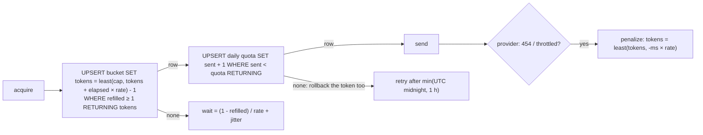

# Postgres token-bucket rate limit

← [Pattern catalog](README.md) · Category: Delivery

## Problem

A provider allows 14 mails per second and 50,000 per day, and you run N instances. An in-memory limiter per instance allows N × the rate. Redis would fix it, but it is another stateful service to run. You also want every instance to back off together when the provider says "slow down", rather than each one discovering it on its own.

## When to use

Shared outbound limits (mail, SMS, a partner API) at rates of up to a few hundred operations per second, when Postgres is already there.

## Solution

One row per bucket: `(key, tokens float8, updated_at)`. Each request is **one atomic upsert** that:
1. computes the refill since `updated_at`, capped at the burst size;
2. takes one token **only if** at least one is available;
3. returns a row on success, and **no row** on refusal.

A second, optional quota row per day is counted in the same transaction. Provider push-back writes **negative tokens** (debt), so everyone waits.



## Implementation

```sql
insert into notification.rate_buckets as b (key, tokens, updated_at)
values ($key, $cap::float8 - 1, now())
on conflict (key) do update
  set tokens = least($cap::float8, b.tokens + extract(epoch from (now() - b.updated_at)) * $rate::float8) - 1,
      updated_at = now()
  where least($cap::float8, b.tokens + extract(epoch from (now() - b.updated_at)) * $rate::float8) >= 1
returning tokens;
```

On refusal, compute the exact wait for the caller:

```sql
select greatest(0, (1 - least($cap, tokens + extract(epoch from (now() - updated_at)) * $rate)) / $rate) * 1000 as wait_ms
from notification.rate_buckets where key = $key;
```

Daily quota, in the same transaction:

```sql
insert into notification.mail_quota as q (key, day, sent) values ($key, (now() at time zone 'utc')::date, 1)
on conflict (key, day) do update set sent = q.sent + 1 where q.sent < $quota
returning sent;     -- no row → throw inside the transaction → the token is rolled back too
```

Debt:

```sql
insert into notification.rate_buckets as b (key, tokens, updated_at) values ($key, -($ms/1000) * $rate, now())
on conflict (key) do update set tokens = least(b.tokens, -($ms/1000) * $rate), updated_at = now();
```

Wiring (`ThrottledMailer`):
- no grant → throw `MailRateLimitedError(retryAfterMs)`, which the queue defers without counting an attempt ([Retry-later deferral](retry-later-deferral.md));
- provider says rate-limited → `penalize(ms)`, then rethrow with that delay.

## Edge cases and pitfalls

- **No timer needed.** The refill is computed lazily from `updated_at`, and a fresh row starts full.
- **`ON CONFLICT … DO UPDATE … WHERE` returns no row when the `WHERE` is false.** That is the whole trick: refusal costs no extra round trip.
- **Use the DB clock (`now()`) only.** App clocks drift between instances.
- **Hot row.** Every send updates one row. That is fine for tens to hundreds per second; beyond that, shard the bucket (`key = mail:<n>`) or move to Redis.
- **Jitter** the returned wait (0–100 ms) so rejected callers do not return in lockstep.
- **`least` in `penalize`** keeps a larger existing debt instead of shortening it.
- **One bucket for everything** means important mail can queue behind bulk mail. Use separate keys per priority if that matters.

## In this repo

- `modules/notification/src/infrastructure/postgres-send-rate-limiter.ts`
- `modules/notification/src/application/throttled-mailer.ts`
- `packages/kit-mail/src/classify-smtp-error.ts`
- Config: `MAIL_RATE_PER_SECOND`, `MAIL_BURST`, `MAIL_DAILY_QUOTA`

## Reuse checklist

- [ ] One upsert per acquire; no row = refused
- [ ] Exact wait returned, with jitter
- [ ] Quota in the same transaction, so the token rolls back with it
- [ ] Penalize (debt) on provider push-back
- [ ] Callers defer instead of failing
