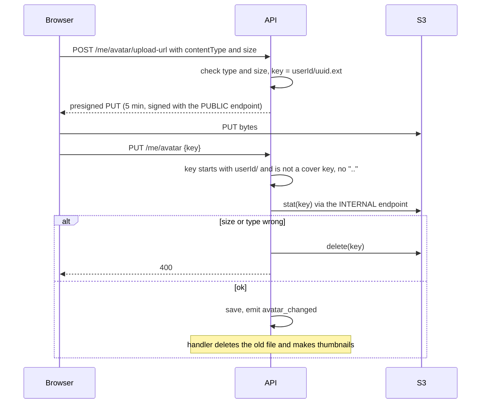

# Presigned upload, then verify

← [Pattern catalog](README.md) · Category: Security

## Problem

Streaming user uploads through the API costs memory, bandwidth and request time, and keeps the API from being stateless. Presigned PUT URLs fix that, but a presigned PUT **cannot enforce size or content type**: the client can upload anything to the key it was given, or claim a key it was never given.

## When to use

Avatars, covers, attachments: anything the browser can send straight to S3-compatible storage.

## Solution



## Implementation

```ts
if (!cmd.key.startsWith(`${cmd.userId}/`) || isCoverKey(cmd.userId, cmd.key) || cmd.key.includes('..'))
  throw new ValidationError('invalid_avatar_key', 'Invalid avatar key')
const stat = await this.storage.stat(cmd.key)
if (!stat) throw new ValidationError('avatar_not_uploaded', '…')
if (stat.size > AVATAR_MAX_BYTES || !(stat.contentType in AVATAR_CONTENT_TYPES)) {
  // A presigned PUT cannot enforce size/type → check afterwards and clean up invalid files.
  await this.storage.delete(cmd.key)
  throw new ValidationError(...)
}
```

- **Key namespaces are an authorization boundary.**
  - `<userId>/` proves ownership.
  - `<userId>/cover/` keeps covers apart from avatars: `PUT /me/avatar` refuses a cover key, so each "delete the old file" handler can only ever delete its own kind of file.
  - Everything a user uploaded sits under `<userId>/`, so erasure is a single prefix delete, including uploads that were never set.
- **Two endpoints.** Sign with the public URL the browser can reach, and use the internal one for `stat`, `read` and `write`.
- **Derived files at derived keys.** Thumbnails are written next to the original (`u1/abc.png` → `u1/abc.256.webp`), so a retry overwrites them and cleanup needs no lookup.
- **Process images defensively** (`sharp`):
  - `limitInputPixels: 25e6` against decompression bombs;
  - `failOn: 'error'`;
  - `.rotate()` for EXIF orientation;
  - log and drop an unprocessable image instead of dead-lettering the event.
- **Crop on the client first**, so only the final image travels (see [Web client](../architecture/10-web-client.md#smaller-touches-worth-copying)).

## Edge cases and pitfalls

- **Configure CORS on the bucket** for the PUT. The compose `seaweedfs-init` job does it.
- **Files that are uploaded but never confirmed** stay until erasure. Add a lifecycle rule or a sweeper if that matters.
- **Shared limits** (max bytes, allowed types) belong in a package both client and server read (`@app/shared-types`).

## In this repo

- `modules/profile/src/application/use-cases/request-avatar-upload.ts`, `set-avatar.ts`, `set-cover.ts`
- `modules/profile/src/application/cover-keys.ts`, `avatar-thumbnails.ts`
- `modules/profile/src/infrastructure/sharp-image-resizer.ts`
- `packages/kit-storage/src/s3-object-storage.ts`
- Commits `fed4e1c` (cover keys) and `1d9081a` (thumbnails on a worker)

## Reuse checklist

- [ ] Validate the declared type and size before signing; short expiry
- [ ] Keys under the owner's prefix; kinds in sub-prefixes
- [ ] Confirm step: ownership check, `stat`, delete on mismatch
- [ ] Derived files at derived keys; image processing with pixel limits
