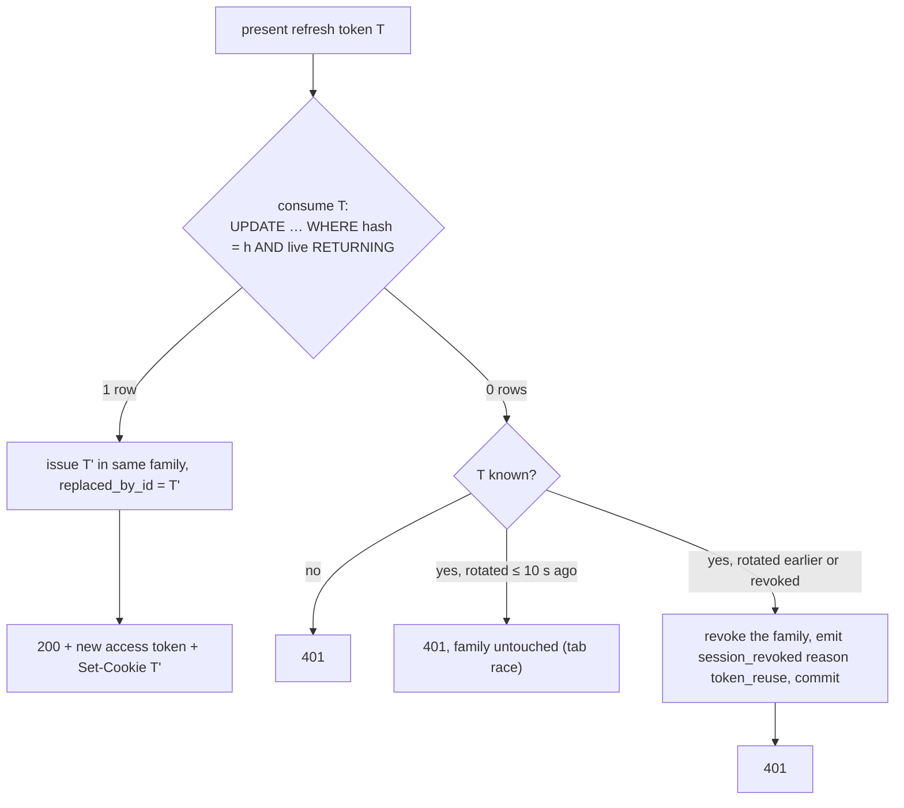

# Refresh-token rotation with reuse detection

← [Pattern catalog](README.md) · Category: Security

## Problem

Long-lived refresh tokens are valuable to steal. If a refresh token never changes, a thief and the victim can both use it indefinitely, and nobody notices. But rotating naively breaks real users: two tabs refreshing at the same moment look like a replay.

## When to use

Browser sessions with short-lived access tokens (JWT) and a long-lived refresh credential in an httpOnly cookie.

## Solution

- A **family** is one sign-in on one device. Each refresh **consumes** the current token and issues the next one in the same family, recording `replaced_by_id`.
- Presenting a token that was already rotated means two parties hold it. Unless it was rotated *very* recently (a grace window for concurrent tabs), **revoke the whole family** and announce it.
- The family id doubles as the session id (`sid` claim), which gives you a device list and remote logout for free.



## Implementation

```ts
const result = await this.uow.run(async () => {
  const nextTokenId = this.ids.next()
  const old = await this.refreshTokens.consume(hash, nextTokenId, now)
  if (!old) {
    const known = await this.refreshTokens.findByHash(hash)
    // A rotated token that is used again → treat as stolen, revoke the whole session.
    if (known && !known.isRecentlyRotated(now)) {
      const revoked = await this.refreshTokens.revokeUserSession(known.userId, known.familyId, now)
      if (revoked) await this.outbox.add([sessionRevoked({ userId: known.userId, sessionId: known.familyId, reason: 'token_reuse' }, now)])
    }
    return null                    // NOT throw: the revocation must commit
  }
  return issueNext(old.familyId, nextTokenId)
})
if (!result) throw new UnauthorizedError('invalid_refresh_token', 'Session expired, please sign in again')
```

```ts
isRecentlyRotated(now: Date): boolean {
  return this.revokedAt !== null && this.replacedById !== null &&
         now.getTime() - this.revokedAt.getTime() <= REFRESH_REUSE_GRACE_MS   // 10 s
}
```

**Cookie.** `HttpOnly`, `Secure` (in production), `SameSite=Lax`, `Path=/api/auth`, so it is not even sent to the rest of the API.

**Client.** Refresh in a single flight per tab ([Single-flight token refresh](single-flight-token-refresh.md)).

**Announce revocation.** `session_revoked` lets you:
- push "signed out" to that device over SSE;
- drop its push subscriptions;
- refresh the device list on other devices;
- create a security-alert notification when the reason is theft.

## Edge cases and pitfalls

- **Return, don't throw, inside the transaction** when the error path must persist something (the revocation and its event).
- **The grace window must not clear the cookie.** If the losing tab's 401 sends `Set-Cookie: refresh_token=; Max-Age=0`, it can wipe the new cookie the winning tab just received. Distinguish "rotated moments ago" from "invalid": this repo answers `401 refresh_token_rotated` and leaves the cookie alone, and the client waits 300 ms and retries once with whatever cookie the browser now holds. Coordinating tabs with Web Locks (`navigator.locks.request('refresh', …)`) or a `BroadcastChannel` avoids the race entirely.
- **Access tokens outlive revocation** until they expire (15 min here). Keep them short, and push revocation to clients that are online.
- **Scope revocation by user.** `DELETE /sessions/{id}` must include `user_id` in the `WHERE`, so one user cannot revoke another's session.
- **Store the hash**, plus the user agent and IP per rotation if you want a meaningful device list.

## In this repo

- `modules/identity/src/application/use-cases/refresh-session.ts`
- `modules/identity/src/domain/refresh-token.ts`
- `modules/identity/src/application/session-issuer.ts`
- Explained in [Identity and sessions](../architecture/04-identity-and-sessions.md#session-model).

## Reuse checklist

- [ ] Family id = session id (`sid`)
- [ ] Atomic consume that records `replaced_by_id`
- [ ] Reuse outside the grace window → revoke the family, commit, emit an event
- [ ] Grace-window 401s do not clear the cookie
- [ ] Single-flight refresh on the client
