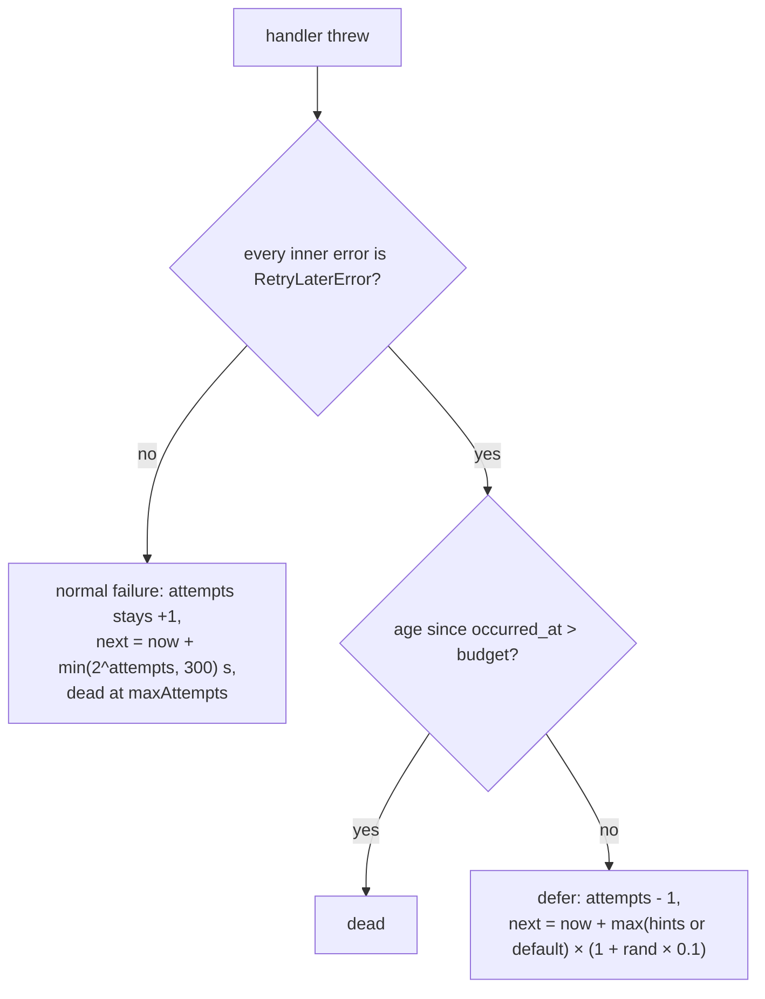

# Retry-later deferral

← [Pattern catalog](README.md) · Category: Data & messaging

## Problem

A queue with "max 10 attempts, exponential backoff" treats every failure as a defect. Some failures are not defects: "you are over your rate limit, try in 40 s", or "daily quota reached, try after midnight". Counting those as attempts sends perfectly good mail to the dead-letter queue during a long throttling spell. Backing off exponentially wastes the exact retry time the provider already told you.

## When to use

- Any consumer that calls a rate-limited or quota-limited dependency (mail providers, SMS, third-party APIs).
- Any condition where "not now" has a known or estimable time ("payment not settled yet").

## Solution

Give handlers a way to say **"not now, try at T"** that the queue understands as distinct from failure:
- a special error type carrying an optional delay hint;
- the queue reschedules to that time, plus a little jitter;
- the queue **gives back** the attempt it counted;
- the queue gives up only when a **time budget**, measured from when the event occurred, runs out.



## Implementation

```ts
export class RetryLaterError extends Error {
  constructor(message: string, readonly retryAfterMs?: number) { super(message); this.name = new.target.name }
}
export class MailRateLimitedError extends RetryLaterError {}
```

In the relay:

```ts
const errors = flattenErrors(err)  // unwrap AggregateError from multi-handler buses, recursively
if (errors.length > 0 && errors.every((e) => e instanceof RetryLaterError)) return this.defer(row, errors)

// defer():
const exhausted = Date.now() - row.occurredAt.getTime() > this.deferBudgetMs
const hinted = Math.max(0, ...errors.map((e) => e.retryAfterMs ?? 0))
const baseMs = hinted > 0 ? hinted : this.defaultDeferMs
const delayMs = Math.ceil(baseMs * (1 + Math.random() * 0.1))  // 0–10% jitter
await db.update(table).set({
  lockedUntil: null,
  attempts: sql`greatest(${table.attempts} - 1, 0)`,             // give the claim's attempt back
  nextAttemptAt: sql`now() + make_interval(secs => ${delayMs / 1000})`,
  deadAt: exhausted ? new Date() : null,
})
```

Where the hint comes from:
- the limiter: "no token for 340 ms", "quota resets in 3 h";
- the provider: a `Retry-After` header or an SMTP 454.

## Edge cases and pitfalls

- **All or nothing.** If one handler deferred and another failed for real, treat the message as a real failure. Otherwise a broken handler could hide behind a throttled one forever.
- **Budget from `occurred_at`, not from the first deferral.** It answers "is this still worth sending?" A magic link from yesterday is not.
- **Jitter** keeps a burst of deferred messages from returning at the same instant and being throttled again together.
- **Logging and tracing.** A deferral is the system working as designed: log it at `warn` without a stack, and tag the span (`outbox.deferred=true`) instead of marking it as an error. Commits `9ce50fd` and `e9285c8` fixed noisy logs here.
- **Expiry inside the handler** complements the budget: content with its own deadline (a link valid 15 min) should be skipped by the handler once that deadline has passed.
- **"Not yet" from an HTTP producer.** Billing's webhook answers `409 payment_not_settled_yet` for an adjustment that arrived before its payment, so *Stripe's* retry schedule does the deferring. Same idea, other direction.

## Variations

- Rate-limited dependencies shared by many instances should also **penalise** a shared limiter when the provider pushes back, so every instance backs off together ([Postgres token-bucket rate limit](postgres-token-bucket-rate-limit.md)).

## In this repo

- `apps/api/src/shared/messaging/errors.ts` (`RetryLaterError`)
- `OutboxRelay.recordFailure` / `OutboxRelay.defer` (`shared/infrastructure/outbox/outbox-relay.ts`)
- `shared/application/mail-errors.ts` (`MailRateLimitedError`), `ThrottledMailer`
- `OUTBOX_DEFER_BUDGET_HOURS` (default 24)

## Reuse checklist

- [ ] An error type with an optional `retryAfterMs`
- [ ] The relay unwraps aggregate errors and defers only if all are "retry later"
- [ ] The attempt is given back, the delay jittered, and the budget measured from the event time
- [ ] Logged as warn, not error
