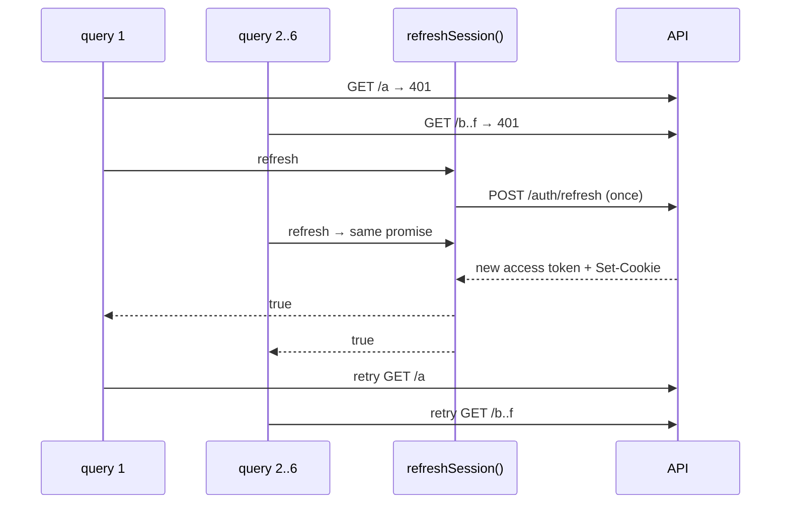

# Single-flight token refresh

← [Pattern catalog](README.md) · Category: Frontend

## Problem

The access token expires, and the page fires six queries at once. Each gets a 401, and each calls `/auth/refresh`. With rotating refresh tokens, the first call rotates the token and the other five present the old one. That looks like token theft, and the server revokes the session. Even without reuse detection, it is five wasted round trips.

## When to use

SPAs with short-lived access tokens and a rotating refresh token, which in practice means every SPA that follows current advice.

## Solution

Keep **one in-flight refresh promise**. Every caller that needs a refresh awaits the same promise, and the slot is cleared when it settles. The API wrapper retries the original request **once** after a successful refresh.



## Implementation

```ts
let inflight: Promise<boolean> | null = null

export function refreshSession(): Promise<boolean> {
  inflight ??= (async () => {
    try {
      let res = await postRefresh()   // raw fetch, not the api client: no interceptor loop
      // Another tab of this browser rotated the token a moment ago; the server kept the cookie its response set.
      // Give that response time to land, then try once more with the current cookie.
      if (res.status === 401 && (await errorCode(res)) === 'refresh_token_rotated') {
        await new Promise((resolve) => setTimeout(resolve, ROTATED_RETRY_MS))   // 300 ms
        res = await postRefresh()
      }
      if (!res.ok) { clearSession(); return false }
      applySession((await res.json()) as SessionResponse); return true
    } catch { clearSession(); return false } finally { inflight = null }
  })()
  return inflight
}
```

In the fetch wrapper:

```ts
let res = await sendWatched()
if (res.status === 401 && !isAuthEndpoint(input) && authStore.get().accessToken) {
  if (await refreshSession()) res = await sendWatched()   // retry exactly once
}
await watchResponse(res)
return res
```

`send()` builds the headers fresh on each call, so the retry picks up the new token.

## Edge cases and pitfalls

- **Raw `fetch` for the refresh itself.** Going through the intercepted client would recurse.
- **Skip `/auth/*`.** A 401 from sign-in is an answer, not an expired token.
- **Retry once.** A second 401 is real.
- **Single flight is per tab.** Two tabs can still race. Either let the server tolerate a short reuse window *without clearing the cookie on the losing request*, or coordinate tabs with `navigator.locks.request('refresh', …)` or a `BroadcastChannel` (see [Refresh-token rotation with reuse detection](refresh-token-rotation-reuse-detection.md)). This repo does the first: on `401 refresh_token_rotated` it waits 300 ms and retries once.
- **Keep the access token in memory**, not `localStorage`. It is lost on reload, which is fine: the boot sequence calls the same `refreshSession()` via `ensureSession()`.
- **Streaming connections** (SSE over fetch) should use the same function on a 401 and then reconnect.

## In this repo

- `apps/web/src/lib/session.ts` (`refreshSession`, `ensureSession`)
- `apps/web/src/lib/api.ts` (`authFetch`)
- `apps/web/src/lib/realtime.ts`

## Reuse checklist

- [ ] One promise slot, cleared in `finally`
- [ ] Raw fetch for the refresh; auth routes excluded
- [ ] Retry once
- [ ] Cross-tab strategy decided
