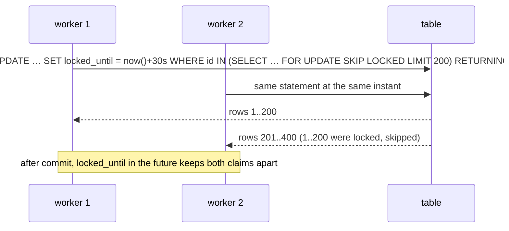

# SKIP LOCKED work claiming

← [Pattern catalog](README.md) · Category: Concurrency

## Problem

Several instances poll the same table for work: outbox rows, due deletions, top-ups to reconcile. Without care, two instances pick the same row and do the work twice, or they serialise on a lock and you lose the point of having several.

## When to use

- A Postgres table *is* the queue: the outbox, scheduled jobs, "rows that need attention".
- You want any number of workers with no coordinator and no broker.

## Solution

Select candidates `FOR UPDATE SKIP LOCKED`. Rows another transaction has locked are skipped instead of waited on. Then, depending on how long the work takes:

| Work | Hold the lock? | How exclusivity survives |
| --- | --- | --- |
| Short, inside one transaction | Yes: claim and work in one transaction | The row lock |
| Long or outside the DB (publish, HTTP) | No: claim, commit, work later | A **lease** column (`locked_until`) and/or a **stamp** (`reconciled_at`) set by the claim |



## Implementation

**Lease claim** (outbox relay):

```ts
const now = sql`now()`   // one clock: the database's
.update(table).set({
  lockedUntil: sql`now() + make_interval(secs => ${this.leaseSeconds})`,
  attempts: sql`${table.attempts} + 1`,
})
.where(inArray(table.id, db.select({ id: table.id }).from(table)
  .where(and(isNull(table.publishedAt), isNull(table.deadAt), lte(table.nextAttemptAt, now),
             or(isNull(table.lockedUntil), lt(table.lockedUntil, now))))
  .orderBy(table.id).limit(this.batchSize)
  .for('update', { skipLocked: true })))
.returning()
```

**Stamp claim** (billing reconciliation): `UPDATE top_ups SET reconciled_at = now() WHERE id IN (SELECT … WHERE status IN ('pending','failed') AND created_at BETWEEN … AND (reconciled_at IS NULL OR reconciled_at < $grace) FOR UPDATE SKIP LOCKED LIMIT n) RETURNING *`. The next pass skips rows checked recently.

**Claim-and-work in one transaction** (privacy jobs): inside `uow.run`, `claimDue()` selects `FOR UPDATE SKIP LOCKED`, the job mutates the rows and writes outbox events, and the commit releases them.

**Pick-one-target** (notification folding): `UPDATE … WHERE id = (SELECT id … ORDER BY id DESC LIMIT 1 FOR UPDATE SKIP LOCKED)` updates the newest matching row unless someone else is already updating it. It cannot stop two events from both inserting when no row exists yet; a per-group advisory lock taken first does that.

## Edge cases and pitfalls

- **`SKIP LOCKED` only protects the instant of the claim.** If the claim statement commits before the work is done, you *need* a lease or a stamp in the `WHERE`, or the next poll claims the row again.
- **Size the lease** to the slowest handler (`OUTBOX_LEASE_SECONDS`). A lease that expires mid-work means a second, concurrent delivery. That is safe with idempotent consumers, but wasteful.
- **Count attempts in the claim**, so a row that crashes its worker still reaches "dead".
- **`RETURNING` order is undefined.** Re-sort if order matters.
- **Use one clock.** Compare against the DB's `now()` on both sides (``const now = sql`now()` ``). Mixing it with an app-side `new Date()` makes app/DB clock skew shift the lease; the relay here did that until it was fixed.
- **Index the predicate.** A partial index on the pending rows keeps the claim cheap however large the table grows.
- **Keep slow, non-DB work out of claim transactions.** Deleting S3 prefixes, for example: mark rows first, commit, then act.

## Variations / when not to use

- At very high throughput, or when you need fan-out to many consumer groups, a real broker is better.
- For "exactly one worker in the cluster" (not "each row once"), use an advisory lock instead ([Singleton work in a cluster](singleton-work-in-a-cluster.md)).

## In this repo

- `OutboxRelay.drain` (`packages/kit-messaging/src/outbox/outbox-relay.ts`): lease claim
- `DrizzleTopUpRepository.claimForReconciliation` (`modules/billing/src/infrastructure/persistence/drizzle-billing-repositories.ts`): stamp claim
- `PrivacyJobs.runOnce` with `claimDue`/`claimStalled`/`claimExpired` (`modules/privacy/src/application/privacy-jobs.ts`, `modules/privacy/src/infrastructure/persistence/*`): claim and work in one transaction
- `DrizzleNotificationRepository` fold: pick one target

## Reuse checklist

- [ ] Candidate subquery with `FOR UPDATE SKIP LOCKED` and `LIMIT`
- [ ] A lease or stamp when the work outlives the claim's transaction
- [ ] Attempts incremented at claim time
- [ ] A partial index on the "pending" predicate
- [ ] A single clock (DB `now()`)
