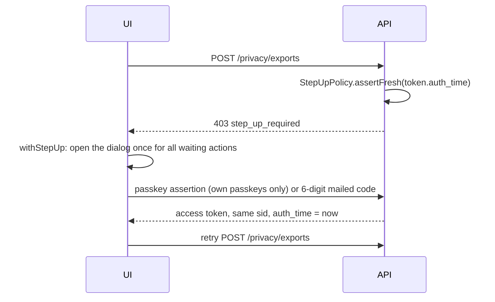

# Step-up authentication

← [Pattern catalog](README.md) · Category: Security

## Problem

Being signed in is not enough for some actions:
- changing the email;
- adding a sign-in method;
- downloading all your data;
- deleting the account.

A stolen session (an access token, or just the refresh cookie) should not be able to take over the account or exfiltrate it. Asking for a password does not work when there are no passwords.

## When to use

Sensitive actions in any app, especially passwordless ones.

## Solution

- Put the **time of the last real authentication** in the access token (`auth_time`, as in OIDC). Set it only when the user *just* proved themselves: magic link, passkey, OAuth, or a step-up. A plain refresh drops it.
- A **policy checked inside the use case** demands `now - auth_time ≤ window`, or answers `403 step_up_required`.
- The client catches that code, asks the user to confirm (a passkey, or an emailed code), gets a new access token for **the same session** with `auth_time = now`, and retries once.



## Implementation

```ts
export class StepUpPolicy {
  constructor(private clock: Clock, private windowSeconds: number) {}

  /** `authTime` = the `auth_time` claim (epoch seconds) of the access token making the request. */
  assertFresh(authTime: number | undefined): void {
    const nowSeconds = this.clock.now().getTime() / 1000
    if (authTime === undefined || nowSeconds - authTime > this.windowSeconds) {
      throw new ForbiddenError('step_up_required', 'Please confirm it is you to continue')
    }
  }
}
```

- **In the use case, not the route.** A new route that reuses the use case cannot forget the check.
- **Passkey step-up.** The challenge purpose is `step_up` and it is bound to the user. The assertion must come from one of *that user's* passkeys.
- **Emailed code.** 6 digits, valid 10 minutes, replaced by the next request, 5 wrong guesses, 5 requests per 15 minutes, stored as an HMAC (server secret) of the user id and the code: a low-entropy code must not be kept as a plain hash. Verified with the attempt-limited consume from [Atomic single-use tokens](atomic-single-use-tokens.md).
- **Elevating** re-signs an access token for the same `sid` with `authTime: now`. No new session, no new refresh token.
- **Client.** `withStepUp(action)` wraps a mutation. On `step_up_required` it awaits a promise-based dialog shared by all waiting actions, retries once, and treats cancellation as a quiet `StepUpCancelled`.

## Edge cases and pitfalls

- **It is stateless, so it cannot be revoked.** A confirmed token keeps its `auth_time` for the whole window even if the device is signed out meanwhile. Keep the window short (5 min here).
- **The method's strength varies.** An emailed code is as strong as the mailbox (the same root of trust as a magic link). A passkey is stronger. If the user can pick, owning a passkey does not force it.
- **Do not offer OAuth as a step-up**: whoever holds the victim's browser usually holds their Google session too.
- **Downloads of sensitive artifacts** (a data export) should require step-up at download time too, not only at request time.

## In this repo

- `apps/api/src/shared/application/step-up-policy.ts`
- `apps/api/src/modules/identity/application/use-cases/step-up.ts`
- `apps/api/src/modules/identity/domain/step-up-code.ts`
- `apps/web/src/features/auth/step-up.ts`
- Commits `67625bd` and `8aec273`. Window: `STEP_UP_TTL`.

## Reuse checklist

- [ ] `auth_time` only on fresh authentication
- [ ] Policy in the use cases; a stable 403 code
- [ ] Elevate the same session
- [ ] A client wrapper that confirms once and retries once
- [ ] Short window, attempt-limited codes
