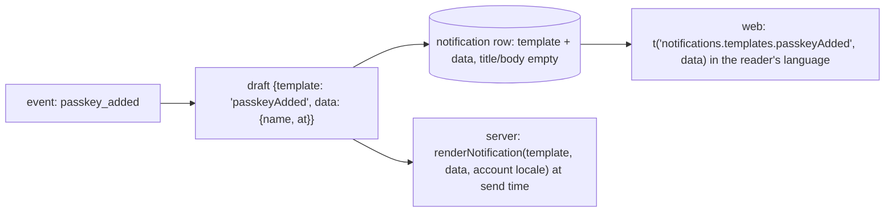

# Store templates, not text (i18n)

← [Pattern catalog](README.md) · Category: Frontend / i18n

## Problem

Notifications are created in the background (from events), long before anyone reads them, and maybe by a reader who has since switched language. If the server writes "Nouvelle connexion depuis Chrome" into the row, it is French forever. Mail and push, on the other hand, leave the system as finished text and must be rendered *somewhere*.

## When to use

Any stored, user-facing message: notifications, activity feeds, audit logs shown to users, and system messages in a chat.

## Solution

- **Store a template key plus raw data**, never a sentence: an ISO date, not "yesterday"; a provider id, not "Google"; a user agent, not "Chrome on macOS".
- The **reader's client renders it** in the reader's language at read time.
- Channels that leave as text (Web Push, mail) are **rendered by the server at send time**, in the recipient's language *then*.
- **Make catalogs type-checked and parity-tested.**



## Implementation

**Draft** (server):

```ts
interface NotificationDraft {
  userId: string
  kind: NotificationKind
  template?: NotificationTemplate          // key of TEMPLATES
  title?: string; body?: string            // only for custom (non-templated) notifications
  data?: Record<string, unknown>           // raw values, never text in a language
}
```

**Typed catalogs** (web):

```ts
// locales/en.ts → export const en = { ... } as const
// i18next.d.ts
declare module 'i18next' { interface CustomTypeOptions { resources: { translation: typeof en } } }
// locales/vi.ts → export const vi = { ... } satisfies Catalog
```

A mistyped key is a compile error.

**Parity test** on both sides:

```ts
expect(diffCatalogs(en, vi)).toEqual([])
// reports "missing: x.y", "unknown: x.z", "placeholders differ: a.b"; plural suffixes folded, {{count}} ignored
```

**Language resolution for text that leaves the system:**
1. the event's own locale (the page that asked for a magic link);
2. else the account's locale (looked up through a contract);
3. else the default.

## Edge cases and pitfalls

- **Keep a fallback.** Rows without a template, and templates the client build does not know yet, render from stored `title`/`body`.
- **Server-side HTML mail.** Escape every value, and inject markup only from an explicit allow-map.
- **Error codes are templates too.** The API returns a stable `code`, and the client renders `errors.<code>`, falling back to the server's English message.
- **One list of languages** in a shared package (`LOCALES`, `negotiateLocale`), used by both sides for `Accept-Language` and `navigator.languages`.
- **Changing a template's placeholders** is a breaking change for stored rows. Add new keys instead of changing old ones.

## In this repo

- `modules/identity/src/integrations/notification.ts` (`TEMPLATES`, `renderNotification`)
- `modules/notification/src/application/messages/` (the module's own words, merged with each producer's `integrations/messages/`)
- `apps/web/src/i18n/` (catalogs, typing, `catalogs.test.ts`), `apps/web/src/features/notifications/text.ts`
- `packages/kit-i18n/src` (`defineLocales`, `diffCatalogs`, `mergeCatalogs`) and `packages/shared-types/src/locales.ts` (the product's languages)
- Commits `d3b3d80` and `3b050f3`. Explained in [i18n](../architecture/11-i18n.md).

## Reuse checklist

- [ ] Template key + raw data stored; text only for custom messages
- [ ] Render at read time (client) or send time (server)
- [ ] Typed keys; a parity test on every catalog
- [ ] A locale resolution chain for outbound text
