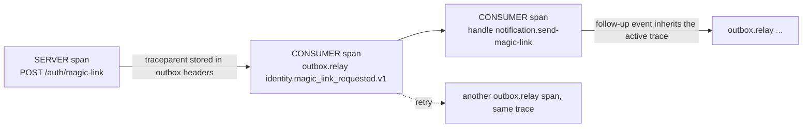

# Trace context across async hops

← [Pattern catalog](README.md) · Category: Data & messaging

## Problem

A request writes an event, and minutes later a worker on another machine handles it, writes a follow-up event, and a third handler sends a mail. In the tracing UI you see disconnected traces, and in the logs nothing links the mail back to the click that caused it. Standard HTTP auto-instrumentation stops at the database.

## When to use

Any system with an outbox, a queue or delayed jobs where you want one trace per user action.

## Solution

**Store the W3C `traceparent` (and a correlation id) in the message headers**, inside the same transaction as the message. The consumer side starts its span **as a child of the stored context**, however late it runs and wherever. Handlers that emit follow-up events do so inside that span, so the chain continues.



## Implementation

```ts
// writer, inside the transaction
const traceparent = currentTraceparent()          // propagation.inject into a carrier
if (traceparent) headers.traceparent = traceparent

// relay
await withSpan(`outbox.relay ${row.type}`, {
  kind: SpanKind.CONSUMER,
  parent: contextFromTraceparent(row.headers.traceparent),   // propagation.extract(ROOT_CONTEXT, …)
  attributes: { 'messaging.message.id': row.id, 'outbox.attempt': row.attempts,
                'app.correlation_id': row.headers.correlationId },
}, async (span) => { ... })

// bus: one span per handler, named after the consumer group
withSpan(`handle ${h.name}`, { kind: SpanKind.CONSUMER,
  attributes: { 'messaging.consumer.group.name': h.name } }, () => h.handle(message))
```

**Frameworks without "wrap the handler" hooks.** Elysia's lifecycle is a set of hooks, so you cannot `context.with(span, handler)`. The tracing plugin therefore stores the span context in the request's AsyncLocalStorage, and `activeContext()` reads `requestContext.otel ?? context.active()`.

**Request ids.** Accept `x-request-id`/`x-correlation-id` only if they match `^[\w.-]{1,64}$` (no log or header injection), echo `x-request-id` back, and put both on every log line with a pino `mixin` that reads the AsyncLocalStorage.

## Edge cases and pitfalls

- **Tracing must be optional.** With no exporter configured, register nothing; the OTel API is then a no-op.
- **Keep span names low-cardinality.** Use the route pattern (`/users/:id`), not the URL.
- **Error status only on 5xx.** A 404 is not a server error.
- **Do not mark deferrals as errors.** Tag them instead.
- **Skip health probes**, or they drown the traces.
- **Restore the correlation id on the consumer side too**, not only the trace. The relay wraps each message in `requestContext.run({ requestId: message.id, correlationId: headers.correlationId ?? message.id }, …)`. The handler's log lines then carry the correlation id, and its follow-up events get `correlationId` = the original one and `causationId` = the message that caused them. That gives a causal chain you can follow in SQL as well as in Jaeger (e2e: *the correlation id survives the relay*).
- **Flush on shutdown.** Shut the tracer down *last*, so the spans of the final batch are exported.

## In this repo

- `apps/api/src/shared/infrastructure/telemetry/tracing.ts` (`initTracing`, `withSpan`, `currentTraceparent`, `contextFromTraceparent`, `activeContext`)
- `apps/api/src/shared/http/tracing.plugin.ts`, `request-context.plugin.ts`
- `apps/api/src/shared/infrastructure/logger.ts` (the `mixin`)
- Commit `6fb17ed`. Jaeger runs in compose: UI on `:16686`, OTLP on `:4318`.

## Reuse checklist

- [ ] `traceparent` and `correlationId` written into message headers in the same transaction
- [ ] Consumer spans parented from the stored context; one span per handler
- [ ] Request context restored for consumer logs
- [ ] Validated, echoed request ids; log mixin
- [ ] No-op without an exporter; tracer flushed last on shutdown
