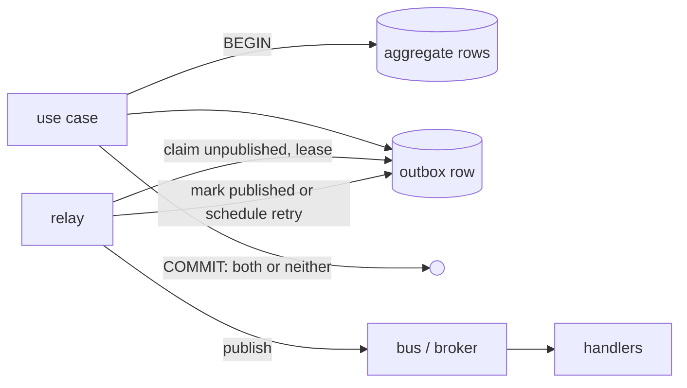

# Transactional outbox

← [Pattern catalog](README.md) · Category: Data & messaging

## Problem

A use case must change state **and** tell other parts of the system about it. If it writes to the database and then publishes to a broker (or sends a mail), a crash or a broker outage between the two leaves them out of sync:
- the state changed but nobody heard;
- or a message describes a change that was rolled back.

There is no distributed transaction between a database and a broker or SMTP server.

## When to use

- Any state change that has consequences elsewhere: other modules, mail, push, search indexing, webhooks out.
- You already have a relational database and want reliable async without adding a broker yet.
- You want to keep the option of moving to a broker later without touching the handlers.

## Solution

Write the event **as a row in the same transaction** as the state change. A separate relay reads unpublished rows and publishes them, retrying until each one gets through. Publishing becomes at-least-once, so consumers must be idempotent (see [Idempotent consumer](idempotent-consumer-inbox.md)).



## Implementation

**Table, one per module/schema:**

```sql
create table <schema>.outbox_messages (
  id uuid primary key,              -- UUIDv7: sortable by time
  type text not null,               -- '<module>.<event>.v1'
  aggregate_id text not null,       -- ordering / grouping key
  payload jsonb not null,
  headers jsonb not null,           -- correlationId, causationId, traceparent
  occurred_at timestamptz not null,
  attempts int not null default 0,
  next_attempt_at timestamptz not null default now(),
  locked_until timestamptz,
  published_at timestamptz,
  dead_at timestamptz,
  last_error text
);
create index outbox_pending_idx on <schema>.outbox_messages (next_attempt_at)
  where published_at is null and dead_at is null;
```

**Writer: refuse to write outside a transaction.**

```ts
async add(events: DomainEvent[]): Promise<void> {
  if (events.length === 0) return
  if (!this.database.inTransaction) {
    throw new Error('OutboxWriter.add must be called inside UnitOfWork.run (transactional outbox)')
  }
  const ctx = requestContext.get()
  const headers = ctx ? { correlationId: ctx.correlationId, causationId: ctx.requestId } : {}
  const traceparent = currentTraceparent()
  if (traceparent) headers.traceparent = traceparent
  await this.database.executor.insert(this.table).values(events.map((e) => ({ id: this.newId(), ...e, headers })))
}
```

**Use case (sketch of `RequestMagicLink`):**

```ts
await this.uow.run(async () => {
  await this.links.insert(link)
  await this.outbox.add([magicLinkRequested(link, now)])
})
```

**Relay.** Claim with `FOR UPDATE SKIP LOCKED` plus a lease ([SKIP LOCKED work claiming](skip-locked-work-claiming.md)). Publish each message, then mark it published, or record the failure with exponential backoff, or defer it ([Retry-later deferral](retry-later-deferral.md)). Delete published rows after a retention period.

## Edge cases and pitfalls

- **The lease is what keeps relays apart**, not `SKIP LOCKED` alone: the claim statement commits immediately, so it is the `locked_until` in the future that hides a claimed row from the next claim.
- **Mark published *after* publishing.** If the mark fails, the lease expires and the message goes out again. That is at-least-once, never at-most-once.
- **Count attempts at claim time**, so a message that crashes the process still ends up dead instead of looping.
- **Payloads are data at rest.** One-time tokens and addresses in them must be cleaned up (retention) and erased with the user (delete *published* rows about them; keep unpublished ones, which are still owed).
- **Ordering.** Group by `aggregate_id` and run one group sequentially if consumers care, but do not promise strict FIFO across retries. Better: design consumers not to need ordering.
- **Payload size.** Keep events small: ids plus what the consumer needs so it never calls back into the emitter. Not whole documents.
- **Version event names** (`.v1`). Only add fields; ship `.v2` in parallel for breaking changes.

## Variations / when not to use

- **CDC instead of polling** (Debezium reading the WAL): lower latency, more infrastructure.
- **Relay publishes to a broker** (Kafka, NATS, RabbitMQ) instead of an in-process bus. The outbox table and handlers stay the same.
- **Not needed** if the "event" is only a cache invalidation you can afford to lose. A plain `NOTIFY` is enough then.

## In this repo

- `packages/kit-messaging/src/outbox/tables.ts` (`outboxTable`)
- `packages/kit-messaging/src/outbox/drizzle-outbox-writer.ts`
- `packages/kit-messaging/src/outbox/outbox-relay.ts`
- `apps/api/scripts/outbox.ts` (dead-letter list and requeue)
- Introduced in `7733d30`; per-aggregate concurrency in `daff342`; trace propagation in `6fb17ed`.
- Explained in [Messaging](../architecture/02-messaging.md).

## Reuse checklist

- [ ] Outbox table per bounded context, with a partial index on pending rows
- [ ] Writer throws outside a transaction
- [ ] Relay: SKIP LOCKED + lease + attempts at claim + backoff + dead letter
- [ ] Published rows deleted after N days; the relay's cleanup runs on one instance
- [ ] Headers carry correlation id and `traceparent`
- [ ] Consumers idempotent (inbox)
- [ ] CLI to list and requeue dead messages
